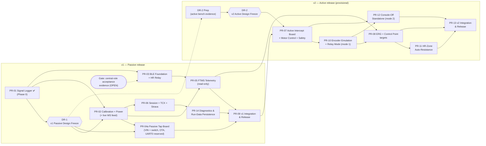

# Echenon Firmware — Programme Plan

> Detailed PR dependency graph, scope boundaries, and architectural rationale.
> Each PR is one atomic, reviewable, mergeable unit following the Torvalds Standard.
>
> **Programme status:** [`PROGRAM.md`](PROGRAM.md)
> **Specification:** [`SPEC.md`](../../../SPEC.md)
> **Rationale:** [`docs/implementation-strategy.md`](../../../docs/implementation-strategy.md)
> — the iterative hardware+software co-development strategy. **The phase and PR
> numbering in this plan is canonical.**
> **Phase 0 register:** [`docs/measurements/phase0/README.md`](../../../docs/measurements/phase0/README.md)
> **Reviews:** [2026-09-23 design audit](reviews/2026-09-23-chief-architect-audit.md) ·
> [2026-09-25 readiness review](reviews/2026-09-25-readiness-review.md) ·
> [DR-1 decision record (v1)](reviews/DR-1-design-freeze.md) ·
> [DR-2 decision record (v2)](reviews/DR-2-design-freeze.md)

---

## Releases

The programme delivers **two explicit releases** (owner decision, 2026-10-12).
v1 ships first and stands alone; v2 is provisional and is decomposed in detail
only after DR-2.

| | **v1 "Passive"** | **v2 "Active"** (provisional) |
|---|---|---|
| **Scope** | Today's tap circuitry wired permanently. Collects data, relays the HRM, broadcasts bike data over **BLE only**: FTMS Indoor Bike Data **read-only** and HR re-broadcast. Records sessions and uploads them to **Strava**. **No resistance control of any kind**: no FTMS Control Point targets, no encoder or motor interception | Aggressive interception, two modes. **Mode 1, relay/active:** sensors and controls taken in as signals and re-emitted; H-bridge + PWM drives the motor ("console as signal source", [design notes §11](../../../docs/mitm-encoder-design-notes.md)); encoder emulation toward the console. Enables FTMS Control Point targets (ERG, resistance setting) and portal-native HR-zone auto-resistance. **Mode 2, console off:** standalone with the console switched off or unplugged, using a replica of the pot reference (console drives Green at 1.66 V from 2.4 kΩ; Yellow is ground) |
| **Power** | ESP32 on the bike's 9 V via the Waveshare **VIN** pin (6–21 V, row #11), with a **power switch on the VIN line** so USB-C can be used instead. External MP1584EN buck dropped. *Open:* back-feed / power-path behaviour with USB and VIN both connected, verified at DR-1 / PR-04a | Inherits v1; driver supply decided at DR-2 |
| **Use cases** | UC1, UC2, UC3 | UC4, UC5, UC6, plus HR-zone auto-resistance |
| **Design freeze** | [DR-1: v1 Passive Design Freeze](reviews/DR-1-design-freeze.md) | [DR-2: v2 Active Design Freeze](reviews/DR-2-design-freeze.md), fed by [DR-2 prep](pr-dr2-prep/PROJECT.md) |
| **PRs** | PR-01 ✅, DR-1, PR-02, PR-03, PR-04a, PR-05, PR-06, PR-14, PR-09 | DR-2 prep, DR-2, PR-07, PR-10, PR-08, PR-11, PR-12, PR-13 |
| **Exit criteria** | UC1–UC3 validated end-to-end on the installed passive board (SPEC §13); v1 coexistence test passes; stock ride indistinguishable from no board; manual OTA proven on the sealed board; 0 build errors / warnings, tick budget < 10 ms, free DRAM > 40 KB | UC4–UC6 and HR-zone auto-resistance validated; fail-safe proven on reset, crash, brownout and an unseated ESP32; v2 coexistence test passes; same build and resource limits |
| **Tag** | **`1.0.0`**: release candidates `v1.0.0-beta.N`, then stable `v1.0.0`. Development tags stay `v0.x.y-dev.N` until the first beta. The owner creates beta and stable tags (rule 03) | **`2.0.0`** (`v2.0.0-beta.N` → `v2.0.0`); owner-only tags |

**ANT+ is not supported** in either release: the ESP32-S3 has no ANT radio. A
future add-on may use an nRF51422 ANT+ module over UART. **UART0 — GPIO 43 (TX,
D1) and GPIO 44 (RX, D0) — is reserved on every board and pin map** for that
interface. Console and logging use native USB-CDC.

**Known limitation of v1:** the stock console's runaway (a fast knob spin past
level 32 leaves the motor turning; A09-20261012 #3) cannot be prevented by a
passive board. v1 may detect and report it; v2 prevents it (DR-2 §2.4).

---

## Design Philosophy

The firmware is developed iteratively alongside the hardware. Each PR corresponds
to a development phase. Earlier phases need minimal hardware (a Y-harness with
series-resistor taps and a USB-powered ESP32), proving assumptions before later
phases commit to a board.

The product is **passive-first**. v1 is the passive tap board (PR-04a), which
delivers UC1–UC3 and never touches resistance. v2 adds an active intercept board
(PR-07) for control and standalone operation.

**Key principle:** No PR assumes hardware that a preceding PR has not validated.
Hardware risk is concentrated in v2 (PR-07 onward); everything in v1 is passive,
BLE-only or non-destructive. Nothing is soldered or permanently installed before
DR-1, and nothing active before DR-2.

---

## Dependency Graph

PR-03 has an external entry gate (framework central-role acceptance) as well as the
Echelon-app HR spike. PR-06 has **no** PR-03 edge: its `ScanInhibit` use is compiled
under `#ifdef WITH_BLE`. PR-05 has **no** PR-04a edge: the fly-wire rig is enough.
PR-07 depends on DR-2 **and the v1 release** (PR-09). DR-2 prep is bench evidence
only; it may run once DR-1 is closed without blocking v1 (timing is the owner's
call).

### Parallelism Opportunities

- **DR-1 ∥ PR-03:** Once PR-01 merges, the HR relay (BLE only, no bike signals) can
  proceed while the Chief Architect runs DR-1, subject to PR-03's entry gates.
- **PR-02 ∥ PR-03:** PR-02 starts after DR-1. Both touch `EchenonModule.*`,
  `platformio.ini` and `main.cpp`. **The PR that merges second rebases onto `main`
  and resolves the conflict.**
- **PR-04a ∥ PR-05 ∥ PR-06:** All can run in parallel once their own dependencies
  merge (PR-04a: PR-02 + DR-1; PR-05: PR-02 + PR-03; PR-06: PR-02).
- **v2:** DR-2 prep can overlap late v1 work. Inside v2, PR-11 ∥ PR-12 once their
  dependencies merge.

### Critical Path

- **v1 (UC1–UC3):** PR-01 → DR-1 → PR-02 → {PR-04a, PR-05 (via PR-03 and its OPEN
  central-acceptance gate), PR-06 → PR-14} → PR-09. PR-03 becomes critical if the framework
  gate stays open.
- **v2 (UC4–UC6, HR zones):** v1 release + DR-2 prep → DR-2 → PR-07 → PR-10 → PR-08
  → PR-11 → PR-13 (PR-12 joins at PR-13).

> **Superseded (2026-10-12):** the earlier "Candidate Restructure (decided at DR-1
> §2.10)" and the 2026-10-04 / DR-1 §2A drafts that put an encoder MITM in v1 (and
> motor MITM in "v1.1") are withdrawn by the owner's decision. All interception is
> v2. The draft content survives as input in [DR-2 §2A](reviews/DR-2-design-freeze.md).

### Phase-to-PR Mapping

| Release | Dev Phase | PR | Hardware Required |
|---|---|---|---|
| v1 | Phase 0: Observe | PR-01 ✅ | Y / back-probe harness with series-resistor taps, USB-C powered ESP32 (no board) |
| v1 | — Design Freeze | DR-1 (v1 Passive) | None (decision review) |
| v1 | Phase 1: Calibrate | PR-02 | Same rig as PR-01 |
| v1 | Phase 2: HR relay | PR-03 | None from the bike (ESP32 + HR armband + P12) |
| v1 | Phase 3: Passive tap board | PR-04a | **Passive tap board** (permanent install, ESP32 on VIN with a VIN/USB switch) |
| v1 | Phase 3: FTMS telemetry (read-only) | PR-05 | No new hardware (PR-01 rig or PR-04a board) |
| v1 | Phase 4: Session + TCX + Strava | PR-06 | No new hardware |
| v1 | Phase 7: v1 Integration & Release | PR-09 | Passive tap board |
| v2 | — Active bench evidence | DR-2 prep | Bench rig + split encoder loom + H-bridge breakout (no install) |
| v2 | — Design Freeze | DR-2 (v2 Active) | None (decision review) |
| v2 | Phase 5: Active board + motor control + safety | PR-07 | **Active intercept board** (H-bridge, NC bypasses) |
| v2 | Phase 5: Encoder emulation + relay mode | PR-10 | Active intercept board |
| v2 | Phase 6: ERG + Control Point targets | PR-08 | Active intercept board |
| v2 | Phase 6: HR-zone auto-resistance | PR-11 | Active intercept board |
| v2 | Phase 6: Console-off standalone | PR-12 | Active intercept board + pot-reference replica |
| v2 | Phase 7: v2 Integration & Release | PR-13 | Active intercept board |

---

## DR-1: v1 Passive Design Freeze (Milestone) — v1

**Record:** [`reviews/DR-1-design-freeze.md`](reviews/DR-1-design-freeze.md)
**Inputs:** The Phase 0 register, with every row's Evidence file and Result.
**Decisions (v1 only):** sense network kept for monitoring (H-01), VIN power path,
VIN/USB switch and back-feed check (D3, v1 part), power model (S-02), v1 pin map
(taps only, UART0 reserved), passive tap board design, no R3/R4/R5, v1 level
reporting (no targets). Switchable supplies, fail-safe, cam-aware controller,
interception architecture and the motor driver moved to DR-2.
**Outputs:** Revised SPEC §4–§6 (v1 rows of the §4.4.2 pin map) and hardware
specification §3, plus the finalised passive-tap-board section (hardware
specification §6.2, a placeholder until DR-1).
**Rule:** No soldering or permanent installation occurs until the Chief Architect
approves DR-1. DR-1 also gates PR-02.

## DR-2: v2 Active Design Freeze (Milestone) — v2, provisional

**Record:** [`reviews/DR-2-design-freeze.md`](reviews/DR-2-design-freeze.md)
**Inputs:** Phase 0 register plus [DR-2 prep](pr-dr2-prep/PROJECT.md) evidence.
**Decisions:** switchable standalone supplies and pot-reference replica, motor
driver (H-bridge/PWM), fail-safe NC bypasses and runaway protection, cam-aware
controller, v2 pin map (active outputs), interception architecture (modes 1 and 2),
encoder emulation timing.
**Outputs:** SPEC §4.4.2 (v2 rows), §5.4–§5.6, §6.3, §7.3–§7.4; hardware spec §7–§8.
**Rule:** No active-board soldering or interception before approval. Gates PR-07.

---

## PR-01: Signal Logger (Phase 0 — Observe) — v1 ✅ merged

**Base:** `main`
**Scope:**
- Project scaffold: `platformio.ini` following `framework/template-app/platformio.ini`
  (env `ex3-waveshare-nano`), `hardware/ex3-waveshare-nano/` (`board.h` from
  `board_contract.h` + `_TEMPLATE`, `partitions.csv`, `sdkconfig.defaults`),
  `EchenonModule` skeleton. No `WITH_DISPLAY_U8G2` or `WITH_BUTTONS` (GPIO 8/9/10
  are taps).
- WO1 bumps the framework submodule to `v0.0.12-dev.82` with BLE off (#236 fix).
- `SignalLogger` on the SPEC §4.4.1 pin map: **10 tap signals** on GPIO 1–10 (all
  ADC1), ADC-continuous DMA, two modes (ride log; triggered burst). WO0 is a spike.
- Live dashboard, CSV export, `echenon.local` check on the P12 with an IP fallback.
**Hardware:** Y / back-probe harness, 22 kΩ series resistors on direct taps, no
internal pulls, USB-C power with GND tied to Brown. Nothing cut.
**Gates:** Bench-ready entry condition; scope characterisation of the motor wires.
**Exit:** Every row of the Phase 0 register has an Evidence file and a Result.
Hardware and bench WOs are `complexity: interactive`.
**Mandate:** [pr-01-signal-logger/PROJECT.md](pr-01-signal-logger/PROJECT.md)
**Update 2026-10-04** ([progress review](reviews/2026-10-04-pr01-progress-review.md)):
- GPIO 8/9 now feed `EncoderModule` (PCNT), leaving 8 ADC channels (owner decision).
- Cadence tap is 4.7 kΩ + 100 nF.
- WO4d (logger fixes L-01 to L-05, L-07) must land before WO5.
- WO5 adds the tap cross-check (E-02), the row #6 load test, and the safe console fault-tolerance tests.
- WO7 doc-sync records the measured pot polarity (E-01) and marks A08 as superseded.
- After PR-01, `SignalLogger` builds only under `WITH_SIGNAL_LOGGER` (diagnostic builds).

---

## PR-02: Calibration + Power Engine (Phase 1 — Calibrate) — v1

**Base:** `main` after PR-01 merged and DR-1 approved
**Scope:** `CadenceSensor`, `ResistanceSensor` (angle-based level table from DR-1),
`PowerEngine` (indexed by cam angle), `CalibrationWizard` (**passive calibration**:
the rider steps through 32 console levels while wiper and angle are logged), live WS
feed, interactive power-data WO.
**Validation:** Against the calibrated passive table, not a linear 1–32 assumption.
**Overlap:** Shares `EchenonModule.*`, `platformio.ini`, `main.cpp` with PR-03; the
second to merge rebases.
**Runaway detection** (owner decision 2026-10-12): flag the stock-console runaway when the wiper stays outside the working range (165–1327 counts) for more than `[PR-02: N]` s. Raise an event and an alert; a passive board cannot stop it (known v1 limitation).
**Mandate:** [pr-02-calibration-power/PROJECT.md](pr-02-calibration-power/PROJECT.md)

---

## PR-03: HR Armband Relay (Phase 2 — HR relay) — v1

**Base:** `main` after PR-01 merged
**Entry gates:** Echelon-app HR spike passed; **framework central-role acceptance
evidence (OPEN)**.
**Scope:** BLE on (`[ble]` mix-in declared locally, `sdkconfig.ble.defaults`),
`BLEManager` composition, `HRMClient` (publishes on the EventBus), `HRMRepeater`,
portal BLE page. Target sdkconfig `CONFIG_BT_NIMBLE_MAX_CONNECTIONS=4`,
`CONFIG_BT_CTRL_BLE_MAX_ACT=6` (SPEC §7.8); `slowRetryMs` = 15 s set through the
BLEManager configuration (mechanism verified in the PR). Advertises `Echenon-XXXX`.
Progressive coexistence test.
**Overlap:** See PR-02.
**Mandate:** [pr-03-hr-relay/PROJECT.md](pr-03-hr-relay/PROJECT.md)

---

## PR-04a: Passive Tap Board (Phase 3 — Passive tap board) — v1

**Base:** `main` after PR-02 merged, DR-1 approved
**Scope:** Pass-through-only tap board for permanent installation (J1–J4
pass-through, high-impedance taps, no motor split, no encoder intercept) per the
DR-1 design. **ESP32 powered from the bike's 9 V via the Waveshare VIN pin, with a
power switch on the VIN line** so USB-C can be used instead; the MP1584EN buck is
dropped. **Back-feed / power-path check** with USB and VIN both connected is an
explicit deliverable. **UART0 (GPIO 43/44) left free and reserved** for a future
ANT+ add-on. **Manual OTA enabled and tested before the board is sealed;
`autoCheck` forced to `false` after config load and after factory reset** until
framework #226 lands. Enables UC1–UC3.
**Deliverable:** Stock ride indistinguishable from no board; all taps read
correctly; fits in the console housing; OTA works; VIN/USB switch behaviour
documented.
**Mandate:** [pr-04a-passive-tap/PROJECT.md](pr-04a-passive-tap/PROJECT.md)

---

## PR-05: FTMS Telemetry, read-only (Phase 3 — FTMS telemetry) — v1

**Base:** `main` after PR-02 + PR-03 merged
**Scope:** `FTMSServer` (0x1826, Indoor Bike Data at 2 Hz, Fitness Machine
Feature with **Target Setting Features = 0**). **Read-only:** no resistance or
power targets. The first WO checks the FTMS v1.0 requirement table: if the
Control Point (0x2AD9) may be omitted when no target settings are supported, v1
omits it (and likewise checks whether 0x2AD6 / 0x2AD8 are required, optional or
excluded without the matching target-setting bit). App-behaviour check with
read-only FTMS (Zwift, TrainerRoad, Xert and others): pairing, telemetry, and how
each app behaves when it cannot control resistance. Progressive coexistence test.
**Hardware:** None new; the fly-wire rig is sufficient.
**Mandate:** [pr-05-ftms-broadcast/PROJECT.md](pr-05-ftms-broadcast/PROJECT.md)

---

## PR-06: Session Recording + TCX + Strava Upload (Phase 4 — Session + TCX + Strava) — v1

**Base:** `main` after PR-02 merged
**Scope:** `SessionManager`, `RideStore`, `TCXGenerator` (`tcx.gz`, 1 Hz),
`UploadQueue` (`IDataSource`, the only execution path; split pipeline, one stage per
`fetchUpdate()`), `IUploader` (capabilities only), `StravaUploader` (BYOA OAuth with
`state`, callback domain, rotated-token persistence, Redactor re-registration).
`ScanInhibit` compiled under `#ifdef WITH_BLE` — no PR-03 dependency.
`SessionOverlay` session REST API, authenticated TCX download and Session History
tab (the standalone `/overlay` page and WebSocket follow in PR-09).
**Mandate:** [pr-06-session-upload/PROJECT.md](pr-06-session-upload/PROJECT.md)

---

## PR-14: Diagnostics & Run-Data Persistence (Phase 4 — Diagnostics) — v1

**Base:** `main` after PR-06 merged (PR-06 sets the LittleFS storage budget)
**Scope** (owner decision 2026-10-12: keep monitoring and diagnostics in v1):
- A **lightweight production diagnostics module**: live tap monitoring, the event
  log and a bounded decimated ride log, sized to leave PSRAM for `RideStore`.
  Full kHz burst capture stays in the `ex3-waveshare-nano-diag` env only.
- **An option to save run data to flash, off by default**: gzip, block writes,
  and a configurable cap within LittleFS (2.75 MiB shared with the upload queue
  and the audit log); oldest run dropped first.
- **Query interface:**
  - `GET /api/echenon/runs` lists saved runs; `GET /api/echenon/runs/<id>.csv.gz`
    downloads one; `DELETE` removes one;
  - time-windowed, paged ride-log and event queries (`from`, `to`, `limit`)
    replace whole-buffer CSV dumps (the dumps caused the bench reboot);
  - optional MCP tools for the same queries;
  - authentication per SPEC §11.5.
- The stock-runaway alert from PR-02 is surfaced in the portal and in the
  persisted event log.
**Deliverable:** diagnostics in the production build within the PSRAM and flash
budgets; downloads never reboot the device; native tests for the paging and
persistence logic.
**Mandate:** [pr-14-diagnostics/PROJECT.md](pr-14-diagnostics/PROJECT.md)

---

## PR-09: v1 Integration & Release (Phase 7 — v1 Integration / RC) — v1

**Base:** `main` after PR-04a + PR-05 + PR-14 merged (PR-06 via PR-14)
**Scope:** `SessionOverlay` standalone `/overlay` page and `/ws/session` WebSocket
(2 Hz), portal polish, **v1 coexistence test**, UC1–UC3 and the v1 SPEC Appendix J
journeys validated against SPEC §13, coupling audit and ADR compliance,
release-candidate firmware.
**Deliverable:** v1 release-candidate firmware. 0 errors / warnings, tick budget
< 10 ms, free DRAM > 40 KB. A beta or stable tag needs the owner (rule 03).
**Mandate:** [pr-09-integration/PROJECT.md](pr-09-integration/PROJECT.md)

---

## v2 track (provisional; decomposed after DR-2)

## DR-2 Prep: Active-Design Bench Evidence — v2

**Owner:** Chief Architect. Evidence gathering for DR-2, like `pr-dr1-prep`.
**Scope:** encoder-emulation timing toward the console; emulation during a seek;
wiper behaviour in the dead zone and during the stock runaway; H-bridge drive with
the console disconnected; pot-reference replica.
**Mandate:** [pr-dr2-prep/PROJECT.md](pr-dr2-prep/PROJECT.md)

---

## PR-07: Active Intercept Board + Motor Control + Safety (Phase 5) — v2

**Base:** `main` after DR-2 approved and v1 released (PR-09)
**Scope:** Active intercept board per DR-2: H-bridge with PWM (DRV8833 class),
normally-closed fail-safe bypasses on every intercepted path, runaway protection.
Cam-aware position controller. **Motor-driven calibration** (full-revolution sweep
finding the cam extremes). Motor safety (run-time bound, reset-safe inputs, IRAM
safety). OTA regression with the board fitted. UART0 stays reserved.
**Verification:** Override level resolution measured; 100 levels is a goal, not an
acceptance criterion.
**Mandate:** [pr-07-mitm-motor/PROJECT.md](pr-07-mitm-motor/PROJECT.md)

---

## PR-10: Encoder Emulation + Relay Mode (mode 1) (Phase 5) — v2

**Base:** `main` after PR-07 merged
**Scope:** Mode 1 relay/active: knob and console motor drive taken in as signals,
encoder emulated toward the console (rate-limited quadrature), motor driven by the
H-bridge ("console as signal source", design notes §11). Bypass control,
wiper-verified level tracking.
**Mandate:** [pr-10-encoder-emulation/PROJECT.md](pr-10-encoder-emulation/PROJECT.md)

---

## PR-08: ERG + FTMS Control Point Targets + Resistance Setting (Phase 6) — v2

**Base:** `main` after PR-10 + PR-05 merged
**Scope:** Control Point `0x2AD9` added (or extended) with Request Control and
**target opcodes**; Target Setting Features bits set; `ERGController` (ACTIVE /
SUSPENDED_BY_RIDER / RELEASED); Fitness Machine Status (0x08 Target Power Changed,
0x07 Target Resistance Level Changed, 0xFF Control Permission Lost; SPEC §5.6);
knob-override latch; cadence smoothing, deadband and rate limit;
`POST /api/resistance` (authenticated).
**Mandate:** [pr-08-erg-control/PROJECT.md](pr-08-erg-control/PROJECT.md)

---

## PR-11: HR-Zone Auto-Resistance, portal-native (Phase 6) — v2

**Base:** `main` after PR-08 merged
**Scope:** `HRZoneController`: HR → zone → target, driving the PR-08 control path
from the portal without an external app.
**Mandate:** [pr-11-hr-zone-control/PROJECT.md](pr-11-hr-zone-control/PROJECT.md)

---

## PR-12: Console-Off Standalone Mode (mode 2, UC6) (Phase 6) — v2

**Base:** `main` after PR-07 + PR-10 merged
**Scope:** Pot-reference replica (≈ 4.7 kΩ / 4.7 kΩ divider reproducing Green's
1.66 V / 2.4 kΩ source; Yellow is ground), standalone cadence and encoder supplies,
switched in only when the console is absent; standalone calibration.
**Mandate:** [pr-12-standalone-mode/PROJECT.md](pr-12-standalone-mode/PROJECT.md)

---

## PR-13: v2 Integration & Release (Phase 7) — v2

**Base:** `main` after PR-07, PR-10, PR-08, PR-11 and PR-12 merged
**Scope:** UC4–UC6 and HR-zone auto-resistance validated, mode switching, v2
coexistence test, fail-safe regression, release-candidate firmware. Beta or stable
tag needs the owner (rule 03).
**Mandate:** [pr-13-v2-integration/PROJECT.md](pr-13-v2-integration/PROJECT.md)

---

## Execution Strategy

- **Phase 0 (PR-01):** Establish the baseline and gather evidence for DR-1. ✅
- **DR-1:** Freeze the v1 passive electrical design, power path and power model.
- **Phase 1–2 (PR-02, PR-03):** Parallel software tracks for calibration / power and BLE.
- **Phase 3 (PR-04a, PR-05):** Daily-use value unlocked; passive board installed with OTA.
- **Phase 4 (PR-06):** Cloud integration, decoupled from BLE.
- **PR-09:** v1 release.
- **v2:** DR-2 prep → DR-2 → PR-07 (hardware risk concentrated here) → PR-10 →
  PR-08 → PR-11 / PR-12 → PR-13.

**Notes:**
- Native tests (`env:native` with googletest) are required for all pure-logic modules.
- One build environment name, `ex3-waveshare-nano`, across all PRs; the framework
  submodule lives at `framework/`.
- Every hardware, bench or tablet task is a `complexity: interactive` WO with its
  evidence committed.
- Shared-file overlaps (`EchenonModule.*`, `platformio.ini`, `main.cpp`) are resolved
  by the PR that merges second, which rebases onto `main`.
- UART0 (GPIO 43/44) is reserved in every `board.h` and pin map for a future ANT+
  add-on; no PR assigns it.
