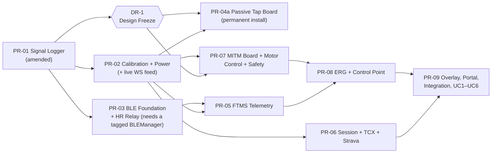

# Echenon: Chief Architect Design Audit (Second Opinion)

| | |
|---|---|
| **Date** | 2026-09-23 |
| **Reviewer role** | Chief Architect (Tier 1), independent second opinion |
| **Baseline** | Echenon `main` @ `4b7b384` · framework submodule @ `0268974a` (untagged dev) |
| **Scope** | `SPEC.md` (2,562 lines), `docs/*` (hardware spec, EX-3 teardown, implementation strategy, use cases, BLE validation), `PROGRAM.md`, `PROGRAM-PLAN.md`, all 7 `pr-*/PROJECT.md`, memory files, archived prior-art WOs |
| **Method** | Full read of every document. SPEC claims about framework APIs checked against the pinned framework source. Upstream issues #225 and #226 checked with `gh`. Electrical claims checked against the ESP32-S3 datasheet and the framework's own board header. Protocol claims checked against Bluetooth SIG FTMS v1.0 and the Strava API. |
| **Status** | Advisory. No SPEC, programme or source files were changed. |
| **Revision** | **r2 (2026-09-23):** updated with two corrections from the owner. (1) The resistance actuator is a **worm drive turning a continuous-rotation cam** with no end stops, so resistance varies sinusoidally with angle between cam-min and cam-max. M-01 is downgraded; S-01, M-02, S-02, H-03, H-05 and Appendix A are revised. (2) **BLEManager is under active development.** P-01 is downgraded and D1 is resolved. **r3:** the pot's dual-sweep behaviour is marked unverified. The owner recalls the console running a start-up calibration; its effects are added to S-01 and H-05, and Appendix A gains #13. **r4 (2026-09-24):** the framework BLEManager PR #235 has been reviewed. P-01 is back to 🟠, with a concrete adoption gate that links the PR review, the consumer-gate comment and the new framework issue #236 (WifiManager open-AP fallback). |

---

## 1. Verdict

**PR-01 (passive signal logger) can start once six small corrections are made (§8.1).**
**Nothing past PR-02 should start in its current form.**

The programme's strategy is sound: observe first, then calibrate, and add risk
step by step. The team has done unusually good work on BLE HR validation and
coexistence. But the SPEC and the hardware build guide already fix, as settled
fact, several electrical and control decisions that Phase 0 was meant to
measure. At least one of those decisions is wrong on paper whatever Phase 0
finds (H-01). The position controller also assumes a monotonic actuator, but
the actuator is a continuously rotating cam (S-01).

### Findings summary

| Severity | Count | Meaning |
|---|---|---|
| 🔴 Critical | 4 | Will fail, risks damaging hardware, or blocks the programme. Resolve before the affected phase starts. |
| 🟠 Major | 24 | Will cause rework, a failed gate, or an interop or UX failure. Resolve inside the owning PR's planning. (Includes P-01, re-raised in r4.) |
| 🟡 Minor | 20 | A robustness item (M-01), plus consistency and documentation drift (P-10, P-11 and the 17 entries in Appendix B). |

### Top five, in order of consequence

1. **H-01. The motor-sense circuit can never read HIGH.** The 30 kΩ/10 kΩ divider outputs 0.825 V for a 3.3 V drive. That equals the ESP32-S3's *VIL maximum*, so the pin reads LOW. A 9 V drive gives 2.25 V, which is still below VIH (2.475 V). Intercept Mode's motor relay cannot work with either scope result.
2. **P-02 / H-02. The Phase 3 board design is committed before Phase 0 has measured anything.** The design ties Green (POT_REF_LO) to GND, forces Yellow to 3.3 V through 100 Ω, and powers the encoder and reed switch from our rail. The teardown data (1.16–1.7 V *across the outer terminals*, which the rider noted as "strange") suggests the console biases the pot. If so, the board changes what the console reads and breaks UC1's "identical to stock" requirement. There is no Design Freeze step between the two phases.
3. **S-01. The actuator is a continuously rotating cam, but the controller assumes a straight line.** Resistance rises and falls sinusoidally over each revolution, and the teardown notes (unverified) say the pot sweeps twice per revolution. A pot voltage therefore probably does not identify a single resistance, which may be why the console seems to calibrate at power-on. The SPEC's controller steers by pot mV alone, so one overshoot past cam-max can leave it settled on the *mirror* position with the wrong resistance. The linear mV-to-level mapping also ignores the sinusoidal profile.
4. **U-01. The upload path does not fit its budget.** A one-hour TCX is about 720 KB, not the stated "10–50 KB". Five queued sessions exceed the 2.75 MiB LittleFS partition. The framework's `FETCH_TOTAL_TIMEOUT_MS = 15000` is a fixed `static constexpr` that has to cover token refresh, TLS, upload and generation. Strava uploads are also asynchronous and need a status poll.
5. **P-03. The critical path runs through the riskiest PR.** HR relay, recording and FTMS telemetry (UC1–UC3) need no motor split, but all of them are scheduled behind the intercept-board PR.

---

## 2. What the programme gets right

These are worth keeping deliberately:

- **Observe first, then calibrate, then control.** Phases 0 and 1 reduce risk before anything is soldered. This is the right shape.
- **The Beat HR validation (`docs/echelon-beat-ble-validation.md`) is excellent.** It uses real GATT dumps, handles BPM = 0 alongside contact flags, documents auto-sleep, and cites QZ and SmartSpin2k as corroboration.
- **The coexistence analysis is honest.** §8.5 says openly that the arithmetic is not the arbiter, that application timer offsets do not phase-lock the radio, and that the measured test decides.
- **The blocking-work discipline is correct.** TCX and HTTPS are moved off `tick()` into `DataManager`. OTA `autoCheck` is disabled pending #226 because of a real risk (a reboot during warm-up).
- **Scope control is good.** The v1 out-of-scope list is clear, HR-zone control is deferred to v2 by decision rather than drift, and a pre-gate for the oscilloscope measurement already exists.
- **The Chief Architect / PA tiering and the provenance rule (`00-operating-model.md`) are well formed,** and the 2026-09-20 restructure was the right call.

---

## 3. Hardware and electrical findings

### 🔴 H-01. The motor-sense divider never produces a logic HIGH
**Where:** SPEC §4.3, §4.4 · hardware_specification §5.4, §7.3.3, §8.2 (TP5/TP6)

**Finding.** The ESP32-S3 guarantees VIH ≥ 0.75 × VDD = **2.475 V** and VIL ≤ 0.25 × VDD = **0.825 V**. The ÷4 divider gives:

| Console drive | GPIO sees | Reads as |
|---|---|---|
| 3.3 V DC (expected) | 0.825 V | **LOW** (exactly VIL max) |
| 9 V PWM (alternative) | 2.25 V | **Undefined** (below VIH) |

The build guide calls 0.825 V a "clear digital HIGH" and quotes a "~0.4 V logic threshold". Both are wrong for this SoC.

**Impact.** The Intercept Mode relay (Phase 3a, UC1–UC3) cannot work with either scope result. Phase 0's "motor drive behaviour documented" criterion also fails if the logger samples these pins digitally.

**Recommendation.**
- **Phase 0:** sample motor sense as **analog** on ADC1 pins at ≥ 1 kHz. Use a scope for the waveform itself.
- **Phase 3:** size the sense network *after* the scope gate. For a 3.3 V drive, use a series 10 kΩ, clamp diodes to the rails and a 100 kΩ pull-down, with no division. For a 9 V drive, use a divider of about 20 kΩ/10 kΩ (3.0 V at 9 V, 3.17 V at 9.5 V) plus clamps. Consider a comparator if the drive turns out to be PWM.

### 🔴 H-02. The standalone sensor supplies are always connected, and their effect on the console has not been measured
**Where:** SPEC §4.6, §4.8, §5.1 · hardware_specification §7.4, §7.5, §7.6

**Finding.** The Phase 3 schematic makes three permanent connections:
- **Green (POT_REF_LO) tied straight to GND.**
- **Yellow (POT_REF_HI) driven from 3V3 through 100 Ω.**
- **ENC_VCC driven through 10 Ω, plus a 10 kΩ cadence pull-up.**

None of these can be switched off. The evidence points the other way: the teardown measured 1.16–1.7 V *across* Yellow and Green, and `use_case_analysis.md` itself warns that "the console applies a voltage divider or current-limited reference". Phase 0 lists "Is Green at GND? Is Yellow at 3.3 V?" as open questions, yet the board already assumes the answers.

**Impact.** If the console biases the pot, a 100 Ω source on Yellow plus a hard ground on Green overrides that bias. The console's resistance reading changes, so its own closed loop and the Echelon app's resistance display become wrong. That fails UC1's core requirement ("identical to stock"). Tying Green to ground may also short a console output. A 10 Ω link between two supply rails also allows back-feeding when the console's rail is down.

**Recommendation.**
- Make R3, R4, R5 and the Green-to-GND link **switchable**. Minimum: jumpers. Better: a high-side switch, or an analog switch controlled by the ESP32, turned on only in standalone Override.
- Do not fix these values until the Design Freeze Review (P-02) has Phase 0 data.
- Add ESP32 internal or external **pull-downs on ENC_A/ENC_B** for standalone mode. Without them the channels float once the console is unplugged.

### 🟠 H-03. The power architecture puts the motor and the SoC on one 3.3 V rail
**Where:** SPEC §4.6, §5.5 · hardware_specification §3.3, §3.4

**Finding.**
- The L9110S and the ESP32 share the MP1584EN 3.3 V output. Motor start current and running current *with the worm loaded by the brake* have **never been measured**; the "800 mA, ~2 s" figure is an assumption. (r2: the cam has no end stops, so there is no stall at an end stop to design for.)
- The L9110S has a bipolar output stage, so at a 3.3 V supply the motor gets noticeably less than the console's drive voltage. That makes the claims of being "faster than stock" and "works up to 9 V" unsupported; neither appears in the teardown.
- The MP1584EN module is trimpot-adjusted, and it sits on a bike that vibrates constantly. The ESP32-S3's 3V3 absolute maximum is 3.6 V, so trimpot drift is a real risk.
- Programming over USB means manually lifting a wire each time. That is error-prone during development.

**Impact.** A brownout reset when the motor starts would drop the Intercept relay, lose the in-progress session (U-03) and loop. There is also a latent risk of over-voltage damage.

**Recommendation.** Measure motor run and stall current and stock drive voltage in Phase 0 (Appendix A). Then:
- Put the motor on its own rail.
- Consider a MOSFET H-bridge with current limiting and a fault output (DRV8833, which the teardown conversation originally suggested, or a TB6612).
- Add bulk capacitance near the SoC.
- Replace the trimpot with fixed resistors, or glue it.
- Check whether the board's **VIN** pin accepts 9 V directly. The Arduino Nano ESP32 reference design takes 6–21 V on VIN through its own buck, with USB power-path OR-ing. If the Waveshare board does the same, the ESP32 no longer needs the external buck at all.

### 🟠 H-04. The pin map uses the wrong GPIO numbers for D8 and D9
**Where:** SPEC §3.2, §4.3, §4.4, §12.3 · hardware_specification §5.3, §7.6, §7.8

**Finding.** The framework's own `hardware/esp32s3nano/board.h` maps **D8 = GPIO 17 and D9 = GPIO 18**. GPIO 11 and GPIO 12 sit at header positions **A4 and A5**, on the opposite side of the board. The docs say "D8 (GPIO 11)" and "GPIO 12 (D9)". GPIO 11 and 12 are also **ADC2** channels, which is unreliable while WiFi is running (as SPEC §4.4 itself notes). Phase 0 samples encoder VCC as analog on GPIO 12.

**Impact.** A builder who solders to the silkscreened D8 pad connects GPIO 17 while the firmware reads GPIO 11, so the motor-negative sense channel is dead. The Phase 0 encoder-VCC reading will fail intermittently.

**Recommendation.** Put every analog tap on ADC1 (GPIO 1–10). In Phase 0, GPIO 6 and 7 are free and both are ADC1. For Phase 3, consider moving motor sense to GPIO 2 and 4 (A1 and A3, ADC1) so they can be sensed as analog. Refer to pins by GPIO number only, and generate the header table from the `board.h` diagram.

### 🟠 H-05. Intercept Mode puts the ESP32 in the stock bike's critical path, with no fail-safe
**Where:** SPEC §1.2 (principle 1), §5.6 · hardware_specification §7.3

**Finding.** With the motor wires split, any firmware crash, watchdog reset, OTA reboot, brownout or unseated ESP32 leaves the *stock console* unable to change resistance. "Unplug the board to restore stock" is true, but only once someone has opened the console. (r2: the worm is self-locking, so the effect is benign: resistance freezes where it is. Short reboots with OTA rollback are a nuisance. A dead or boot-looping board means a fixed-resistance bike until the console is opened. That residual risk keeps this at Major.)

**(r3) Start-up race.** The console and the ESP32 power up together from the same 9 V line. If the console runs its calibration sweep straight away, it can issue motor commands before the ESP32 has booted and started relaying. That boot includes the ROM loader, PSRAM init with `CONFIG_SPIRAM_MEMTEST` over 8 MB, and framework `begin()`. The motor would not move, so the console's calibration would fail or record a wrong reference, **on every power-on**. That breaks UC1. A normally-closed bypass (option (a) below) avoids the race by design. Without one, the relay has to start in the first milliseconds of `setup()`, before WiFi and the framework, and the PSRAM memtest must be disabled. Phase 0 must time the console's power-on sequence (Appendix A #13).

**Recommendation.** Choose one of these explicitly:
- **(a)** A normally-closed relay or analog-switch bypass that reconnects the console motor lines unless the ESP32 is actively holding it off. This is a genuine fail-safe.
- **(b)** Ship a **passive-tap board** (no motor split) as the permanent daily install for UC1–UC3, and keep the MITM board for Override use (see §7).
- **(c)** Evaluate the teardown's "Path B", which injects quadrature pulses into the encoder lines. This gives 32-level ERG in Intercept Mode with the console still in charge of the motor.

### 🟠 H-06. The encoder decoder is hand-rolled without debouncing, when the framework already has a hardware decoder
**Where:** SPEC §5.4 · PR-04

**Finding.** The ISR decoder (`dir = (a ^ _lastB)`) has no glitch rejection, and mechanical encoders bounce. The framework ships `EncoderModule`, which uses the **PCNT** hardware peripheral with a glitch filter, detent normalisation and atomic deltas. PCNT counting also carries on through main-loop stalls. The teardown's "A toggles each click, B brief pulse" description needs Phase 0 characterisation (counts per detent).

**Recommendation.** Reuse `EncoderModule` via a `BoardEncoder` descriptor in the board header. Record the counts-per-detent figure from Phase 0 logic captures.

---

## 4. Motor control and sensing findings

### 🔴 S-01. The actuator is a continuous cam, but the SPEC's controller and level mapping assume a straight line
**Where:** SPEC §4.3 (`BIKE_POT_MV_MIN/MAX`), §5.2, §5.3, §5.5, §6.4 · ex3_specification §6.1, §8

**Mechanism (r2, from the owner).** The motor turns a worm, the worm turns a cam, and the cam presses the magnets between cam-min and cam-max. There are no end stops: a motor left running makes resistance rise and fall slowly and sinusoidally, and the pot turns with it. The teardown notes say the pot sweeps **0→5.4 kΩ, clicks off, then 0→5.4 kΩ again**, which is two sweeps per revolution. **(r3) This is unverified;** the owner does not recall the exact behaviour. The owner also recalls the console **calibrating the actuator at power-on**, which suggests the console has to establish absolute position at start-up. The findings below hold for any pot that is not one-to-one with resistance over a full revolution. Phase 0 must confirm the exact shape (Appendix A #5, #13).

**Finding.** The SPEC models the actuator as a monotonic slider:
- **A pot voltage does not identify a single resistance.** On one sweep resistance rises with pot voltage; on the other sweep it falls. If the sweep boundaries line up with cam-min and cam-max (to be confirmed), the same voltage V means resistance *r* on one half and roughly its mirror on the other.
- **The controller can settle at the wrong resistance.** `ResistanceMotor::update()` steers by the sign of the mV error only. Overshoot past cam-max (likely; see M-02) makes the pot click off to 0 V. The error then looks hugely positive, so the motor keeps going forward into the falling half. It stops wherever the pot next passes the target voltage, which is the **mirror position with the wrong resistance**. It reports success.
- **The linear level mapping is wrong for a sine.** Mapping mV to level linearly gives uneven resistance steps: coarse near mid-travel and very fine near cam-min and cam-max, where the sine is flat. "100 evenly spaced levels" and "~5.4 mV per level" do not describe equal resistance steps.
- **The clamps and limits are meaningless on this mechanism.** "< 1100 mV → min, > 1750 mV → max" and the calibration step "turn the knob to minimum or maximum" assume end stops that do not exist.
- **The source numbers are still unverified.** The 1160–1700 mV figures come from an informal reading *across the outer terminals*, which the rider called "strange".

**Impact.** In Override, ERG, UC4, UC5 and UC6, the bike can quietly sit at the wrong resistance after an overshoot. Power estimates and ERG targets are then wrong in ways the rider will feel but the firmware cannot see.

**Recommendation.**
- **Track the cam angle across the whole revolution (0–360°), not raw mV.** Combine the pot sweep with a half-revolution counter, updated on each click-off (a discontinuity detected in the fast ADC stream) and on the motor's drive direction. Mark the angle invalid after reset until the first click-off or a startup homing move.
- **Keep the working range to the half-revolution from cam-min to cam-max.** Choose the direction of approach by angle, and never cross an extreme to reach a target.
- **Define levels on a calibrated angle-to-resistance table, not linear mV.** Calibrate by *finding the extremes*: sweep through a full revolution and record the angles of minimum and maximum resistance. Proxies for resistance include the console's level display, or power at a fixed cadence.
- **Phase 0 exit criterion:** log the wiper, Yellow and Green voltages over at least one full console-driven revolution, and locate the click-off points relative to cam-min and cam-max. Remove the hard-coded mV constants from the SPEC until the Design Freeze.

**(r3) Effects of a console start-up calibration, if Phase 0 confirms one:**
- **Standalone Override needs its own start-up routine.** With the console absent, Echenon must establish the cam angle at boot. The worm is self-locking and nothing moves while the power is off. So an alternative to a homing sweep is to **store the last known half-revolution in NVS** whenever it changes (rarely, so flash wear is negligible). At boot, check it with a small verification move. Never run a full homing sweep while there is cadence (a mid-ride brownout), because the rider would feel it.
- **Override must not desynchronise the console.** If the console tracks which half it is on from its own start-up calibration, an Override move that crosses a click-off, or leaves the cam on the other half, can leave the console's model wrong after switching back to Intercept. It would then show the wrong level or drive the wrong way. Keeping Override inside the working half-revolution avoids this. Otherwise, switching modes needs a console power-cycle, which should be written down.
- **Copy the console's own method.** How the console calibrates at power-on is the best existing example of homing on this mechanism, and Echenon's standalone routine should copy it.

### 🟠 M-02. The position controller as specified will overshoot and hunt
**Where:** SPEC §5.2, §5.3, §5.5, §6.4

**Finding.**
- Feedback runs at 20 Hz through an EMA with α = 0.15. Its time constant is about **310 ms**, roughly six samples of lag.
- The dead zone is ±2.7 mV (100 levels), and bang-bang drive runs at full speed.
- If the cam goes from min to max in about 2 s (unmeasured), the pot moves about 13 mV per sample. That is already 2.5 levels, well outside the dead zone, before the lag is counted.
- The "~0.16 mV effective resolution, 34 counts per level" claim assumes white noise and ignores ESP32 ADC INL and DNL. Realistically it is a few counts per level.
- The NVS default `motor_dead_zone = 5` also contradicts §5.5's "~2.7 mV".
- **(r2)** Because of S-01, an overshoot near cam-max or cam-min does more than cost precision: it can flip the controller onto the mirror half. The self-locking worm helps, because the position holds once the motor stops, so coasting is the only overshoot to budget for.

**Recommendation.** Run the control loop from an unfiltered (or lightly filtered) fast ADC path at 200 Hz or more, separate from the display EMA. Add a brake-and-approach profile (PWM slow-down near the target), hysteresis, and a settle/retry limit. Treat "100 levels" as a *goal to measure* in Phase 3b, not a spec fact. Phase 0 must log pot mV against time over a full console-driven revolution (Appendix A #3).

### 🟡 M-01. Motor fault handling (downgraded from 🔴 in r2)
**Where:** SPEC §5.5, §5.6 · PR-04

**Revised assessment.** The cam has no end stops and the worm is self-locking, so the stall-and-overheat scenario in r1 does not exist. A runaway motor just cycles resistance between cam-min and cam-max. Nothing is damaged, although the rider will notice. What remains is cheap robustness work, and it belongs in the M-02 and S-01 controller work, not in a separate "safety" section:
- **A run-time bound tied to the mechanism.** Any command still unsatisfied after about one full cam revolution means the loop is lost. Stop, flag the cam angle as invalid, and re-home. This time comes from Appendix A #3.
- **Reset-safe driver inputs.** Fit 10 kΩ pull-downs on IA and IB so boots, brownouts and flashing cannot make the motor twitch and change resistance mid-ride.
- **Pot plausibility.** A wiper reading stuck, open-circuit or outside the rails should stop the motor and report a fault, instead of letting it cycle forever.
- **Immunity to main-loop stalls.** During a SPI-flash erase (LittleFS or NVS writes), cache access stalls non-IRAM code on both cores for tens to hundreds of milliseconds while the motor keeps running. Run the Intercept relay as an IRAM GPIO-edge ISR (`ESP_INTR_FLAG_IRAM`), which also delivers the claimed "< 1 ms" latency. Keep motor stop and start decisions IRAM-safe.
- **Test 6.6** ("motor stops at mechanical limit") should become "the ERG target near cam-max settles without crossing the extreme".

### 🟠 S-02. The power model is wrong by about 7× and is indexed by the wrong variable
**Where:** SPEC §6.2, §6.3, §6.4

**Finding.**
- **The Tier 1 physics defaults are unusable.** At R = 20 and 80 rpm the polynomial gives **27 W**, against the SPEC's own community-table preview of **191 W**. At R = 32 and 90 rpm it gives about 66 W.
- **The model is indexed by "level" (1–32).** In Override Mode the level runs 1–100, so a power lookup at "level 56" reads off the end of the table.
- **(r2) The polynomial assumes R is linear in position.** With a sinusoidal cam, it is not.
- **The community matrix does not exist yet.** Collecting it is not in any PR. UK/EU *database right* may cover compiled datasets even where the individual facts are not copyrightable.

**Recommendation.** Index power by **cam angle within the working half-revolution**, and use a table with enough angle points to capture the sine. Treat "level" purely as a display scale for each mode. Re-derive the defaults from real data in PR-02. Add a "power data acquisition" WO to PR-02, and record where each data point came from.

---

## 5. BLE, FTMS and HR findings

### 🟠 P-01. BLEManager dependency: adoption gate (r4, 2026-09-24) [OPEN]
- **Framework PR:** [esp32-app-foundation#235](https://github.com/matthewmcneill/esp32-app-foundation/pull/235). The Chief Architect review has **9 blocking defects in the central (HR-strap) role**, which has never run on hardware.
  - [Review](https://github.com/matthewmcneill/esp32-app-foundation/pull/235#pullrequestreview-5300520072)
  - [Consumer adoption gate](https://github.com/matthewmcneill/esp32-app-foundation/pull/235#issuecomment-5808862997)
- **Framework issue:** [esp32-app-foundation#236](https://github.com/matthewmcneill/esp32-app-foundation/issues/236). WifiManager drops permanently to an open, unauthenticated AP after one slow STA reconnect. BLE connection churn triggers it.
- **Gate for Echenon PR-03:** pin a *tagged* release that has:
  1. PR #235 🔴 1–9 fixed;
  2. RFC §17.2 items 4, 5, 6a/6b/6c, 7, 8 and 9 passed with a real HR peripheral;
  3. #236 fixed.
- **Needed later, before FTMS/ERG:** provider characteristic callbacks no longer overwritten, plus a main-loop write dispatch for the Control Point; a built-in DIS override.
- **Echenon still owes RFC §19:** item 1 (Beat address type, via nRF Connect on Android) and item 5 (Appearance value).
- **Severity note:** raised back to 🟠 because the gate is now concrete and depends on defects outside Echenon's control.

### 🟡 P-01 (r2 text, superseded by r4 above). Track BLEManager as an external dependency (downgraded from 🔴 in r2)
**Where:** SPEC §1.3, §3.5, §7.2, §8.2, §8.5 · PR-03, PR-05, PR-06

**Revised assessment.** The owner confirms BLEManager is being built now, upstream, so D1 is resolved. What remains is programme bookkeeping:
- **Gate PR-03 on a tagged framework release that contains BLEManager.** Replace PR-03's "implement against RFC contract and stub calls" with that entry condition, and record the dependency in `PROGRAM.md`'s gates table.
- **Sweep the SPEC's code samples against the real headers once they land.** Candidates for drift: `getBLEManager()`, `ScanInhibit`, `BLENotification`, and the `registerServiceProvider` signatures.
- **Set a framework upgrade policy.** PR-01 and PR-02 will be built on the current untagged dev commit. Bumping the submodule for BLEManager is a cross-PR change and needs one owner, ideally the first WO of PR-03.
- **Housekeeping.** #225 still carries the `P4-enhancement` label; consider updating it so the tracker matches reality. #226 (OTA `checkOnBoot`) is still open (see P-07).

### 🟠 B-01. FTMS GATT and feature definitions have spec errors and gaps
**Where:** SPEC §7.3, §7.4

**Findings.**
- **The target-setting feature bit is wrong.** Resistance Target Setting Supported is **bit 2** of the Target Setting Features field; bit 0 is Speed. Power target (bit 3) is correct.
- **Two characteristics are missing:** **Supported Resistance Level Range (0x2AD6)** and **Supported Power Range (0x2AD8)**. FTMS requires each one when the matching target setting is supported, and apps read them to scale their UIs.
- **Zwift simulation mode is not addressed.** Free-ride and route gradients use **Set Indoor Bike Simulation Parameters (0x11)**, not Set Target Power. Supporting it or not is a scope decision (D4). Without it, Zwift free rides have no resistance changes.
- **The Set Target Resistance Level parameter needs a defined encoding.** FTMS v1.0 defines it as UINT8 with 0.1 resolution (maximum 25.5), while several clients send SINT16. "Map to level 1–100" needs an explicit decode rule tied to the advertised range.
- **Feature flags should reflect the current mode.** In Intercept Mode, advertising target-power support and then always answering `0x05` makes apps show "trainer control failed". Clear the target-setting bits in the Feature characteristic while in Intercept Mode.
- **Request Control is required first.** Test 0.8 omits it, but Control Point commands return `0x05` without it.
- **The §7.7 app list is asserted, not tested.** Peloton's FTMS support in particular should be verified. Convert the list into a test matrix.

### 🟠 B-02. ERG and manual-override behaviour is underspecified
**Where:** SPEC §5.6 (command priority), §7.4, Journey 4b

**Finding.**
- **A knob turn "cancels ERG", but the next Set Target Power immediately re-engages it,** because apps resend targets on every change or periodically. The rider's override therefore lasts a second or two.
- **No Fitness Machine Status notifications are defined,** such as Control Permission Lost or Target Power Changed.
- **The ERG setpoint will jitter.** It is recomputed from cadence measured once per crank revolution (about every 0.75 s at 80 rpm), so the motor will chatter without setpoint hysteresis or rate limiting.
- The "Web overlay command" source has **no API endpoint**.

**Recommendation.** Specify an ERG state machine covering the states ACTIVE, SUSPENDED_BY_RIDER and RELEASED. Define whether the rider's override latches until a new Request Control or for a fixed hold time, which Status notifications are sent, and how cadence is smoothed and the setpoint deadbanded.

### 🟠 B-03. The HR reconnect policy contradicts itself, and its recovery criterion cannot be met
**Where:** SPEC §8.4 and §8.5

**Finding.**
- §8.4 says to retry "slow phase every 60 s, indefinitely". §8.5 says "max 5 attempts ... give up ... user can re-trigger pairing".
- Criterion (c), "reconnected within 35 s of the strap returning", holds only inside the fast phase. After it, the worst case is 60 s or more. Because the Beat auto-sleeps after 30–60 s off-skin, **the slow phase is the common case, not the edge case.**
- Direct connect still uses the radio: the controller's initiator scans. So "no scan at all" is misleading for the coexistence budget.

**Recommendation.** Keep one policy: fast backoff, then an indefinite slow retry *while RUNNING*. Re-derive criterion (c) from it, for example "≤ slow-retry interval + 5 s". Make the slow interval about 10–15 s with a low-duty initiator window, and measure its coexistence cost.

### 🟠 B-04. Nobody has checked whether the Echelon app will pair with a third-party HR peripheral
**Where:** SPEC §8.3 · Phase 2 go/no-go

**Finding.** UC1's HR relay depends on the Echelon Fit app listing and accepting an HR device called `Echenon-XXXX`. The app might filter by name prefix (for example `EBEAT-`) or by manufacturer data. This is unvalidated, and it is the premise of PR-03.

**Recommendation.** Run a **zero-code spike now**. Use nRF Connect's advertiser and GATT server on a spare phone to emulate a `0x180D` device named `Echenon-TEST`, then see whether the Echelon app on the P12 lists it and shows the HR. This takes hours, not weeks.

---

## 6. Session, upload and web findings

### 🟠 U-01. TCX size, storage and the upload deadline do not fit
**Where:** SPEC §8.5 (burst table), §9.3, §9.4, §9.5, §10.4 · framework `FetchContext.hpp:69`

**Finding.**
- **The TCX size is badly underestimated.** A trackpoint as shown in §9.4 is about 190–250 bytes, so an hour at 1 Hz is **about 720 KB**, not "10–50 KB".
- **The queue does not fit in storage.** Five queued sessions come to about 3.6 MB, but the S3-Nano storage partition is **2.75 MiB** and is shared with the audit log.
- **The deadline is fixed and too tight.** `FETCH_TOTAL_TIMEOUT_MS = 15000` is a `static constexpr`, not a per-source setting. Token refresh (a second HTTPS round trip), TLS setup, a 720 KB upload and, per §9.4, TCX *generation* all have to fit inside one `fetchUpdate()`.
- **Strava's `POST /uploads` is asynchronous.** It needs a `GET /uploads/{id}` poll before the upload's status is known, or before a duplicate rejection is visible.
- `IDataSource` also warns that a long fetch **blocks every other data source** on the shared queue.

**Recommendation.**
- Generate **`tcx.gz`**, which Strava accepts; that is about 5–8% of the raw size. Put a zlib stream inside the generator.
- Split the pipeline into separate fetches: generate, refresh token, upload, poll status.
- Size the queue against the partition.
- Treat Strava's duplicate response as success.
- If needed, file a framework issue for a per-source deadline override.

### 🟠 U-02. The upload execution models contradict each other, and framework names are reused
**Where:** SPEC §10.2 vs §10.4 · strategy Phase 5 · PR-04

**Finding.**
- `IUploader::upload()` is synchronous and is called in a loop by `UploadManager`, which is an `ITickable`. That blocks `tick()`. §10.4 then specifies the same work as an `IDataSource`.
- SPEC samples use `FetchResult`; the framework returns `UpdateStatus`. `contributeSettings(WebServer&)` also does not match the framework's `PsychicHttpServer` / `IWebContributor` model.
- **Name collisions:** PR-04 creates `src/echenon/ConfigManager.*`, and strategy Phase 5 lists an Echenon `DataManager`. Both names are global classes in the framework (`modules/ConfigManager`, `modules/DataManager`).

**Recommendation.** Make `IDataSource` the only execution path and have `IUploader` describe capabilities only. Rename the Echenon classes (for example `OperatingModeStore`, `UploadQueue`), or give all Echenon code the namespace `echenon::`. Sweep the SPEC code samples against the pinned framework headers.

### 🟠 U-03. Session integrity: wall-clock time, crash loss and ghost rides
**Where:** SPEC §9.2, §9.3, §9.5

**Findings.**
- **No wall-clock anchor.** Points are stored as `millis()` since start, and the board has no RTC. A ride that starts before NTP sync, or while offline (§9.5), has no valid ISO-8601 time. Strava then misdates it or rejects it.
- **The in-progress session exists only in PSRAM.** PSRAM does not survive a reset, and the framework's sdkconfig enables `CONFIG_SPIRAM_MEMTEST`, which overwrites it at boot. A brownout (H-03) or watchdog reset loses the whole ride.
- **Ghost sessions.** Recording starts on the *first cadence pulse*, so a knock on the crank or a single reed bounce creates a session that gets uploaded.
- **Trailing zeros.** Auto-end after 180 s leaves 3 minutes of zeros on every activity, inflating elapsed time and diluting the averages.

**Recommendation.**
- Anchor to the first NTP-synced time and back-compute the start.
- Write an append-only checkpoint every 30–60 s. Schedule it so it does not collide with active motor control (M-01).
- Require at least N seconds of cadence (and total duration) before creating a session.
- Trim trailing idle time before generating the TCX.

### 🟠 U-04. The Strava credential model for an open device is not defined
**Where:** SPEC §10.4

**Finding.**
- An open-source firmware cannot embed a Strava client secret.
- New Strava API apps start with a very small athlete capacity (historically one, the owner) until Strava reviews them.
- The OAuth callback must match the app's registered *Authorization Callback Domain*, and the browser must be able to resolve that host.
- Refresh tokens can rotate on refresh, so the new token must be persisted.
- There is no `state` parameter, so the flow has no CSRF protection.

**Recommendation.** Specify a **bring-your-own Strava API app** model: each user enters their client ID and secret in the portal, and the SPEC states the callback-domain setup. Persist rotated refresh tokens. Re-register the redactor for every new access token (the current `begin()`-only registration misses refreshes). Use and validate `state`.

### 🟠 W-01. The web surface has no defined security posture
**Where:** SPEC §5.6, §9.6, §11.4

**Finding.** The SPEC does not say whether `/overlay`, `/ws/session`, `/api/session/*`, the TCX download (which contains HR, i.e. health data) and the web resistance command require `AuthManager` login. An unauthenticated LAN client could start or stop sessions, download rides or drive the motor. Any BLE central in range can also Request Control and set resistance in Override Mode. That is normal for trainers, but it should be written down as an accepted risk.

**Recommendation.** Add a short "Trust boundaries" subsection. Allow read-only live data without login; require auth for mutations, downloads and motor commands (for example a session cookie the floating window keeps); and record the BLE control risk as accepted.

### 🟠 W-02. `echenon.local` on Android Chrome is an untested dependency
**Where:** SPEC §11.1, Journeys 1, 5 and 6

**Finding.** The main UX surface, a floating Chrome window on the P12, relies on `.local` mDNS name resolution. Android and Chrome have historically been unreliable here. Separately, the OAuth redirect (U-04) needs the same hostname to resolve.

**Recommendation.** Verify this on the P12 during PR-01. Provide fallbacks: show the IP address on the AP captive page and in the serial log, recommend a DHCP reservation, and consider a QR code.

---

## 7. Programme and plan findings

### 🔴 P-02. There is no Design Freeze Review between observation and building
**Where:** PROGRAM-PLAN "Key principle" · strategy Phase 0 → 3 · PROGRAM.md hardware gates

**Finding.** The plan says "No PR assumes hardware that hasn't been validated by a preceding PR". But `hardware_specification.md` §7 already fixes the Phase 3 board (sense network, R3/R4/R5, Green to GND, a motor on the 3.3 V rail, the L9110S). No programme step revises the SPEC and hardware spec from Phase 0 data before soldering starts. The existing gates also expect one outcome only (for example "confirm 3.3 V DC") and have no redesign branch. The R3/R4/R5 gate sits at PR-07, but those parts are soldered in PR-04 and affect UC1 there.

**Recommendation.** Insert **DR-1: Design Freeze Review**. It is a docs-only milestone owned by the Chief Architect:
- **Inputs:** Phase 0 evidence committed under `docs/measurements/phase0/` (scope captures, CSVs, a filled-in Appendix A).
- **Outputs:** revised SPEC §4–§6 and hardware spec §7; decisions D3 (driver and rail) and H-05 (fail-safe); a cam-aware control-loop architecture (S-01, M-02, M-01).
- **Rule:** no hardware is soldered until DR-1 is approved. Also move the R3/R4/R5 gate to DR-1 and PR-04.

### 🟠 P-03. The critical path runs through the riskiest PR when it doesn't need to
**Where:** PROGRAM-PLAN dependency graph

**Finding.**
- **FTMS telemetry (PR-05)** needs only sensors (PR-02) and BLE (PR-03).
- **Session, TCX and Strava** (half of PR-06) need only PR-02.
- **UC1–UC3,** which cover Journeys 1, 3 and 6, the bulk of daily use, need **no motor split at all**. A passive tap harness (J1–J4 pass-through with high-impedance taps) is enough.

The current graph blocks all of them behind PR-04, the highest-risk hardware PR.

**Recommendation.** Adopt the restructure in §9. It delivers value earlier, pushes risk later, allows parallel work, and gives the rider a permanent passive install that is safe by construction.

### 🟠 P-04. PR-05's "merge both" base does not fit the stacked-branch model
**Where:** PR-05 PROJECT.md ("PR-03 + PR-04 (merge both before starting)")

**Finding.** STACKING_REFERENCE uses linear stacks with named single bases. A base with two parents leads to ad-hoc merge commits and makes restacking very hard.

**Recommendation.** Write the rule down: a PR whose predecessors are on different stacks bases on **`main` after both have merged**. If the restructure in §9 is adopted, the question largely goes away.

### 🟠 P-05. PR-06 covers two unrelated risk domains
**Where:** PR-06

**Finding.** PR-06 contains closed-loop motor ERG (hardware-coupled, safety-relevant) *and* session, TCX, OAuth, upload and two portal pages (cloud and storage). This breaks one-PR-one-concern, and a failed ERG gate would hold up upload, or the reverse.

**Recommendation.** Split it into **ERG** (after the MITM work and FTMS) and **Session + Upload** (after PR-02, in parallel with the BLE work).

### 🟠 P-06. Coexistence is only checked at the end
**Where:** SPEC §8.5 "Verification requirement (PR-07)" · PR-07

**Finding.** Radio coexistence is an architecture-level risk, but the maximum-configuration test runs in the last PR. A failure there would force architecture changes at release-candidate stage.

**Recommendation.** Test it progressively. **PR-03:** HR relay plus synthetic 2 Hz notifications plus portal WebSocket. **PR-05:** full connection count with a scripted Central. **Final:** the §8.5 matrix. Each check needs a scripted, repeatable harness (for example `bleak` from the existing `tmp/ble-venv`).

### 🟠 P-07. OTA arrives after the board is sealed in the console
**Where:** PR-07 · SPEC §8.5 and Journey 7

**Finding.** From PR-04 onward the board lives inside the console housing, and USB flashing needs the buck-disconnect procedure. OTA is framework-provided but scheduled last. Separately, `autoCheck` defaults to `true` in `OTAUpdateManager`, and factory reset sets it back to `true`. The SPEC's `autoCheck=false` rule has no enforcement point.

**Recommendation.** Enable and test manual OTA in the PR that first installs a board. Enforce `autoCheck=false` in code (Echenon overrides it after config load and after factory reset) until #226 lands.

### 🟠 P-08. There is no automated test strategy, and the ERG acceptance test is circular
**Where:** all PR verification sections · SPEC §13

**Findings.**
- **Nothing is host-tested.** The framework ships `env:native` with googletest, but every PR verifies by manual riding. The HR parser, FTMS packet encoding, Control Point state machine, power model, level mapping, encoder decoding, session state machine, TCX generator and ERG setpoint logic are all pure logic and should be tested on the host.
- **"200 W ERG target stabilises ±10 W" cannot fail.** Displayed power is *computed from the same model* that picks the ERG setpoint, so the test only proves quantisation. ERG accuracy is really power-model accuracy (S-02).

**Recommendation.** Require native tests for every pure-logic module, one PR at a time. Rephrase the ERG acceptance as "setpoint reached within X s without oscillation; position error ≤ 1 level". Where available, validate power against a reference meter.

### 🟠 P-09. Hardware work is modelled as autonomous Work Orders
**Where:** PR-01, PR-02 and PR-04 mandates · `00-operating-model.md`

**Finding.** Soldering, oscilloscope measurements, rides and Echelon-app comparisons are human tasks. The operating model lets Tier-3 workers implement *autonomously*. Without explicit interactive WOs, a PA will either spawn a worker that cannot finish, or collect the evidence informally.

**Recommendation.** PAs model bench and ride work as **`complexity: interactive` WOs** with checklists, and commit the evidence (CSV files, scope screenshots, photos) as part of the WO. That evidence becomes the auditable input to DR-1.

### 🟡 P-10. Scope overlap and parallel-work claims
- **The calibration wizard is in both PR-02 and PR-07,** with `web/calibration.js` in one and `Calibration.h/.cpp` in the other. Assign it to one PR.
- **The PR-01 dashboard and the PR-07 overlay** will likely duplicate the live-metrics plumbing. Build the WebSocket feed once, in PR-02.
- **PR-02 and PR-03 both edit `EchenonModule.h/.cpp`,** and PR-03 also edits `platformio.ini` and `main.cpp`. The plan says both "no file overlap" and "share no files except EchenonModule". Per Core Directive 4, state the expected conflict and the resolution owner.

### 🟡 P-11. Documentation and governance hygiene
- **Broken links.** `PROGRAM.md` → `../../SPEC.md` should be `../../../SPEC.md`. `PROGRAM-PLAN.md` → `../../../../docs/*` has one `..` too many. The `pr-*/PROJECT.md` links are correct.
- **Stale plan text.** PROGRAM-PLAN says "hardware risk is compressed into a single PR (PR-03)"; it is PR-04.
- **Stale sub-phase labels.** implementation-strategy §Phase 3 labels its sub-phases "Phase 2a/2b".
- **Superseded design in the use cases.** use_case_analysis UC6 still refers to the AMS1117 LDO.
- **Build environment names disagree.** PR-01 to PR-06 verify with `pio run -e ex3-waveshare-nano`; PR-07 uses `pio run -e echenon`.
- **Prior art encodes the superseded model.** Archived WO1 prescribes `[env:echenon]` and `hardware/echenon/board.h`. PAs are told to use these as prior art, so stale design could leak back in. Add a banner to each archived WO naming the SPEC sections that supersede it.
- **The framework submodule is pinned to an untagged dev commit.** Pin to a tag and record the upgrade policy (see P-01).

---

## 8. Required actions by gate

### 8.1 Before PR-01 starts (small; Chief Architect edits to SPEC and hardware spec)

| # | Action | Fixes |
|---|---|---|
| A1 | Correct the pin map (D8 = GPIO 17, D9 = GPIO 18). Move every Phase 0 analog tap to ADC1 (use GPIO 6 and 7 for motor− and encoder VCC). | H-04 |
| A2 | Phase 0 samples motor sense as **analog** at ≥ 1 kHz. Mark the 30 kΩ/10 kΩ divider as protection only, not a logic-level interface. | H-01 |
| A3 | Choose one hardware-config model that **extends the framework contract** (`-DBOARD_HEADER=...board.h`, `env:esp32s3nano` base, `um_nanos3`, octal-PSRAM sdkconfig). Put the bike characteristics in that header or a companion file. Drop `board = esp32-s3-devkitc-1`. | Appendix B #1 |
| A4 | Confirm access to an oscilloscope (a cheap USB scope is enough). Buy the J1–J4 JST pairs early and build a **back-probe tap harness** instead of clipping alligator clips onto JST-SM contacts. | P-02 |
| A5 | Adopt the evidence convention: `docs/measurements/phase0/`, plus the Appendix A register as the PR-01 exit checklist. | P-02, P-09 |
| A6 | Verify `echenon.local` resolves in Chrome on the P12, and add an IP fallback. | W-02 |

### 8.2 Before PR-03 starts
- **A tagged framework release with BLEManager is available and meets the P-01 r4 gate:** PR #235 🔴 1–9 fixed, RFC §17.2 central acceptance passed on hardware, #236 fixed. Submodule bump owned by PR-03 WO1; SPEC samples swept against the real API.
- **Echelon-app HR acceptance spike passed** (B-04).
- HR reconnect policy reconciled (B-03).

### 8.3 At DR-1 (after PR-01, before any soldering)
- Appendix A closed with evidence. SPEC §4–§6 and hardware spec §7 revised (H-01, H-02, H-03).
- **Cam-aware controller specified (S-01, M-02).** It covers full-revolution angle tracking, working half-revolution and approach direction, angle-based level table, calibration by finding the extremes, a run-time bound of one revolution, and reset-safe driver inputs (M-01).
- Fail-safe strategy chosen (H-05). Decoder decision recorded: reuse `EncoderModule` (H-06).
- Power model re-indexed on cam angle (S-02).

### 8.4 Before the FTMS, ERG and upload PRs
- FTMS corrections (B-01). ERG state machine specified (B-02).
- Upload redesign: gzip, split fetches, async status poll, credentials (U-01, U-04).
- Execution model unified and names deconflicted (U-02). Session integrity (U-03). Trust boundaries (W-01).

### 8.5 Decisions needed from you

| ID | Decision | Recommendation |
|---|---|---|
| ~~**D1**~~ | ~~BLEManager: upstream first, or a local adapter?~~ | **Resolved (r2):** upstream, in progress. PR-03 is gated on a tagged release. |
| **D2** | Adopt the passive-first restructure (§9)? | Yes |
| **D3** | Motor driver and rail (after the Phase 0 current and voltage data) | A MOSFET driver with current limit and a fault pin, on its own rail. |
| **D4** | Zwift SIM mode (0x11) in v1? | Yes for v1.1. Spec it now so the FTMS work leaves room for it. |
| **D5** | Strava credential model | Bring-your-own API app. |

---

## 9. Recommended programme restructure (for decision D2)

| PR | Unlocks | Hardware risk |
|---|---|---|
| PR-01 → DR-1 | Evidence, frozen design | None (taps) |
| PR-02, PR-03 (in parallel) | Calibrated metrics; HR relay | None |
| PR-04a, PR-05, PR-06 (in parallel) | **UC1, UC2, UC3 as a daily-use product** | Low (pass-through only) |
| PR-07 | Intercept relay with fail-safe, manual Override, UC6 hardware | **High (isolated)** |
| PR-08 | UC4, UC5 (ERG) | Medium (software on proven hardware) |
| PR-09 | Release candidate | None |

This has nine PRs and a milestone instead of seven PRs. The critical path to first
daily value becomes **PR-01 → PR-02 → PR-04a / PR-06**, and the motor risk moves
off the path of every non-ERG feature.

---

## Appendix A: Phase 0 hardware assumptions register (PR-01 exit checklist)

| # | SPEC assumption | Current evidence | Phase 0 measurement | Design impact if wrong |
|---|---|---|---|---|
| 1 | Console motor drive is 3.3 V DC bang-bang | DMM average only | Scope both wires, both directions, and at rest (brake or coast?) | Sense network (H-01), relay logic, motor rail |
| 2 | Motor current ≤ 800 mA, intermittent | None | Shunt or clamp: start inrush, and running current with the worm under brake load at cam-max | Driver choice, rail, brownout (H-03) |
| 3 | Motor stops within one level from 20 Hz feedback | None | Log pot mV against time for **one full cam revolution** (this also gives the run-time bound) and coast distance after the drive stops | Loop rate, dead zone, braking profile (M-02, M-01) |
| 4 | Wiper 1160–1700 mV, linear over levels 1–32 | DMM across the *outer* terminals ("strange"); r2: the cam makes it sinusoidal | Wiper, Yellow and Green at every console level, both directions; resistance proxy (console level, or power at fixed cadence) against angle | Level table, calibration method, 100-level claim (S-01) |
| 5 | The pot's shape over one revolution (number of sweeps, click-off points) relative to cam-min and cam-max; which half the console works in | Teardown notes say two 180° sweeps (owner unsure, r3); r2: continuous cam, no end stops | Drive a full revolution; mark the click-offs and the resistance extremes | Angle tracking, mirror-position ambiguity (S-01) |
| 6 | Green = GND and Yellow = 3.3 V from a stiff source | None; #4 suggests a bias | Measure both, plus source impedance (load test) | R4 and the Green–GND tie (H-02) |
| 7 | Cadence: Orange pulled up by the console, reed closes to GND | Colour mapping contradicts itself (ex3 §7 vs §8) | Orange, Grey and Brown voltages open and closed | R3 path; whether Grey needs grounding |
| 8 | Encoder common = 3.3 V, channels pulled down by the console | DMM | Logic capture: counts per detent, pull direction | Standalone pull-downs, decoder (H-06) |
| 9 | Console tolerates its motor lines being disconnected (Override with console connected) | None | Unplug the motor at the hub, turn the knob, watch the console and app | UC4 and UC5 viability |
| 10 | Console's 3.3 V rail tolerates parallel supplies via R4/R5 | None | Console rail voltage at idle, active and sleep | Back-feed risk (H-02) |
| 11 | The Waveshare VIN pin cannot take 9 V | Not checked | Board datasheet or schematic | May remove the external buck for the SoC (H-03) |
| 12 | Echelon app pairs any `0x180D` peripheral | None | nRF Connect emulation spike | PR-03 premise (B-04) |
| 13 | **(r3)** What the console does at power-on: whether it runs a calibration sweep, how long after 9 V is applied, and how it finds its reference (click-off, extremes, or a stored value) | Owner recollection only | **Scope in single-shot mode** on the motor wires and wiper, triggered by applying 9 V. Power the ESP32 logger **from USB** so it is already logging before the bike is switched on (buck disconnected, as §3.5 requires). Repeat from several starting positions, including a cold start after the cam was left on each half. | Boot-time relay race (H-05), standalone homing and persisted half (S-01), console desync after Override (S-01) |

## Appendix B: SPEC internal consistency defects (🟡, one docs PR)

| # | Defect | Locations |
|---|---|---|
| 1 | Three hardware-config models: `-include config.h` / `esp32-s3-devkitc-1` / `HAS_*`; `env:echenon` / `BOARD_HEADER` / `WITH_*`; and the framework `board_contract.h` | §4.3 vs §12.2–§12.3 vs framework |
| 2 | Motor sense described as a 10 kΩ pull-down, a 30k/10k divider, and "no dividers required" | §3.2, §5.6, §12.3 vs §4.3, §4.4 vs §4.7 |
| 3 | Parts list gives two 10 kΩ pull-downs (R1, R2); build guide gives four divider resistors (R1a/b, R2a/b) | §4.8 vs hw spec §2 |
| 4 | Relay latency: 20 Hz / 50 ms loop vs "< 1 ms" | §3.3 vs §5.6, test 1.8 |
| 5 | Overlay URL `/dashboard` vs `/overlay`; test 0.3 expects an "overlay tab" | §11.1 vs §11.4, §13.1 |
| 6 | Device name `Echenon` vs `Echenon-XXXX` | §7.7, §13, Journeys vs §7.2, §7.8 |
| 7 | Module `ResistanceADC` vs `ResistanceSensor` | §3.4 vs §12.1, PR-02 |
| 8 | Framework submodule path `lib/esp32-app-foundation` vs actual `framework/` | §12.1 |
| 9 | Pot calibration "maps to levels 1–32" vs mode-dependent 32 or 100 | §6.3 vs §5.3 |
| 10 | `motor_dead_zone` default 5 mV vs "~2.7 mV" | §6.4 vs §5.5 |
| 11 | The coupling audit claims no sibling concrete refs, but `HRMClient` calls `_hrmRepeater.publishHr()` | §3.4 vs §8.2 |
| 12 | Web overlay listed as a resistance command source, but no endpoint is defined | §5.6 vs §11.4 |
| 13 | API drift: `FetchResult` (framework has `UpdateStatus`), `getBLEManager()`, `WebServer&` vs `PsychicHttpServer&`, `server.websocket()` | §3.5, §10.2, §10.4, §11.4 |
| 14 | `RideDataPoint` "10 bytes" is 12 with padding (use `__attribute__((packed))` or reorder) | §9.3 |
| 15 | Flash 16 MB / octal PSRAM (SPEC and framework sdkconfig) vs "8 MB / QSPI" (framework docs and `board.h` comment). Verify the actual module. | §4.1 vs framework |
| 16 | `BIKE_MOTOR_VOLTAGE 3.3f` and "works up to 9 V" have no source | §4.3, §4.5 |
| 17 | Redactor registered once in `begin()`. Refreshed tokens are never registered, and the `RegisterResult` is ignored. | §3.5 vs §10.4 |

---

*End of audit. The findings are advisory. Applying any of them (SPEC edits,
programme restructure, PROJECT.md changes) needs your explicit approval under
`.agents/rules/01-plan-before-execute.md`.*
