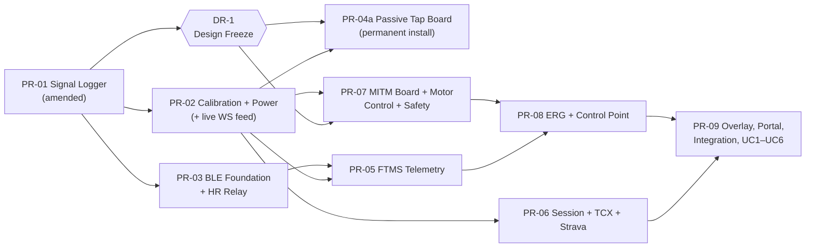

# Echenon Firmware — Programme Plan

> Detailed PR dependency graph, scope boundaries, and architectural rationale.
> Each PR is one atomic, reviewable, mergeable unit following the Torvalds Standard.
>
> **Aligned to:** [`docs/implementation-strategy.md`](../../../../docs/implementation-strategy.md)
> — the iterative hardware+software co-development roadmap.

---

## Design Philosophy

The firmware is developed iteratively alongside the hardware. Each PR
corresponds to a development phase from the implementation strategy. Earlier
phases require minimal hardware (fly wires + ESP32), proving assumptions
before later phases commit to the full intercept board.

**Key principle:** No PR assumes hardware that hasn't been validated by a
preceding PR's test plan. The programme is structured so that hardware risk is
compressed into PR-07, with everything before it being passive, BLE-only, or non-destructive.

---

## Dependency Graph

### Parallelism Opportunities

- **PR-02 (Calibration) ∥ PR-03 (HR Relay):** Both depend only on PR-01. File overlap resolution: `EchenonModule` registration must be managed carefully on merge.
- **PR-04a ∥ PR-05 ∥ PR-06:** All can run in parallel after their respective dependencies (PR-02 / PR-03 / DR-1).

### Critical Path

PR-01 → PR-02 → PR-04a / PR-06 (Fastest path to daily passive value: UC1-UC3)
PR-01 → DR-1 → PR-07 → PR-08 → PR-09 (Full path to ERG value: UC4-UC6)

### Phase-to-PR Mapping

| Dev Phase | PR | Hardware Required |
|---|---|---|
| Phase 0: Observe | PR-01 | Fly wires + ESP32 (no intercept board) |
| Phase 1: Calibrate | PR-02 | Same fly wires |
| Phase 2: HR Relay | PR-03 | Same (BLE only, no bike signals needed) |
| Phase 3: Passive | PR-04a | **Passive Tap Board** (permanent install) |
| Phase 3: FTMS | PR-05 | Passive Tap Board |
| Phase 4: Session | PR-06 | Passive Tap Board |
| Phase 5: MITM | PR-07 | **Intercept board** (motor split) |
| Phase 6: ERG | PR-08 | Intercept board |
| Phase 7: Integration | PR-09 | Intercept board |

---

## DR-1: Design Freeze Review (Milestone)

**Inputs:** Phase 0 evidence (CSV logs, scope captures, power readings).
**Outputs:** Finalised electrical values, revised SPEC §4–§6 (working range, loop rates, fail-safe decision, dead zones).
**Rule:** No hardware soldering or permanent installation can occur until DR-1 is approved by the Chief Architect.

---

## PR-01: Signal Logger (Phase 0 — Passive Observation)

**Base:** `main`
**Scope:** PlatformIO project setup (`env:ex3-waveshare-nano`), board configuration, `EchenonModule` skeleton, `SignalLogger` (all 12 wire taps: cadence, pot wiper, pot outers, motor sense ×2, cadence return, encoder Ch A/B, encoder VCC), `WebServer` (live dashboard), CSV `DataExport`. Interactive hardware WOs.
**Hardware:** Fly wires from existing loom to ESP32. Motor sense pins via voltage dividers. No wires cut.
**Deliverable:** Live telemetry.
**GATE:** Oscilloscope motor voltage verification.
**Notes:** Includes Appendix A exit checklist and `docs/measurements/phase0/` evidence path.

---

## PR-02: Calibration + Power Engine (Phase 1 — Calibrate)

**Base:** PR-01
**Scope:** `CadenceSensor`, `ResistanceSensor`, `PowerEngine`, `CalibrationWizard` (portal page). Live WS feed. Power data acquisition WO.
**Deliverable:** Meaningful metrics and calibration workflow.

---

## PR-03: HR Armband Relay (Phase 2 — BLE Foundation)

**Base:** PR-01
**Scope:** `BLEManager` integration (`≥ v0.0.12-dev.82`), `HRMClient`, `HRMRepeater`, Portal BLE page.
**Deliverable:** Echelon app sees HR device.
**Entry conditions:** Echelon-app HR acceptance spike passed.
**Notes:** `MAX_CONNECTIONS=3`, `setSlowRetryMs(15000)`, progressive coexistence test.

---

## PR-04a: Passive Tap Board (Phase 3 — Passive)

**Base:** `main` after PR-02 merged, DR-1 approved
**Scope:** Build a pass-through-only tap harness for permanent installation. J1-J4 pass-through with high-impedance taps. No motor split. Enables UC1-UC3 as daily-use product. Hardware scope: Passive tap board per revised hardware spec (post DR-1).
**Deliverable:** Stock ride indistinguishable from no-board. All sensor taps read correctly. Board fits in console housing.

---

## PR-05: FTMS Telemetry (Phase 3 — App Visibility)

**Base:** `main` after PR-02 + PR-03 merged
**Scope:** `FTMSServer` (FTMS GATT service, notifications at 2 Hz). FTMS corrections (bit 2, missing chars).
**Deliverable:** Broadcast to fitness apps.
**Notes:** Progressive coexistence test.

---

## PR-06: Session Recording + TCX + Strava Upload (Phase 4 — Cloud)

**Base:** PR-02 (calibration-power branch tip)
**Scope:** `SessionManager` (auto-start, crash recovery, trailing-zero trim), `RideStore` (PSRAM + LittleFS), `TCXGenerator` (gzipped, 1 Hz), `StravaUploader` (BYOA OAuth, async upload, split pipeline), `UploadQueue`.
**Deliverable:** Rides auto-detected, valid gzipped TCX, Strava upload succeeds.

---

## PR-07: MITM Board + Motor Control + Safety (Phase 5 — Intercept)

**Base:** `main` after PR-02 merged, DR-1 approved
**Scope:** Intercept board build per revised hardware spec. Cam-aware position controller. Fail-safe (NC relay). Switchable R3/R4/R5. `EncoderModule` via PCNT. Motor safety (run-time bound, reset-safe inputs, IRAM safety). OTA enabled and tested.
**Deliverable:** Intercept mode indistinguishable from stock. Fail-safe activates on reset/crash. Motor stops within 1 revolution. OTA works.

---

## PR-08: ERG Mode + FTMS Control Point (Phase 6 — Control)

**Base:** `main` after PR-05 + PR-07 merged
**Scope:** `ERGController` with state machine (ACTIVE/SUSPENDED/RELEASED). FTMS Control Point integration. Cadence smoothing. Status notifications. Knob override semantics.
**Deliverable:** ERG setpoint reached without oscillation.

---

## PR-09: Integration, Portal & Polish (Phase 7 — Release Candidate)

**Base:** `main` after PR-06 + PR-08 merged
**Scope:** `SessionOverlay` (/overlay with WebSocket 2 Hz). Final portal polish. Final coexistence test. All 6 use cases validated. Coupling audit + ADR compliance.
**Deliverable:** Release-candidate firmware. 0 errors/warnings, tick budget <10ms, free DRAM >40KB.

---

## Execution Strategy

- **Phase 0 (PR-01):** Establish baseline and gather evidence for DR-1.
- **Phase 1-2 (PR-02, PR-03):** Parallel software tracks for power math and BLE.
- **Phase 3 (PR-04a, PR-05):** Daily use value unlocked. Passive board installed.
- **Phase 4 (PR-06):** Cloud integration decoupled from motor risk.
- **Phase 5 (PR-07):** Hardware risk concentrated here. Intercept board built.
- **Phase 6-7 (PR-08, PR-09):** Final feature delivery and polish.

**Notes:**
- Native tests (`env:native` with googletest) are required for all pure-logic modules.
- Ensure consistent build environment name (`ex3-waveshare-nano`) across all PRs.
- File overlaps (e.g. `EchenonModule` and `platformio.ini`) must be carefully resolved on merge.
