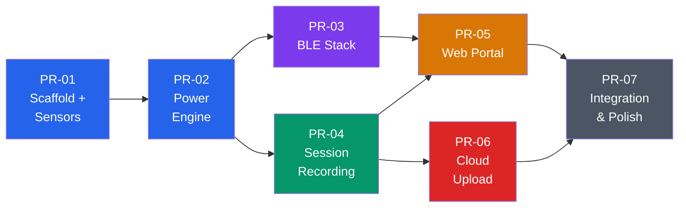

# Echenon Firmware — Programme Plan

> Detailed PR dependency graph, scope boundaries, and architectural rationale.
> Each PR is one atomic, reviewable, mergeable unit following the Torvalds Standard.

---

## Dependency Graph



### Parallelism Opportunities
- **PR-03 (BLE) ∥ PR-04 (Session):** Both depend only on PR-02. No file overlap
  (BLE touches FTMS/HRM files; Session touches SessionManager/RideStore/TCX).
  **Can be run in parallel** once PR-02 merges.
- **PR-05 (Web) waits on both** PR-03 and PR-04 because the overlay displays
  live data from both the BLE layer and the session engine.
- **PR-06 (Upload) ∥ PR-05 (Web):** Upload depends on PR-04 (needs TCX files)
  but not PR-03 or PR-05. **Can be run in parallel** with PR-05.

### Critical Path
```
PR-01 → PR-02 → PR-04 → PR-05 → PR-07
                    ↘ PR-06 ↗
```
PR-03 (BLE) is off the critical path — it can slip without delaying PR-07.

---

## PR-01: Project Scaffold + Sensor Acquisition

**Base:** `main`
**Scope:** PlatformIO project setup, board configuration, `EchenonModule` skeleton,
`CadenceSensor` (ISR + RPM), `ResistanceADC` (ADC + EMA + level mapping).

**Deliverable:** A firmware that boots, reads the cadence reed switch and
resistance potentiometer, and logs clean RPM + resistance level to serial.

**Spec sections:** §3.5, §4.3–4.7, §5.1–5.2, §12.1–12.3

**Files created:**
- `platformio.ini`, `hardware/echenon/board.h`, `partitions.csv`, `sdkconfig.defaults`
- `src/main.cpp`, `src/echenon/Config.h`
- `src/echenon/EchenonModule.h/.cpp` (skeleton)
- `src/echenon/CadenceSensor.h/.cpp`
- `src/echenon/ResistanceADC.h/.cpp`
- `SPEC.md` (copied into project root from artifacts), `README.md`

**Verification:** `pio run -e echenon` compiles clean. Serial output logs RPM
and resistance level.

**Prior art:** `archive-pa-decomposition/wo1-scaffold/WORKORDER.md`,
`archive-pa-decomposition/wo2-sensors/WORKORDER.md`

---

## PR-02: Power Calculation Engine

**Base:** PR-01
**Scope:** `PowerEngine` with 3-tier calibration (physics polynomial, community
power matrix with bilinear interpolation, reference power meter coefficients).
`PowerMatrix.h` with placeholder table.

**Deliverable:** Firmware now calculates and logs instantaneous watts from
resistance + cadence inputs.

**Spec sections:** §6.1–6.4

**Files created:**
- `src/echenon/PowerEngine.h/.cpp`
- `src/echenon/PowerMatrix.h`

**Files modified:**
- `src/echenon/EchenonModule.h/.cpp` (add PowerEngine, wire tick)

**Verification:** `pio run -e echenon` compiles clean. `calculate(16, 80)` ≈ 150W
with Tier 1 defaults.

**Prior art:** `archive-pa-decomposition/wo3-power/WORKORDER.md`

---

## PR-03: BLE Stack (FTMS Server + HRM Relay)

**Base:** PR-02
**Scope:** NimBLE integration via Foundation BLEManager ([RFC #225 v2](https://github.com/matthewmcneill/esp32-app-foundation/issues/225)).
Three provider modules using the RFC v2 contract:
- `FTMSServer` (`IBLEServiceProvider` + `ITickable`): `registerServices()`,
  `contributeAdvertising()`, `onSubscriptionChanged()`, `onStackPaused()`
- `HRMClient` (`IBLEClientProvider`, declarative): `getTargetServiceUUIDs()`,
  `getSubscriptions()`, `onNotification()` — no raw NimBLE types
- `HRMRepeater` (`IBLEServiceProvider`): static HR service, `publishHr()`

**Deliverable:** Device advertises as `"Echenon-XXXX"` (BT MAC suffix) with FTMS
+ HR services. Fitness apps pair and see live power/cadence/HR. HR relay from
Beat armband with <50ms latency (p99). Opportunistic bonding.

**Spec sections:** §7.1–7.7, §8.1–8.5

**Files created:**
- `src/echenon/FTMSServer.h/.cpp`
- `src/echenon/HRMClient.h/.cpp`
- `src/echenon/HRMRepeater.h/.cpp`

**Files modified:**
- `platformio.ini` (add NimBLE dependency + BLE env mix-in + `WITH_BLE`)
- `src/echenon/EchenonModule.h/.cpp` (register BLE providers, wire updates)
- `src/main.cpp` (`#ifdef WITH_BLE` registration block)

**Verification:** `pio run -e echenon` compiles clean. GATT service structure
matches Bluetooth SIG FTMS v1.0. `contributeAdvertising()` produces ≤29 bytes.

**Prior art:** `archive-pa-decomposition/wo4-ftms/WORKORDER.md`,
`archive-pa-decomposition/wo5-hrm/WORKORDER.md`

**Note:** This PR depends on Foundation BLEManager (RFC #225 v2). If BLEManager is
not yet merged upstream, the PA must implement against the RFC'd interface
contract and stub the registration calls.

---

## PR-04: Session Recording

**Base:** PR-02
**Scope:** `SessionManager` (auto/manual lifecycle state machine), `RideStore`
(PSRAM ring buffer), `TCXGenerator` (streaming 1 Hz XML output to LittleFS).

**Deliverable:** Rides are automatically detected, data points buffered at 2 Hz
in PSRAM, and TCX files written to flash on session end.

**Spec sections:** §9.1–9.6

**Files created:**
- `src/echenon/SessionManager.h/.cpp`
- `src/echenon/RideStore.h/.cpp`
- `src/echenon/TCXGenerator.h/.cpp`

**Files modified:**
- `src/echenon/EchenonModule.h/.cpp` (add SessionManager, wire tick + EventBus)

**Verification:** `pio run -e echenon` compiles clean. TCX output is valid XML
per Garmin TCX schema.

**Prior art:** `archive-pa-decomposition/wo6-session/WORKORDER.md`

---

## PR-05: Web Portal (Overlay + Calibration + Session History)

**Base:** PR-03 + PR-04 (merge both before starting)
**Scope:** `SessionOverlay` (standalone `/overlay` page with WebSocket 2 Hz
push), calibration portal tab (potentiometer wizard, power tier selector,
community matrix dropdown, CSV upload), session history portal tab. All assets
via the gzip+PROGMEM pipeline.

**Deliverable:** Full web UI — the overlay shows live training data in a floating
window, and the portal has Calibration and Session tabs.

**Spec sections:** §6.3 (calibration UI), §11.1–11.4

**Files created:**
- `src/echenon/SessionOverlay.h/.cpp`
- `src/echenon/Calibration.h/.cpp`
- `web/overlay.html`, `web/overlay.js`, `web/overlay.css`
- `web/session.js`, `web/calibration.js`

**Files modified:**
- `src/echenon/EchenonModule.h/.cpp` (register IWebContributors)

**Verification:** `pio run -e echenon` compiles clean. `portalBuilder.py` generates
`include/portal_assets/*.hpp` headers. WebSocket endpoint registered.

**Prior art:** `archive-pa-decomposition/wo7-overlay/WORKORDER.md`,
`archive-pa-decomposition/wo9-calibration-portal/WORKORDER.md`

---

## PR-06: Cloud Upload (Strava)

**Base:** PR-04
**Scope:** `IUploader` interface, `StravaUploader` (OAuth 2.0, IDataSource
pipeline via DataManager, offline resilience), `UploadManager` (uploader
registry + portal tab), upload settings portal tab.

**Deliverable:** Post-ride TCX files are automatically uploaded to Strava.
OAuth flow works from the portal. Failed uploads are queued and retried.

**Spec sections:** §10.1–10.6

**Files created:**
- `src/echenon/IUploader.h`
- `src/echenon/StravaUploader.h/.cpp`
- `src/echenon/UploadManager.h/.cpp`
- `web/upload_settings.js`

**Files modified:**
- `src/echenon/EchenonModule.h/.cpp` (register IDataSource, IWebContributor)

**Verification:** `pio run -e echenon` compiles clean. OAuth endpoints registered.
IDataSource health state machine wired correctly.

**Prior art:** `archive-pa-decomposition/wo8-strava/WORKORDER.md`

---

## PR-07: Integration & Polish

**Base:** PR-05 + PR-06 (merge both before starting)
**Scope:** Final `EchenonModule` wiring of all 11 sub-components, coupling audit
(Service Module Pattern), ADR compliance verification (ADR-16, ADR-17, ADR-39),
Redactor secret registration, tick budget profiling, DRAM usage validation,
README, known limitations, and build sign-off.

**Deliverable:** Release-candidate firmware. Full README with build/flash/setup
instructions. All framework compliance checks pass.

**Spec sections:** §3.4 (coupling audit), §3.5 (Foundation integration), §13

**Files modified:**
- `src/echenon/EchenonModule.h/.cpp` (final composition)
- `README.md` (comprehensive)

**Verification:** `pio run -e echenon` compiles with zero errors and zero warnings.
Tick budget <10ms. Free DRAM >40KB. Coupling audit table passes.

**Prior art:** `archive-pa-decomposition/wo10-integration/WORKORDER.md`

---

## Execution Strategy

### Phase 1 — Foundation (serial)
PR-01 → PR-02. Must be serial: PR-02 depends on sensor output types from PR-01.

### Phase 2 — Core features (parallel opportunity)
PR-03 (BLE) and PR-04 (Session) can run **in parallel** — they share no files
except `EchenonModule`, and their additions to `EchenonModule` are independent
member variables and tick calls. The PA for each PR must add its components to
`EchenonModule` without touching the other's additions.

### Phase 3 — User-facing (parallel opportunity)
PR-05 (Web) and PR-06 (Upload) can run **in parallel** once their dependencies
are met. PR-05 needs both PR-03 + PR-04; PR-06 needs only PR-04.

### Phase 4 — Polish (serial)
PR-07 runs last after all feature PRs are merged. Single PA, single pass.
