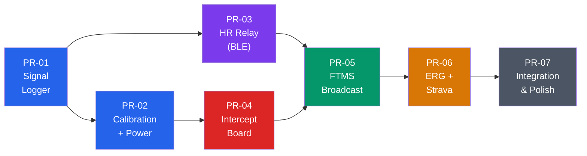

# Echenon Firmware — Programme Plan

> Detailed PR dependency graph, scope boundaries, and architectural rationale.
> Each PR is one atomic, reviewable, mergeable unit following the Torvalds Standard.
>
> **Aligned to:** [`docs/implementation-strategy.md`](../../../../docs/implementation-strategy.md)
> — the iterative hardware+software co-development roadmap.

---

## Design Philosophy

The firmware is developed iteratively alongside the hardware. Each PR
corresponds to a development phase from the implementation strategy. Earlier
phases require minimal hardware (fly wires + ESP32), proving assumptions
before later phases commit to the full intercept board.

**Key principle:** No PR assumes hardware that hasn't been validated by a
preceding PR's test plan. The programme is structured so that hardware risk is
compressed into a single PR (PR-03), with everything before it being read-only
or BLE-only, and everything after it being software-only.

---

## Dependency Graph



### Parallelism Opportunities

- **PR-02 (Calibration) ∥ PR-03 (HR Relay):** Both depend only on PR-01.
  No file overlap (PR-02 touches sensor/power files; PR-03 touches BLE files).
  **Can be run in parallel** once PR-01 merges.
- **All other PRs are serial** — each validates assumptions needed by the next.

### Critical Path

```
PR-01 → PR-02 → PR-04 → PR-05 → PR-06 → PR-07
                    ↗
PR-01 → PR-03 (HR) ↗
```

PR-03 (HR Relay) is off the critical path — it can run in parallel with PR-02
and must complete before PR-05 starts.

### Phase-to-PR Mapping

| Dev Phase | PR | Hardware Required |
|---|---|---|
| Phase 0: Observe | PR-01 | Fly wires + ESP32 (no intercept board) |
| Phase 1: Calibrate | PR-02 | Same fly wires |
| Phase 2: HR Relay | PR-03 | Same (BLE only, no bike signals needed) |
| Phase 3: Intercept | PR-04 | **Intercept board** (first hardware build) |
| Phase 4: FTMS | PR-05 | Same intercept board |
| Phase 5: ERG+Strava | PR-06 | Same intercept board |
| Phase 6: Polish | PR-07 | Same intercept board |

---

## PR-01: Signal Logger (Phase 0 — Passive Observation)

**Base:** `main`
**Scope:** PlatformIO project setup, board configuration, `EchenonModule`
skeleton, `SignalLogger` (all 12 wire taps: cadence, pot wiper, pot outers,
motor sense ×2, cadence return, encoder Ch A/B, encoder VCC), `WebServer`
(live dashboard), CSV `DataExport`.

**Hardware:** Fly wires from existing loom to ESP32. Motor sense pins via
30kΩ/10kΩ voltage dividers. No wires cut, no intercept board.

**Deliverable:** A firmware that boots, connects to WiFi, reads all bike
signals at high frequency, displays them live in a browser dashboard, and
exports ride data as CSV.

**GATE:** Before connecting motor sense wires, the oscilloscope motor voltage
verification must confirm 3.3V DC (not 9V PWM). See
[`docs/implementation-strategy.md`](../../../../docs/implementation-strategy.md)
Phase 0 Pre-Gate.

**Spec sections:** §3.5, §4.3–4.8, §12.1–12.3

**Files created:**
- `platformio.ini` (with `[env:ex3-waveshare-nano]`), `sdkconfig.defaults`
- `hardware/ex3-waveshare-nano/config.h` (pin map, bike characteristics, module flags)
- `hardware/ex3-waveshare-nano/partitions.csv` (flash partition table)
- `hardware/ex3-waveshare-nano/sdkconfig.defaults` (SDK config overrides)
- `src/main.cpp`, `src/echenon/Config.h`
- `src/echenon/EchenonModule.h/.cpp` (skeleton)
- `src/echenon/SignalLogger.h/.cpp`
- `web/dashboard.html`, `web/dashboard.js` (raw signal display)
- `README.md`

**Verification:** `pio run -e ex3-waveshare-nano` compiles clean. Serial output logs all
signals. Browser dashboard shows live data. CSV export of a full ride works.
Cadence matches manual pedal count ±1 RPM. Pot voltage range documented.
Motor drive behaviour documented (timing, polarity, duration, voltage confirmed
by oscilloscope).

**Prior art:** `archive-pa-decomposition/wo1-scaffold/WORKORDER.md`,
`archive-pa-decomposition/wo2-sensors/WORKORDER.md`

---

## PR-02: Calibration + Power Engine (Phase 1 — Calibrate)

**Base:** PR-01
**Scope:** `CadenceSensor` (production RPM from ISR intervals with timeout
and filtering), `ResistanceSensor` (ADC → resistance level mapping with NVS
calibration), `PowerEngine` (3-tier: physics polynomial, community matrix,
reference meter coefficients), `CalibrationWizard` (portal page: guided
min/max pot calibration).

**Hardware:** Same fly wires as PR-01. No changes.

**Deliverable:** Firmware converts raw signals into meaningful metrics.
Calibration wizard guides user through pot min/max. Power is calculated from
cadence × resistance. Side-by-side comparison with Echelon app validates
accuracy.

**Spec sections:** §5.1–5.2, §6.1–6.4

**Files created:**
- `src/echenon/CadenceSensor.h/.cpp`
- `src/echenon/ResistanceSensor.h/.cpp`
- `src/echenon/PowerEngine.h/.cpp`
- `src/echenon/PowerMatrix.h`
- `web/calibration.js`

**Files modified:**
- `src/echenon/EchenonModule.h/.cpp` (add sensor + power modules, wire tick)

**Verification:** `pio run -e ex3-waveshare-nano` compiles clean. Cadence matches Echelon
app ±1 RPM. Resistance levels match Echelon app's 1–32 display. Power within
±15% of Echelon's displayed power. Calibration survives power cycle.

**Prior art:** `archive-pa-decomposition/wo2-sensors/WORKORDER.md`,
`archive-pa-decomposition/wo3-power/WORKORDER.md`

---

## PR-03: HR Armband Relay (Phase 2 — BLE Foundation)

**Base:** PR-01
**Scope:** NimBLE integration via Foundation BLEManager (RFC #225 v2).
Three modules:
- `BLEManager` integration: NimBLE stack init, advertising, connection mgmt
- `HRMClient` (`IBLEClientProvider`): scan, connect, subscribe to HR armband
- `HRMRepeater` (`IBLEServiceProvider`): re-broadcast HR as `0x180D`
- Portal BLE page: scan, select, pair HR armband

**Hardware:** Same fly wires (or no wires at all — HR relay is purely BLE).
Can be developed and tested independently of any bike hardware.

**Deliverable:** HR armband pairs via portal. Echelon app sees `"Echenon"` as
HR device and displays live heart rate. BLE + WiFi coexist. First user-facing
feature with zero bike risk.

**Spec sections:** §8.1–8.5

**Files created:**
- `src/echenon/HRMClient.h/.cpp`
- `src/echenon/HRMRepeater.h/.cpp`
- `web/ble_settings.js`

**Files modified:**
- `platformio.ini` (add NimBLE dependency + BLE env mix-in + `WITH_BLE`)
- `src/echenon/EchenonModule.h/.cpp` (register BLE providers)
- `src/main.cpp` (`#ifdef WITH_BLE` registration block)

**Verification:** `pio run -e ex3-waveshare-nano` compiles clean. HR armband pairs.
Echelon app shows HR. BLE + WiFi coexist. Armband auto-reconnects after
power cycle. No interference with factory Echelon PCB BLE.

**Prior art:** `archive-pa-decomposition/wo5-hrm/WORKORDER.md`

**Note:** This PR depends on Foundation BLEManager (RFC #225 v2). If not yet
merged upstream, implement against the RFC interface contract and stub calls.

---

## PR-04: Intercept Board + Motor Control (Phase 3 — MITM)

**Base:** PR-02
**Scope:** Hardware build + motor control firmware. This is the highest-risk
PR — it's where we physically modify signal paths and drive a motor.

Sub-phases:
- **Phase 3a (Intercept):** `InterceptController` reads console motor sense
  (GPIO 10/11) and relays to L9110S (GPIO 6/7). Transparent pass-through.
- **Phase 3b (Override):** `ResistanceEncoder` reads quadrature knob.
  `ResistanceMotor` drives L9110S with bang-bang position controller using
  pot ADC feedback. `ConfigManager` handles mode switching + NVS persistence.

**Hardware:** Build the intercept board per
[`docs/hardware_specification.md`](../../../../docs/hardware_specification.md):
perfboard with ESP32 carrier, L9110S, MP1584EN, JST connectors, R1–R5, C1–C2.
Split the motor wires (the MITM). Install between bike frame and console.

**Deliverable:** Intercept Mode: bike works identically to stock. Override
Mode: 100-level resistance control via encoder knob, faster and more precise
than stock console.

**Spec sections:** §4.5–4.7, §5.3–5.6

**Files created:**
- `src/echenon/InterceptController.h/.cpp`
- `src/echenon/ResistanceMotor.h/.cpp`
- `src/echenon/ResistanceEncoder.h/.cpp`
- `src/echenon/ConfigManager.h/.cpp`

**Files modified:**
- `src/echenon/EchenonModule.h/.cpp` (add motor/encoder/intercept modules)
- `src/echenon/ResistanceSensor.h/.cpp` (integrate with motor feedback loop)

**Verification:** Phase 3a: Full Echelon class with intercept board — no
perceptible difference. Phase 3b: Encoder-to-motor closed loop across full
range. 100 levels achievable. Motor dead zone tuned. Board fits in housing.

---

## PR-05: FTMS Broadcast (Phase 4 — App Visibility)

**Base:** PR-03 + PR-04 (merge both before starting)
**Scope:** `FTMSServer` (FTMS GATT service, Indoor Bike Data notifications
at 2 Hz, Feature flags, Control Point characteristic). Adds FTMS to the
existing BLE stack from PR-03.

**Hardware:** Same intercept board from PR-04. No changes.

**Deliverable:** `"Echenon"` appears in Zwift, Xert, TrainerRoad, and any
FTMS-compatible app with live power, cadence, resistance, and HR data.
Control Point present but rejects writes with `0x05` in Intercept Mode.

**Spec sections:** §7.1–7.7

**Files created:**
- `src/echenon/FTMSServer.h/.cpp`

**Files modified:**
- `src/echenon/EchenonModule.h/.cpp` (register FTMS provider)

**Verification:** `pio run -e ex3-waveshare-nano` compiles clean. Zwift displays live
power/cadence. Three simultaneous BLE connections (Echelon tablet HR + fitness
app FTMS + armband Central). GATT structure matches FTMS v1.0.

**Prior art:** `archive-pa-decomposition/wo4-ftms/WORKORDER.md`

---

## PR-06: ERG Mode + Cloud Upload (Phase 5 — Close the Loop)

**Base:** PR-05
**Scope:** `ERGController` (FTMS Control Point → power table lookup → target
resistance level), `FTMSControlPoint` (mode-aware response codes: `0x01` in
Override, `0x05` in Intercept), `SessionManager` (auto-start/stop based on
cadence), `RideStore` (PSRAM ring buffer), `TCXGenerator` (1 Hz XML to
LittleFS), `StravaUploader` (OAuth 2.0, offline queue), `UploadManager`.

**Hardware:** Same intercept board. No changes.

**Deliverable:** ERG mode works — apps command power targets, resistance
adjusts automatically. Rides auto-record and upload to Strava. Manual encoder
override cancels ERG instantly.

**Spec sections:** §5.6 (ERG), §7.4 (Control Point), §9.1–9.6, §10.1–10.6

**Files created:**
- `src/echenon/ERGController.h/.cpp`
- `src/echenon/SessionManager.h/.cpp`
- `src/echenon/RideStore.h/.cpp`
- `src/echenon/TCXGenerator.h/.cpp`
- `src/echenon/IUploader.h`
- `src/echenon/StravaUploader.h/.cpp`
- `src/echenon/UploadManager.h/.cpp`
- `web/upload_settings.js`, `web/session.js`

**Files modified:**
- `src/echenon/EchenonModule.h/.cpp` (add ERG, session, upload modules)
- `src/echenon/FTMSServer.h/.cpp` (wire Control Point to ERGController)

**Verification:** 200W ERG target stabilises ±10W. Encoder cancels ERG.
Auto-session records and uploads to Strava. TCX valid per Garmin schema.

**Prior art:** `archive-pa-decomposition/wo6-session/WORKORDER.md`,
`archive-pa-decomposition/wo8-strava/WORKORDER.md`

---

## PR-07: Integration, Portal & Polish (Phase 6 — Use Case Validation)

**Base:** PR-06
**Scope:** `SessionOverlay` (standalone `/overlay` page with WebSocket push),
full calibration portal, session history tab, OTA firmware update, final
`EchenonModule` wiring, coupling audit, ADR compliance, README, all 6 use
cases validated end-to-end per
[`docs/use_case_analysis.md`](../../../../docs/use_case_analysis.md).

**Hardware:** Same intercept board. Also test standalone mode (console
disconnected) to validate R3/R4/R5 sensor power.

**Deliverable:** Release-candidate firmware. All 6 use cases pass. OTA works.
Portal polished. Full README.

**Spec sections:** §11.1–11.4, §13, Appendix A

**Files created:**
- `src/echenon/SessionOverlay.h/.cpp`
- `src/echenon/Calibration.h/.cpp`
- `web/overlay.html`, `web/overlay.js`, `web/overlay.css`

**Files modified:**
- `src/echenon/EchenonModule.h/.cpp` (final composition)
- `README.md` (comprehensive)

**Verification:** `pio run -e echenon` zero errors, zero warnings.
Tick budget <10ms. Free DRAM >40KB. All 6 use cases validated (UC1–UC6).
Coupling audit passes. OTA update works.

**Prior art:** `archive-pa-decomposition/wo7-overlay/WORKORDER.md`,
`archive-pa-decomposition/wo9-calibration-portal/WORKORDER.md`,
`archive-pa-decomposition/wo10-integration/WORKORDER.md`

---

## Execution Strategy

### Phase 1 — Foundation (serial)
PR-01. Must complete before anything else — establishes project scaffold,
board config, and proves all signals can be read.

### Phase 2 — Calibration + HR (parallel opportunity)
PR-02 (Calibration) and PR-03 (HR Relay) can run **in parallel** — they share
no files except `EchenonModule`, and their additions are independent. PR-02
needs the bike; PR-03 needs only the ESP32 + an HR armband.

### Phase 3 — Motor Interception (serial, highest risk)
PR-04 is the critical hardware phase. Must be serial — it requires validated
sensor readings from PR-02 and builds the physical intercept board.

### Phase 4 — FTMS (serial)
PR-05 merges the BLE stack (from PR-03) with the intercept board (from PR-04)
and adds FTMS. Must wait for both.

### Phase 5 — ERG + Cloud (serial)
PR-06 builds on the FTMS layer from PR-05.

### Phase 6 — Polish (serial)
PR-07 runs last. Full integration, all use cases, release candidate.

---

## Changes from Previous Programme Plan

> The original plan (archived in `archive-pa-decomposition/`) was designed as
> a big-bang build assuming the hardware design was finalised. The new plan
> adopts an iterative strategy where each PR validates hardware assumptions
> before the next PR adds complexity.

| Change | Old Plan | New Plan | Rationale |
|---|---|---|---|
| **PR-01 scope** | All sensors at once | Signal logger only (raw observation) | Prove signals before processing them |
| **Power calculation** | PR-02 standalone | PR-02 includes calibration wizard | Validate against Echelon app before building further |
| **HR relay** | Bundled in PR-03 with FTMS | Separate PR-03 (HR only) | First user-facing feature, zero bike risk, proves BLE stack |
| **Motor control** | Part of PR-01 scaffold | Dedicated PR-04 | Highest-risk work isolated into one PR after signals validated |
| **FTMS** | PR-03 (BLE + HR + FTMS) | PR-05 (FTMS only, HR already done) | BLE proven incrementally, not all at once |
| **Session + Upload** | Separate PRs (04 + 06) | Combined PR-06 | Session recording and upload are tightly coupled |
| **PR count** | 7 PRs | 7 PRs | Same count, different scope boundaries |
| **Hardware dependency** | All PRs assume intercept board | PR-01/02/03 need only fly wires or ESP32 alone | Validate before committing to the hardware build |
