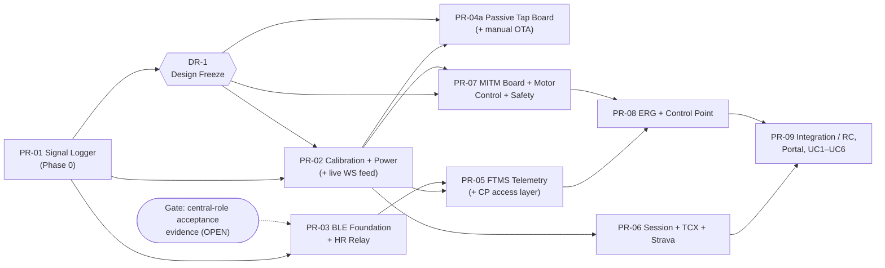

# Echenon Firmware — Programme Plan

> Detailed PR dependency graph, scope boundaries, and architectural rationale.
> Each PR is one atomic, reviewable, mergeable unit following the Torvalds Standard.
>
> **Programme status:** [`PROGRAM.md`](PROGRAM.md)
> **Specification:** [`SPEC.md`](../../../SPEC.md)
> **Rationale:** [`docs/implementation-strategy.md`](../../../docs/implementation-strategy.md)
> — the iterative hardware+software co-development strategy. **The phase and PR
> numbering in this plan is canonical.**
> **Phase 0 register:** [`docs/measurements/phase0/README.md`](../../../docs/measurements/phase0/README.md)
> **Reviews:** [2026-09-23 design audit](reviews/2026-09-23-chief-architect-audit.md) ·
> [2026-09-25 readiness review](reviews/2026-09-25-readiness-review.md) ·
> [DR-1 decision record](reviews/DR-1-design-freeze.md)

---

## Design Philosophy

The firmware is developed iteratively alongside the hardware. Each PR corresponds
to a development phase. Earlier phases need minimal hardware (a Y-harness with
series-resistor taps and a USB-powered ESP32), proving assumptions before later
phases commit to a board.

The product is **passive-first**. The default permanent install is the passive
tap board (PR-04a), which delivers UC1–UC3. The MITM intercept board (PR-07) is
optional and adds Override and ERG.

**Key principle:** No PR assumes hardware that a preceding PR has not validated.
Hardware risk is concentrated in PR-07; everything before it is passive, BLE-only
or non-destructive. Nothing is soldered or permanently installed before DR-1.

---

## Dependency Graph

PR-03 has an external entry gate (framework central-role acceptance) as well as the
Echelon-app HR spike. PR-06 has **no** PR-03 edge: its `ScanInhibit` use is compiled
under `#ifdef WITH_BLE`. PR-05 has **no** PR-04a edge: the fly-wire rig is enough.

### Parallelism Opportunities

- **DR-1 ∥ PR-03:** Once PR-01 merges, the HR relay (BLE only, no bike signals) can
  proceed while the Chief Architect runs DR-1, subject to PR-03's entry gates.
- **PR-02 ∥ PR-03:** PR-02 starts after DR-1. Both touch `EchenonModule.*`,
  `platformio.ini` and `main.cpp`. **The PR that merges second rebases onto `main`
  and resolves the conflict.**
- **PR-04a ∥ PR-05 ∥ PR-06:** All can run in parallel once their own dependencies
  merge (PR-04a: PR-02 + DR-1; PR-05: PR-02 + PR-03; PR-06: PR-02).
- **PR-07** can run in parallel with PR-04a, PR-05 and PR-06 once PR-02 and DR-1 are done.

### Critical Path

- **Passive value (UC1–UC3):** PR-01 → DR-1 → PR-02 → PR-04a (with PR-06 for
  session upload, and PR-03 → PR-05 for HR and FTMS).
- **Full ERG value (UC4–UC6):** PR-01 → DR-1 → PR-02 → PR-07 → PR-08 → PR-09. PR-05
  (via PR-03 and its OPEN central-acceptance gate) joins at PR-08 and can become
  critical if the framework gate stays open.

### Candidate Restructure (decided at DR-1 §2.10)

PR-01 bench evidence makes an **encoder-only MITM** viable.
- **What it is:** the board intercepts only the 3-pin knob loom (J3/J4). PCNT
  decodes the knob, and the ESP32 resynthesises clean quadrature to the console.
  A normally-closed bypass keeps the knob working if the ESP32 is unpowered.
- **What it fixes:** the stock console misses 28% of clicks (B02).
- **What else it enables:** the console can be driven by **injecting clicks**
  (audit H-05 option c). That gives 32-level ERG without splitting the motor
  wires.

If DR-1 adopts it, the expected shape is:

| Change | Detail |
|---|---|
| PR-04a | Passive tap board **+ J3/J4 encoder intercept with NC bypass** |
| New PR (Phase 3) | **Encoder relay**: PCNT ingest, quadrature resynthesis, clean-click, intercept-mode switch, fail-safe tests |
| PR-08 | ERG via encoder injection first (Intercept Mode, console drives the motor); FTMS target-power → level → click sequence |
| PR-07 | Motor MITM / console-as-signal-source (ESP32 PID) becomes the high-fidelity or Override path: v1.1 or after PR-08 |

**Not adopted until DR-1 approves it.** Prerequisites (PR-01 WO5):
- the safe console fault-tolerance tests (design notes §12 #1, #2, #3, #7, #9);
- the minimum quadrature pulse width the console accepts;
- the console's behaviour when clicks arrive during a motor seek.

### Phase-to-PR Mapping

| Dev Phase | PR | Hardware Required |
|---|---|---|
| Phase 0: Observe | PR-01 | Y / back-probe harness with series-resistor taps, USB-C powered ESP32 (no board) |
| — Design Freeze | DR-1 | None (decision review) |
| Phase 1: Calibrate | PR-02 | Same rig as PR-01 |
| Phase 2: HR relay | PR-03 | None from the bike (ESP32 + HR armband + P12) |
| Phase 3: Passive tap board | PR-04a | **Passive tap board** (permanent install, first use of the buck) |
| Phase 3: FTMS telemetry | PR-05 | No new hardware (PR-01 rig or PR-04a board) |
| Phase 4: Session + TCX + Strava | PR-06 | No new hardware |
| Phase 5: MITM board + motor control + safety | PR-07 | **Intercept board** (motor split, fail-safe) |
| Phase 6: ERG + Control Point | PR-08 | Intercept board |
| Phase 7: Integration / RC | PR-09 | Passive tap board and intercept board configurations |

---

## DR-1: Design Freeze Review (Milestone)

**Record:** [`reviews/DR-1-design-freeze.md`](reviews/DR-1-design-freeze.md)
**Inputs:** The Phase 0 register, with every row's Evidence file and Result.
**Decisions:** Sense network (H-01), switchable supplies (H-02), motor driver and
rail (D3), fail-safe (H-05), cam-aware controller (S-01, M-02, M-01), power model
(S-02), Phase 3 pin map, passive tap board design, R3/R4/R5.
**Outputs:** Revised SPEC §4–§6 (including the §4.4.2 Phase 3+ pin map) and
hardware specification §3 and §7–§8, plus the finalised passive-tap-board
section (hardware specification §6.2, a placeholder until DR-1).
**Rule:** No soldering or permanent installation occurs until the Chief Architect
approves DR-1. DR-1 also gates PR-02.

---

## PR-01: Signal Logger (Phase 0 — Observe)

**Base:** `main`
**Scope:**
- Project scaffold: `platformio.ini` following `framework/template-app/platformio.ini`
  (env `ex3-waveshare-nano`), `hardware/ex3-waveshare-nano/` (`board.h` from
  `board_contract.h` + `_TEMPLATE`, `partitions.csv`, `sdkconfig.defaults`),
  `EchenonModule` skeleton. No `WITH_DISPLAY_U8G2` or `WITH_BUTTONS` (GPIO 8/9/10
  are taps).
- WO1 bumps the framework submodule to `v0.0.12-dev.82` with BLE off (#236 fix).
- `SignalLogger` on the SPEC §4.4.1 pin map: **10 tap signals** on GPIO 1–10 (all
  ADC1), ADC-continuous DMA, two modes (ride log; triggered burst). WO0 is a spike.
- Live dashboard, CSV export, `echenon.local` check on the P12 with an IP fallback.
**Hardware:** Y / back-probe harness, 22 kΩ series resistors on direct taps, no
internal pulls, USB-C power with GND tied to Brown. Nothing cut.
**Gates:** Bench-ready entry condition; scope characterisation of the motor wires.
**Exit:** Every row of the Phase 0 register has an Evidence file and a Result.
Hardware and bench WOs are `complexity: interactive`.
**Mandate:** [pr-01-signal-logger/PROJECT.md](pr-01-signal-logger/PROJECT.md)
**Update 2026-10-04** ([progress review](reviews/2026-10-04-pr01-progress-review.md)):
- GPIO 8/9 now feed `EncoderModule` (PCNT), leaving 8 ADC channels (owner decision).
- Cadence tap is 4.7 kΩ + 100 nF.
- WO4d (logger fixes L-01 to L-05, L-07) must land before WO5.
- WO5 adds the tap cross-check (E-02), the row #6 load test, and the safe console fault-tolerance tests.
- WO7 doc-sync records the measured pot polarity (E-01) and marks A08 as superseded.
- After PR-01, `SignalLogger` builds only under `WITH_SIGNAL_LOGGER` (diagnostic builds).

---

## PR-02: Calibration + Power Engine (Phase 1 — Calibrate)

**Base:** `main` after PR-01 merged and DR-1 approved
**Scope:** `CadenceSensor`, `ResistanceSensor` (angle-based level table from DR-1),
`PowerEngine` (indexed by cam angle), `CalibrationWizard` (**passive calibration**:
the rider steps through 32 console levels while wiper and angle are logged), live WS
feed, interactive power-data WO.
**Validation:** Against the calibrated passive table, not a linear 1–32 assumption.
**Overlap:** Shares `EchenonModule.*`, `platformio.ini`, `main.cpp` with PR-03; the
second to merge rebases.
**Mandate:** [pr-02-calibration-power/PROJECT.md](pr-02-calibration-power/PROJECT.md)

---

## PR-03: HR Armband Relay (Phase 2 — HR relay)

**Base:** `main` after PR-01 merged
**Entry gates:** Echelon-app HR spike passed; **framework central-role acceptance
evidence (OPEN)**.
**Scope:** BLE on (`[ble]` mix-in declared locally, `sdkconfig.ble.defaults`),
`BLEManager` composition, `HRMClient` (publishes on the EventBus), `HRMRepeater`,
portal BLE page. Target sdkconfig `CONFIG_BT_NIMBLE_MAX_CONNECTIONS=4`,
`CONFIG_BT_CTRL_BLE_MAX_ACT=6` (SPEC §7.8); `slowRetryMs` = 15 s set through the
BLEManager configuration (mechanism verified in the PR). Advertises `Echenon-XXXX`.
Progressive coexistence test.
**Overlap:** See PR-02.
**Mandate:** [pr-03-hr-relay/PROJECT.md](pr-03-hr-relay/PROJECT.md)

---

## PR-04a: Passive Tap Board (Phase 3 — Passive tap board)

**Base:** `main` after PR-02 merged, DR-1 approved
**Scope:** Pass-through-only tap board for permanent installation (J1–J4
pass-through, high-impedance taps, no motor split) per the DR-1 design. **Manual OTA
enabled and tested before the board is sealed; `autoCheck` forced to `false` after
config load and after factory reset** until framework #226 lands. Enables UC1–UC3.
**Deliverable:** Stock ride indistinguishable from no board; all taps read
correctly; fits in the console housing; OTA works.
**Mandate:** [pr-04a-passive-tap/PROJECT.md](pr-04a-passive-tap/PROJECT.md)

---

## PR-05: FTMS Telemetry (Phase 3 — FTMS telemetry)

**Base:** `main` after PR-02 + PR-03 merged
**Scope:** `FTMSServer` (0x1826, Indoor Bike Data at 2 Hz, Feature bit 2,
0x2AD6/0x2AD8, mode-dependent flags). **Control Point access layer:** exposes
0x2AD9, handles 0x00 Request Control, answers target opcodes with 0x05 in Intercept
mode and 0x02 otherwise. Progressive coexistence test.
**Hardware:** None new; the fly-wire rig is sufficient.
**Mandate:** [pr-05-ftms-broadcast/PROJECT.md](pr-05-ftms-broadcast/PROJECT.md)

---

## PR-06: Session Recording + TCX + Strava Upload (Phase 4 — Session + TCX + Strava)

**Base:** `main` after PR-02 merged
**Scope:** `SessionManager`, `RideStore`, `TCXGenerator` (`tcx.gz`, 1 Hz),
`UploadQueue` (`IDataSource`, the only execution path; split pipeline, one stage per
`fetchUpdate()`), `IUploader` (capabilities only), `StravaUploader` (BYOA OAuth with
`state`, callback domain, rotated-token persistence, Redactor re-registration).
`ScanInhibit` compiled under `#ifdef WITH_BLE` — no PR-03 dependency.
`SessionOverlay` session REST API, authenticated TCX download and Session History
tab (the standalone `/overlay` page and WebSocket follow in PR-09).
**Mandate:** [pr-06-session-upload/PROJECT.md](pr-06-session-upload/PROJECT.md)

---

## PR-07: MITM Board + Motor Control + Safety (Phase 5 — MITM board + motor control + safety)

**Base:** `main` after PR-02 merged, DR-1 approved
**Scope:** Intercept board per DR-1 (fail-safe, driver and rail, switchable
R3/R4/R5). Cam-aware position controller. **Motor-driven calibration** (full-
revolution sweep finding the cam extremes). `EncoderModule` via PCNT. Motor safety
(run-time bound, reset-safe inputs, IRAM safety). OTA regression with the board fitted.
**Verification:** Override level resolution measured; 100 levels is a goal, not an
acceptance criterion.
**Mandate:** [pr-07-mitm-motor/PROJECT.md](pr-07-mitm-motor/PROJECT.md)

---

## PR-08: ERG Mode + FTMS Control Point (Phase 6 — ERG + Control Point)

**Base:** `main` after PR-05 + PR-07 merged
**Scope:** `ERGController` (ACTIVE / SUSPENDED_BY_RIDER / RELEASED), Control Point
**target opcodes**, Fitness Machine Status (0x08 Target Power Changed, 0x07 Target
Resistance Level Changed, 0xFF Control Permission Lost; SPEC §5.6), knob-override latch,
cadence smoothing, deadband and rate limit, `POST /api/resistance` (authenticated,
Override only).
**Mandate:** [pr-08-erg-control/PROJECT.md](pr-08-erg-control/PROJECT.md)

---

## PR-09: Integration, Portal & Polish (Phase 7 — Integration / RC)

**Base:** `main` after PR-06 + PR-08 merged
**Scope:** `SessionOverlay` standalone `/overlay` page and `/ws/session` WebSocket
(2 Hz), final portal polish,
**final** coexistence test, UC1–UC6 and SPEC Appendix J: User Journeys validated
against SPEC §13, coupling audit and ADR compliance.
**Deliverable:** Release-candidate firmware. 0 errors / warnings, tick budget
< 10 ms, free DRAM > 40 KB.
**Mandate:** [pr-09-integration/PROJECT.md](pr-09-integration/PROJECT.md)

---

## Execution Strategy

- **Phase 0 (PR-01):** Establish the baseline and gather evidence for DR-1.
- **DR-1:** Freeze the electrical design, controller and power model.
- **Phase 1–2 (PR-02, PR-03):** Parallel software tracks for calibration / power and BLE.
- **Phase 3 (PR-04a, PR-05):** Daily-use value unlocked; passive board installed with OTA.
- **Phase 4 (PR-06):** Cloud integration, decoupled from motor risk and from BLE.
- **Phase 5 (PR-07):** Hardware risk concentrated here; intercept board built.
- **Phase 6–7 (PR-08, PR-09):** Final feature delivery, validation and polish.

**Notes:**
- Native tests (`env:native` with googletest) are required for all pure-logic modules.
- One build environment name, `ex3-waveshare-nano`, across all PRs; the framework
  submodule lives at `framework/`.
- Every hardware, bench or tablet task is a `complexity: interactive` WO with its
  evidence committed.
- Shared-file overlaps (`EchenonModule.*`, `platformio.ini`, `main.cpp`) are resolved
  by the PR that merges second, which rebases onto `main`.
