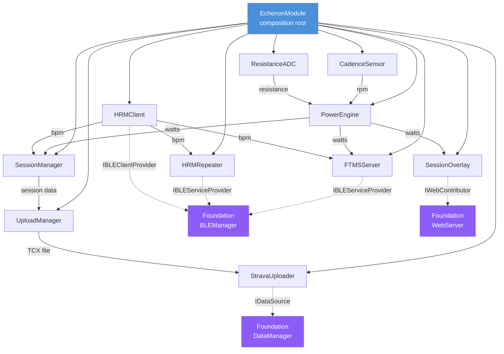

> ⚠️ **SUPERSEDED.** This work order was part of the v1/initial programme plan. The programme was restructured on 2026-09-25 per the Chief Architect Design Audit. See the current programme at `../PROGRAM.md` and `../PROGRAM-PLAN.md`.

# Echenon Firmware — Project Plan

> **Goal:** Implement the complete Echenon firmware as specified in [SPEC.md](../../../../SPEC.md)
> (currently in the Antigravity artifacts directory — to be copied into the project root).
>
> **PR target:** `main`
> **Specification:** [SPEC.md (artifact)](file:///Users/mcneillm/.gemini/antigravity/brain/c73eec9a-9856-41f9-bd09-f97217b4c7f2/SPEC.md)

---

## Architectural Overview

The firmware is a single `EchenonModule` (composition root) registered with the
ESP32 App Foundation framework. It owns 11 sub-components, each responsible for
a single concern. The Foundation provides WiFi, web portal, config, OTA, auth,
and (pending RFC #225) BLE management.

### Dependency Graph



### Work Order Sequence

The 10 Work Orders form a linear dependency chain. Each WO builds on the
previous one's output and can be verified independently at the end.

```
WO1 → WO2 → WO3 → WO4 → WO5 → WO6 → WO7 → WO8 → WO9 → WO10
 │      │      │      │      │      │      │      │      │      │
 │      │      │      │      │      │      │      │      │      └─ End-to-end integration test
 │      │      │      │      │      │      │      │      └─ Calibration portal tab
 │      │      │      │      │      │      │      └─ Strava upload pipeline
 │      │      │      │      │      │      └─ Session overlay (standalone page)
 │      │      │      │      │      └─ Session recording engine
 │      │      │      │      └─ HRM client + repeater
 │      │      │      └─ FTMS BLE server
 │      │      └─ Power calculation engine
 │      └─ Sensor acquisition (cadence + resistance)
 └─ Project scaffold + clean build
```

### Parallelism Analysis

| WOs | File Overlap | Verdict |
|---|---|---|
| WO2 + WO3 | `PowerEngine` depends on `CadenceSensor` + `ResistanceADC` output structs | ❌ Serialize |
| WO4 + WO5 | Both implement `IBLE*Provider` but touch different files | ⚠️ Parallelisable with care (shared `EchenonModule` registration) |
| WO7 + WO8 | `SessionOverlay` (web) vs `StravaUploader` (data) — no overlap | ✅ Parallelisable |

**Recommendation:** Execute serially for first build. Parallel execution possible
for WO7+WO8 once WO6 is stable.

---

## Work Order Ledger

- **[ ] [wo1-scaffold](wo1-scaffold/WORKORDER.md):** Project scaffold — PlatformIO config, board.h, main.cpp, clean build
- **[ ] [wo2-sensors](wo2-sensors/WORKORDER.md):** Sensor acquisition — CadenceSensor (ISR + RPM) and ResistanceADC (ADC + EMA + level mapping)
- **[ ] [wo3-power](wo3-power/WORKORDER.md):** Power calculation engine — polynomial model, calibration coefficients, community matrix tables
- **[ ] [wo4-ftms](wo4-ftms/WORKORDER.md):** BLE FTMS server — GATT service, Indoor Bike Data notifications, IBLEServiceProvider
- **[ ] [wo5-hrm](wo5-hrm/WORKORDER.md):** HRM client + repeater — BLE Central scan/connect, IBLEClientProvider, HR re-broadcast as IBLEServiceProvider
- **[ ] [wo6-session](wo6-session/WORKORDER.md):** Session recording — auto/manual lifecycle, RideStore ring buffer, TCX generation
- **[ ] [wo7-overlay](wo7-overlay/WORKORDER.md):** Session overlay — standalone `/overlay` page, WebSocket 2 Hz push, gzip+PROGMEM pipeline
- **[ ] [wo8-strava](wo8-strava/WORKORDER.md):** Strava upload — OAuth 2.0 flow, IDataSource pipeline, StravaUploader, upload settings portal tab
- **[ ] [wo9-calibration-portal](wo9-calibration-portal/WORKORDER.md):** Calibration portal tab — potentiometer calibration wizard, power tier selector, community matrix dropdown, CSV upload
- **[ ] [wo10-integration](wo10-integration/WORKORDER.md):** End-to-end integration — full EchenonModule wiring, desk test, coupling audit, known limitations doc

---

## Modules & Components

| Module | WO | Files | Foundation Interface |
|---|---|---|---|
| Project scaffold | WO1 | `platformio.ini`, `main.cpp`, `board.h`, `partitions.csv`, `sdkconfig.defaults`, `Config.h` | — |
| `CadenceSensor` | WO2 | `src/echenon/CadenceSensor.h/.cpp` | — |
| `ResistanceADC` | WO2 | `src/echenon/ResistanceADC.h/.cpp` | — |
| `PowerEngine` | WO3 | `src/echenon/PowerEngine.h/.cpp`, `src/echenon/PowerMatrix.h` | — |
| `FTMSServer` | WO4 | `src/echenon/FTMSServer.h/.cpp` | `IBLEServiceProvider` |
| `HRMClient` | WO5 | `src/echenon/HRMClient.h/.cpp` | `IBLEClientProvider` |
| `HRMRepeater` | WO5 | `src/echenon/HRMRepeater.h/.cpp` | `IBLEServiceProvider` |
| `SessionManager` | WO6 | `src/echenon/SessionManager.h/.cpp` | — |
| `RideStore` | WO6 | `src/echenon/RideStore.h/.cpp` | — |
| `TCXGenerator` | WO6 | `src/echenon/TCXGenerator.h/.cpp` | — |
| `SessionOverlay` | WO7 | `src/echenon/SessionOverlay.h/.cpp`, `web/overlay.html`, `web/overlay.js`, `web/overlay.css` | `IWebContributor` |
| `UploadManager` | WO8 | `src/echenon/UploadManager.h/.cpp` | `ITickable`, `IConfigurable`, `IWebContributor` |
| `StravaUploader` | WO8 | `src/echenon/StravaUploader.h/.cpp`, `src/echenon/IUploader.h` | `IUploader`, `IDataSource` |
| `Calibration` | WO9 | `src/echenon/Calibration.h/.cpp`, `web/calibration.js` | `IWebContributor` (via EchenonModule) |
| `EchenonModule` | WO10 | `src/echenon/EchenonModule.h/.cpp` (finalize) | `ITickable`, `IConfigurable`, `IWebContributor`, `IDataSource` |

---

## Session Log

### 2026-09-17 — Project Initialisation
- Created PA workspace, memory system, and 10 work order directories
- Provisioned `00-operating-model.md` rule into `.agents/rules/`
- Specification is at v5 with all framework best-practice compliance
- Foundation BLE module RFC filed as [issue #225](https://github.com/matthewmcneill/esp32-app-foundation/issues/225)
- **Awaiting user approval of decomposition** before spawning WO1

---

## Status
**Plan Status:** AWAITING APPROVAL
**User Approval:** *(pending)*
