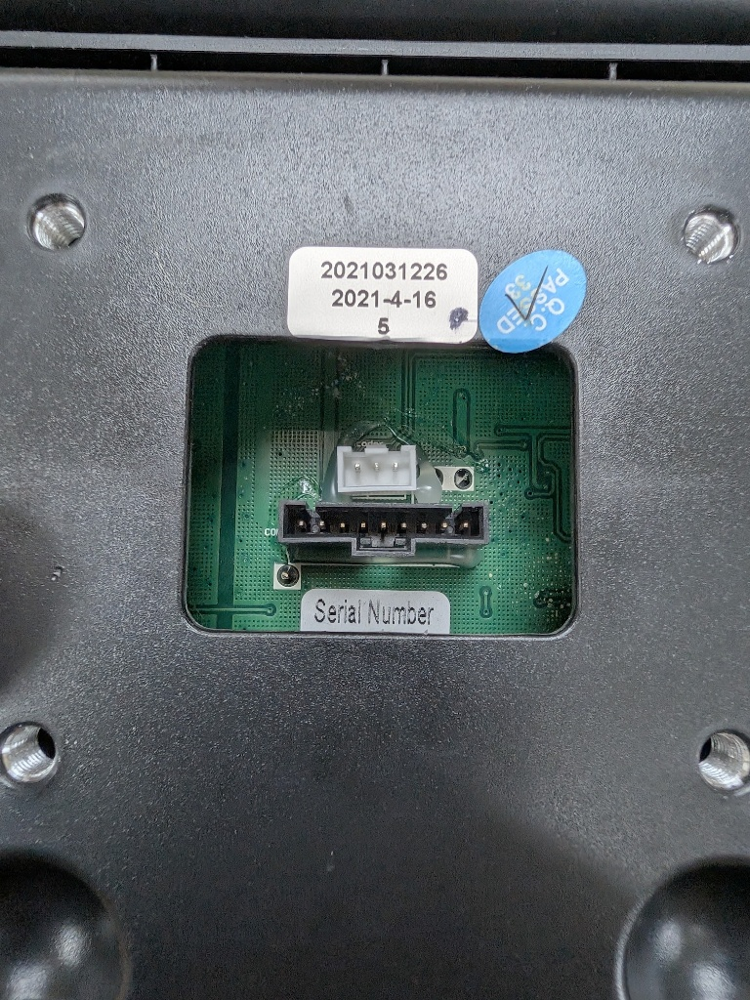
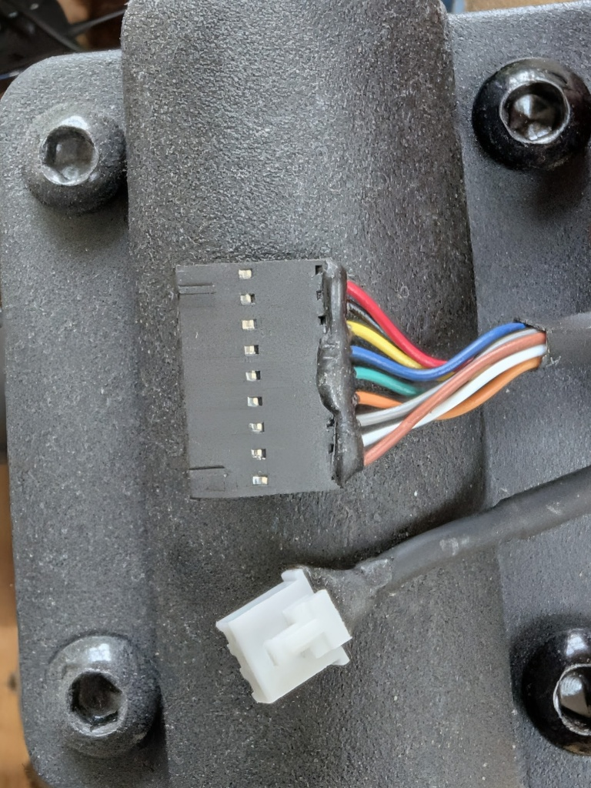
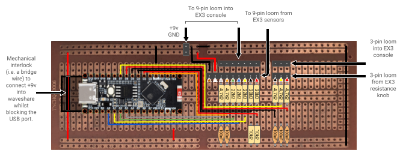
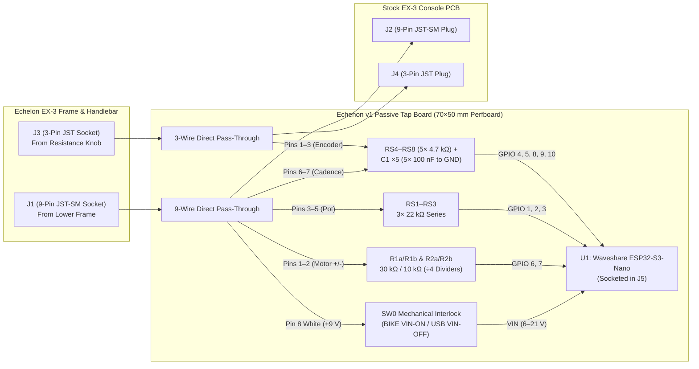

# Echenon v1 Beta Hardware Build & Commissioning Guide (`ex3-waveshare-nano`)

**Standalone construction, pre-power testing, flashing, and calibration guide for the Echenon v1 "Passive" Tap Board on the Echelon EX-3 (`v0.3.0-beta.1`).**

*For deep-dive circuit history, oscilloscope captures, and future v2 design notes, see [`hardware_specification.md`](hardware_specification.md) and [`ex3_specification.md`](ex3_specification.md). For authoritative firmware pin definitions, see [`../hardware/ex3-waveshare-nano/board.h`](../hardware/ex3-waveshare-nano/board.h).*

---

> [!CAUTION]
> ### ⚡ CRITICAL POWER INTERLOCK (`SW0`): `+9 V VIN` OR `USB-C` — NEVER BOTH SIMULTANEOUSLY
>
> The Echenon v1 Passive Tap Board powers the **Waveshare ESP32-S3-Nano** (`U1`) directly from the bike's `+9 V DC` supply line (`J1` Pin 8, White) via the board's onboard **MP2322 `VIN` (6–21 V)** switching regulator. **No external buck converter is used in v1.**
>
> We recommend you install a mechanical power interlock switch (`SW0`) in series with the `+9 V` `VIN` feed and follow this checklist so that **bike `+9 V VIN` and computer `USB-C` are NEVER connected at the same time**:
>
> #### Bench / USB-C Flashing Checklist (`VIN` OFF → `USB-C` ON)
> 1. **STOP** and verify the bike's 9 V wall adapter is unplugged **or** flip `SW0` firmly to the **USB / VIN-OFF** position (disconnecting `J1-8` `+9 V` from `U1 VIN`).
> 2. Verify with a multimeter (or mechanical switch gate) that `U1 VIN` is isolated from `J1-8`.
> 3. **Only now** plug the USB-C cable from your computer into the Waveshare ESP32-S3-Nano.
>
> #### Bike Riding / Normal Operation Checklist (`USB-C` OFF → `VIN` ON)
> 1. **Unplug the USB-C cable completely** from the Waveshare ESP32-S3-Nano (`U1`).
> 2. Verify no USB cable is attached to `U1`.
> 3. Flip `SW0` to the **BIKE / VIN-ON** position (connecting `J1-8` `+9 V` to `U1 VIN`) and plug in the bike's 9 V power adapter.

---

## 1. What This Board Does (v1 Passive Tap Architecture)

The **v1 Passive Tap Board** is a non-destructive, inline pass-through harness board that installs inside the Echelon EX-3 handlebar console housing between two factory connectors:

1. **Main 9-pin JST-SM loom (`J1` ↔ `J2`):** Passes all 9 conductors straight through between the lower bike frame and the stock console PCB while tapping high-impedance sense lines for the resistance potentiometer, cadence reed switch, and motor drive voltage.
2. **Handlebar 3-pin JST encoder loom (`J3` ↔ `J4`):** Passes all 3 rotary encoder wires straight through from the red resistance knob to the stock console PCB while tapping quadrature channels A/B (`PCNT`) and the `3.3 V` reference monitor.

### Key Architectural Properties
- **Zero factory wire cutting:** Unplugging the tap board and reconnecting the factory JST plugs restores the bike to 100% stock hardware.
- **High-impedance, zero-bias observation:** Every signal tap uses a series protection resistor (`22 kΩ` on potentiometer DC lines, `4.7 kΩ + 100 nF` low-pass filter on cadence/encoder lines, and `30 kΩ / 10 kΩ` ÷4 dividers on motor lines). All ESP32-S3 GPIO pins are configured as inputs with **no internal pull-up or pull-down resistors**, ensuring the board never back-powers or loads the stock console.
- **Passive / read-only in v1:** The stock Echelon console retains full control of the resistance motor. Echenon computes calibrated power (Watts), cadence (RPM), resistance level (1–32), and heart-rate relay telemetry, broadcasting via **BLE FTMS (`0x1826`)**, the **Live Ride Web UI (`/ride`)**, and post-ride cloud uploads.

| Stock Console Connectors (Rear PCB) | 9-Pin JST-SM & 3-Pin JST Harness |
|---|---|
|  |  |

---

## 2. Master Bill of Materials (v1 Passive Tap Board)

Cross-checked against [`hardware_specification.md`](hardware_specification.md) (§2, §6.2) and [`hardware/ex3-waveshare-nano/board.h`](../hardware/ex3-waveshare-nano/board.h).

| Ref | Component | Qty | Specification / Value | Circuit Role |
|---|---|---|---|---|
| `U1` | **Waveshare ESP32-S3-Nano** | 1 | `ESP32-S3R8` SoC, **16 MB Flash / 8 MB OPI PSRAM**, onboard MP2322 `VIN` (6–21 V) regulator | Main MCU (powered directly via `VIN` or `USB-C` — **no external buck converter needed**) |
| `SW0` | **Mechanical VIN / USB-C Interlock Switch** | 1 | SPDT slide or toggle switch rated **≥ 1 A @ 12 V DC** (or slotted mechanical USB-C blocker gate) | Series disconnect on `J1-8` (`+9 V`) to `U1 VIN` (**`VIN` OR `USB-C`, never both**) |
| `D1` | **Schottky Barrier Diode** *(recommended)* | 1 | `1N5819` or `SS14` (**≥ 1 A**, low $V_F$) | Series reverse-current protection on `+9 V` line between `SW0` and `U1 VIN` (anode to `SW0`, cathode to `U1 VIN`) |
| `RS1–RS3` | **22 kΩ Resistors** | 3 | `22 kΩ`, 1% metal film, 1/4 W axial | High-Z series taps for potentiometer lines (`GPIO 1, 2, 3`) |
| `RS4–RS8` | **4.7 kΩ Resistors** | 5 | `4.7 kΩ`, 1% metal film, 1/4 W axial | Series protection & RC filter input for cadence (`GPIO 4, 5`) and knob encoder (`GPIO 8, 9, 10`) |
| `R1a, R2a` | **30 kΩ Resistors** | 2 | `30 kΩ`, 1% metal film, 1/4 W axial | Upper leg of ÷4 voltage dividers for motor sense (`GPIO 6, 7`) |
| `R1b, R2b` | **10 kΩ Resistors** | 2 | `10 kΩ`, 1% metal film, 1/4 W axial | Lower leg to `GND` of ÷4 voltage dividers for motor sense (`GPIO 6, 7`) |
| `C1 ×5` | **100 nF Ceramic Capacitors** | 5 | `100 nF` (`0.1 µF`), **X7R** dielectric, ≥ 16 V, 2.54 mm lead spacing | Low-pass filter (~338 Hz cutoff with `4.7 kΩ`) & ADC S/H charge reservoir from **ESP32 GPIO side** of `RS4–RS8` to `GND` on **`GPIO 4, 5, 8, 9, 10`** |
| `J1` | **JST-SM 9-Pin Socket (Female)** | 1 | 9-pin JST-SM receptacle housing + female crimp pins (or pre-wired pigtail) | Connects to the 9-pin male plug arriving from the bike frame |
| `J2` | **JST-SM 9-Pin Plug (Male)** | 1 | 9-pin JST-SM plug housing + male crimp pins (or pre-wired pigtail) | Connects to the 9-pin female socket on the EX-3 console PCB |
| `J3` | **JST 3-Pin Socket (Female)** | 1 | 3-pin JST receptacle + crimp pins | Connects to the 3-pin male plug from the handlebar resistance knob |
| `J4` | **JST 3-Pin Plug (Male)** | 1 | 3-pin JST plug + crimp pins | Connects to the 3-pin female socket on the EX-3 console PCB |
| `J5` | **Female Header Strips (2× 15-Pin)** | 1 set | 2× 15-pin, `2.54 mm` pitch female socket strips | Socket carrier for `U1` so the ESP32-S3-Nano can be unseated for testing |
| — | **Prototype Perfboard & Wire** | 1 | `70 × 50 mm` double-sided plated-through FR-4 perfboard + `22 AWG` stranded/solid hookup wire (colour-matched) | Carrier board fitting inside the EX-3 console shell |

> [!IMPORTANT]
> **Components NOT fitted on the v1 Passive Tap Board:**
> - **No external buck converter:** `U1` regulates `+9 V` directly via its onboard MP2322 on the `VIN` pin.
> - **No wiper capacitor (`C2`):** Not fitted on `GPIO 1`.
> - **No motor driver or standalone pull-ups:** Leave `GPIO 17`, `GPIO 43` (UART0 TX), `GPIO 44` (UART0 RX), and all other unlisted `U1` pins **completely unconnected** with their header pads accessible for future expansion.

---

## 3. Complete Pin Map, Wire Colours & Tap Networks

All 12 harness conductors (`9` on `J1 ↔ J2`, `3` on `J3 ↔ J4`) pass straight through without cutting or splitting any wire.



*Left-to-right layout on the perfboard:*
1. **Waveshare ESP32-S3-Nano (`U1`)** socketed in `J5`, with `VIN` fed via the mechanical `+9 V` interlock jumper (`SW0`, blocking the USB-C port when `+9 V` is bridged) and `GND` tied to the common ground rail.
2. **Main 9-Pin Harness Tap Bank (`J1 ↔ J2`, 7 signal columns left-to-right):**
   - **Cadence (`Grey` → `A3`, `Orange` → `D2`):** 2× `4.7 kΩ` series resistors (`RS4`, `RS5`) with 2× `100 nF` capacitors (`C1`) from the ESP32 GPIO side to the bottom `GND` rail.
   - **Potentiometer (`Green` → `A2`, `Yellow` → `A1`, `Blue` → `A0`):** 3× `22 kΩ` series resistors (`RS3`, `RS2`, `RS1`).
   - **Motor Sense (`Black` → `D4`, `Red` → `D3`):** 2× `30 kΩ` series resistors (`R2a`, `R1a`) to the GPIO tap row, with 2× `10 kΩ` resistors (`R2b`, `R1b`) from the GPIO tap row to the bottom `GND` rail (`÷4` divider).
3. **Encoder 3-Pin Harness Tap Bank (`J3 ↔ J4`, 3 columns on the right — `Black` → `D5`, `Yellow/Orange` → `D7`, `Red` → `D6`):** 3× `4.7 kΩ` series resistors (`RS6`, `RS8`, `RS7`) with 3× `100 nF` capacitors (`C1`) from the ESP32 GPIO side to the bottom `GND` rail.

### 3.1 Main 9-Pin Loom (`J1` Bike Frame ↔ `J2` Console PCB)

| `J1`/`J2` Pin | Factory Wire Colour | Signal Name | Pass-Through (`J1` → `J2`) | Tap Component(s) | `U1` Waveshare Silkscreen | `U1` ESP32-S3 GPIO | Firmware Role (`board.h`) |
|---|---|---|---|---|---|---|---|
| **1** | **Red** | `MOTOR_POS` | Direct (`J1-1` → `J2-1`) | `R1a` (`30 kΩ` series) + `R1b` (`10 kΩ` to `GND`) | `D3` | **`GPIO 6`** | `PIN_MOTOR_SENSE_P` (ADC1 ÷4 sense, `ADC_ATTEN_DB_11`) |
| **2** | **Black** | `MOTOR_NEG` | Direct (`J1-2` → `J2-2`) | `R2a` (`30 kΩ` series) + `R2b` (`10 kΩ` to `GND`) | `D4` | **`GPIO 7`** | `PIN_MOTOR_SENSE_N` (ADC1 ÷4 sense, `ADC_ATTEN_DB_11`) |
| **3** | **Yellow** | `POT_REF_HI` *(0 V ref)* | Direct (`J1-3` → `J2-3`) | `RS2` (`22 kΩ` series) | `A1` | **`GPIO 2`** | `PIN_POT_HI` (ADC1 reference monitor, ~0 V) |
| **4** | **Blue** | `POT_WIPER` | Direct (`J1-4` → `J2-4`) | `RS1` (`22 kΩ` series) | `A0` | **`GPIO 1`** | `PIN_POT_WIPER` (ADC1 cam wiper position, ~0.13–1.07 V) |
| **5** | **Green** | `POT_REF_LO` *(1.67 V ref)* | Direct (`J1-5` → `J2-5`) | `RS3` (`22 kΩ` series) | `A2` | **`GPIO 3`** | `PIN_POT_LO` (ADC1 active ref monitor, ~1.67 V; strapping pin safe) |
| **6** | **Orange** | `CADENCE` | Direct (`J1-6` → `J2-6`) | `RS5` (`4.7 kΩ` series) + `C1` (`100 nF` to `GND` on GPIO side) | `D2` | **`GPIO 5`** | `PIN_CADENCE` (ADC1 / falling-edge reed switch pulse) |
| **7** | **Grey** | `CADENCE_RTN` | Direct (`J1-7` → `J2-7`) | `RS4` (`4.7 kΩ` series) + `C1` (`100 nF` to `GND` on GPIO side) | `A3` | **`GPIO 4`** | `PIN_CADENCE_RETURN` (ADC1 return monitor, 0 V) |
| **8** | **White** | `V9_SUPPLY` (`+9 V DC`) | Direct (`J1-8` → `J2-8`) | **`SW0` Interlock** (+ `D1` Schottky) | `VIN` | — *(Power)* | Feeds `U1` onboard MP2322 regulator (**NEVER connect to a GPIO!**) |
| **9** | **Brown** | `GND` | Direct (`J1-9` → `J2-9`) | Direct common ground bus | `GND` | — *(Ground)* | Common ground for `U1 GND`, `R1b`, `R2b`, and all 5× `C1` caps |

### 3.2 Handlebar Encoder 3-Pin Loom (`J3` Resistance Knob ↔ `J4` Console PCB)

> [!NOTE]
> **Verified EX-3 Encoder Wire Colours:** On the 3-pin JST connector (`J3`/`J4`), **Orange *(or Yellow)* is the centre pin (`3.3 V` common reference)**, **Black is Left (`Ch A`)**, and **Red is Right (`Ch B`)**. Always verify pin position against the connector latch orientation before crimping.

| `J3`/`J4` Pin | Position | Factory Wire Colour | Signal Name | Pass-Through (`J3` → `J4`) | Tap Component(s) | `U1` Waveshare Silkscreen | `U1` ESP32-S3 GPIO | Firmware Role (`board.h`) |
|---|---|---|---|---|---|---|---|---|
| **1** | Left | **Black** | `ENC_CHA` | Direct (`J3-1` → `J4-1`) | `RS6` (`4.7 kΩ` series) + `C1` (`100 nF` to `GND` on GPIO side) | `D5` | **`GPIO 8`** | `PIN_KNOB_ENC_A` (Hardware `PCNT` quadrature input) |
| **2** | Centre | **Orange** *(or **Yellow**)* | `ENC_VCC` (`3.3 V`) | Direct (`J3-2` → `J4-2`) | `RS8` (`4.7 kΩ` series) + `C1` (`100 nF` to `GND` on GPIO side) | `D7` | **`GPIO 10`** | `PIN_KNOB_ENC_VCC` (ADC1 CH9 supply monitor, steady `3.3 V`) |
| **3** | Right | **Red** | `ENC_CHB` | Direct (`J3-3` → `J4-3`) | `RS7` (`4.7 kΩ` series) + `C1` (`100 nF` to `GND` on GPIO side) | `D6` | **`GPIO 9`** | `PIN_KNOB_ENC_B` (Hardware `PCNT` quadrature input) |

### 3.3 Reserved / Unconnected Pins on `U1`

| `U1` Silkscreen | `U1` ESP32-S3 GPIO | Status in v1 | Reason |
|---|---|---|---|
| `D8` | **`GPIO 17`** | **LEAVE UNCONNECTED** | Reserved for future expansion |
| `D1 (TX)` | **`GPIO 43`** | **LEAVE UNCONNECTED** | Reserved UART0 TX for future ANT+ module |
| `D0 (RX)` | **`GPIO 44`** | **LEAVE UNCONNECTED** | Reserved UART0 RX for future ANT+ module |

---

## 4. Circuit Schematic

### 4.1 Block & Signal Flow Diagram



### 4.2 Detailed Point-to-Point ASCII Schematic

> [!IMPORTANT]
> **Capacitor `C1 ×5` Placement Rule:** Each of the five `100 nF` ceramic capacitors (`C1`) connects between the **ESP32 GPIO side** of its `4.7 kΩ` resistor (`RS4–RS8`) and `GND` (not the bike harness side). Together with the `4.7 kΩ` series resistor, this forms a $f_c \approx \frac{1}{2\pi \cdot 4700\,\Omega \cdot 100\,\text{nF}} \approx 338\,\text{Hz}$ low-pass filter and provides a low-impedance charge reservoir for the ESP32-S3 ADC sample-and-hold stage.

```
═══════════════════════════════════════════════════════════════════════════════════════
                 ECHENON v1 PASSIVE TAP BOARD — COMPLETE SCHEMATIC
═══════════════════════════════════════════════════════════════════════════════════════

1. POWER & MECHANICAL INTERLOCK (J1 Pins 8–9, Straight Pass-Through to J2 Pins 8–9)
───────────────────────────────────────────────────────────────────────────────────────
                                           SW0 (SPDT Interlock)
J1-8 (White, +9 V) ───┬───────────────────► o  BIKE (VIN-ON)
                      │                        \
                      │                         o───► [ D1 1N5819 ] ───► U1 VIN (MP2322)
                      │                               (optional)
                      │                     o  USB (VIN-OFF: open)
                      └───► J2-8 (White, +9 V to Console)

USB-C Port on U1   ────────────────────────────────────────────────────► U1 VBUS
                            (NEVER plug USB-C in while SW0 is in BIKE / VIN-ON!)

J1-9 (Brown, GND)  ───┬───► J2-9 (Brown, GND to Console)
                      └───► COMMON GND BUS (U1 GND, R1b, R2b, C1 ×5)


2. MOTOR SENSE ÷4 DIVIDERS (J1 Pins 1–2, Straight Pass-Through to J2 Pins 1–2)
───────────────────────────────────────────────────────────────────────────────────────
J1-1 (Red, Motor +)   ───┬───► J2-1 (Red, to Console)
                         └───► R1a (30 kΩ) ───┬───► U1 GPIO 6  (Silkscreen D3, ADC1)
                                              │
                                          R1b (10 kΩ)
                                              │
                                             GND

J1-2 (Black, Motor −) ───┬───► J2-2 (Black, to Console)
                         └───► R2a (30 kΩ) ───┬───► U1 GPIO 7  (Silkscreen D4, ADC1)
                                              │
                                          R2b (10 kΩ)
                                              │
                                             GND


3. POTENTIOMETER TAPS (J1 Pins 3–5, Straight Pass-Through to J2 Pins 3–5)
───────────────────────────────────────────────────────────────────────────────────────
J1-4 (Blue, Wiper)    ───┬───► J2-4 
                         └───► RS1 (22 kΩ) ───────► U1 GPIO 1  (Silkscreen A0, ADC1)

J1-3 (Yellow, Ref 0V) ───┬───► J2-3
                         └───► RS2 (22 kΩ) ───────► U1 GPIO 2  (Silkscreen A1, ADC1)

J1-5 (Green, Ref 1.7V)───┬───► J2-5
                         └───► RS3 (22 kΩ) ───────► U1 GPIO 3  (Silkscreen A2, ADC1)


4. CADENCE & ENCODER RC TAPS (5× 4.7 kΩ Series + 5× 100 nF to GND on ESP32 GPIO Side)
───────────────────────────────────────────────────────────────────────────────────────
J1-7 (Grey, Cad Rtn)  ───┬───► J2-7
                         └───► RS4 (4.7 kΩ) ──┬───► U1 GPIO 4  (Silkscreen A3, ADC1)
                                              └───  C1 (100 nF) ───► GND

J1-6 (Orange, Cadence)───┬───► J2-6
                         └───► RS5 (4.7 kΩ) ──┬───► U1 GPIO 5  (Silkscreen D2, ADC1/ISR)
                                              └───  C1 (100 nF) ───► GND

J3-1 (Black, Enc Ch A)───┬───► J4-1
                         └───► RS6 (4.7 kΩ) ──┬───► U1 GPIO 8  (Silkscreen D5, PCNT)
                                              └───  C1 (100 nF) ───► GND

J3-3 (Red, Enc Ch B)  ───┬───► J4-3
                         └───► RS7 (4.7 kΩ) ──┬───► U1 GPIO 9  (Silkscreen D6, PCNT)
                                              └───  C1 (100 nF) ───► GND

J3-2 (Orange, Enc VCC)───┬───► J4-2
                         └───► RS8 (4.7 kΩ) ──┬───► U1 GPIO 10 (Silkscreen D7, ADC1 CH9)
                                              └───  C1 (100 nF) ───► GND


5. RESERVED / UNCONNECTED PINS ON U1
───────────────────────────────────────────────────────────────────────────────────────
U1 GPIO 17 (Silkscreen D8)      ──► NC (Unconnected)
U1 GPIO 43 (Silkscreen D1 / TX) ──► NC (Reserved for future ANT+ UART0)
U1 GPIO 44 (Silkscreen D0 / RX) ──► NC (Reserved for future ANT+ UART0)
═══════════════════════════════════════════════════════════════════════════════════════
```

---

## 5. Pre-Power Sanity Checks (CRITICAL — Perform With `U1` Unseated!)

> [!WARNING]
> **Do NOT insert the Waveshare ESP32-S3-Nano (`U1`) into socket `J5` and do NOT connect the board to the bike until every check below passes.** A misplaced `+9 V` wire on a `3.3 V` GPIO pin will permanently destroy the ESP32-S3 SoC.

### Step 1: Visual Inspection
- [ ] Inspect the solder side of the `70 × 50 mm` perfboard under magnification and good light. Confirm there are no solder bridges or stray wire strands between adjacent `2.54 mm` pads on `J5`.
- [ ] Confirm all 5× `C1` (`100 nF`) capacitors are wired from the **ESP32 GPIO side** of `RS4–RS8` to `GND`.
- [ ] Confirm `GPIO 17` (`D8`), `GPIO 43` (`D1`), and `GPIO 44` (`D0`) socket pins have nothing soldered to them.

### Step 2: Unpowered Multimeter Continuity & Isolation Checks (`U1` Unseated, Bike Disconnected)
Set your digital multimeter (DMM) to continuity / resistance ($\Omega$) mode:

- [ ] **Main Harness Pass-Through (`J1` ↔ `J2`):** Measure pin-to-pin from `J1-1` to `J2-1` through `J1-9` to `J2-9`. Every matching pair must read **`< 0.5 Ω`** (direct continuity).
- [ ] **Encoder Harness Pass-Through (`J3` ↔ `J4`):** Measure `J3-1` to `J4-1`, `J3-2` to `J4-2`, and `J3-3` to `J4-3`. Every matching pair must read **`< 0.5 Ω`**.
- [ ] **Adjacent-Pin Short Check:** Probe between adjacent pins on `J1` (`1–2`, `2–3`, ..., `8–9`) and on `J3` (`1–2`, `2–3`). Confirm **zero shorts** (`OL` / open circuit, except the expected `~40 kΩ` through `R1a+R1b` or `R2a+R2b` relative to `GND`).
- [ ] **Power Rail Short Check:** Probe between `J5` **`VIN`** and **`GND`**, and between `J5` **`3V3`** and **`GND`**. Both must read **`OL` (infinite resistance)**.
- [ ] **`SW0` Mechanical Interlock Check:**
  - Flip `SW0` to **USB / VIN-OFF**: Resistance between `J1-8` (White `+9 V`) and `J5 VIN` must read **`OL` (completely open)**.
  - Flip `SW0` to **BIKE / VIN-ON**: Continuity between `J1-8` and `J5 VIN` must read **`< 0.5 Ω`** (or a `~0.2–0.3 V` forward drop in diode-test mode if `D1` Schottky is fitted).
  - Return `SW0` to **USB / VIN-OFF** before proceeding.

### Step 3: Tap Resistor & Voltage Divider Verification (`U1` Unseated)
Measure resistance ($\Omega$) with your DMM:

| Measurement Point A | Measurement Point B | Expected DMM Reading | Verifies |
|---|---|---|---|
| `J1-1` (Red, Motor +) | `J5 GND` | **`40.0 kΩ ± 1%`** (`39.6–40.4 kΩ`) | `R1a` (`30 kΩ`) + `R1b` (`10 kΩ`) total series resistance |
| `J5 GPIO 6` (`D3`) | `J5 GND` | **`10.0 kΩ ± 1%`** (`9.9–10.1 kΩ`) | `R1b` lower leg of Motor + ÷4 divider |
| `J1-1` (Red, Motor +) | `J5 GPIO 6` (`D3`) | **`30.0 kΩ ± 1%`** (`29.7–30.3 kΩ`) | `R1a` upper leg of Motor + ÷4 divider |
| `J1-2` (Black, Motor −) | `J5 GND` | **`40.0 kΩ ± 1%`** (`39.6–40.4 kΩ`) | `R2a` (`30 kΩ`) + `R2b` (`10 kΩ`) total series resistance |
| `J5 GPIO 7` (`D4`) | `J5 GND` | **`10.0 kΩ ± 1%`** (`9.9–10.1 kΩ`) | `R2b` lower leg of Motor − ÷4 divider |
| `J1-2` (Black, Motor −) | `J5 GPIO 7` (`D4`) | **`30.0 kΩ ± 1%`** (`29.7–30.3 kΩ`) | `R2a` upper leg of Motor − ÷4 divider |
| `J1-4` (Blue) / `J1-3` (Yellow) / `J1-5` (Green) | `J5 GPIO 1` (`A0`) / `GPIO 2` (`A1`) / `GPIO 3` (`A2`) | **`22.0 kΩ ± 1%`** each | `RS1`, `RS2`, `RS3` potentiometer series resistors |
| `J1-7` / `J1-6` / `J3-1` / `J3-3` / `J3-2` | `J5 GPIO 4` / `5` / `8` / `9` / `10` | **`4.7 kΩ ± 1%`** each | `RS4–RS8` cadence & encoder series resistors |
| `J5 GPIO 4, 5, 8, 9, 10` | `J5 GND` | **`OL` (DC)** / **`100 nF`** (capacitance mode) | `C1 ×5` capacitors open at DC, no shorted caps |

### Step 4: Live Bike Voltage Check With `U1` Still Unseated
1. Leave `U1` **out of socket `J5`**. Set `SW0` to **USB / VIN-OFF**.
2. Connect `J1`/`J2` and `J3`/`J4` inline inside the console housing and plug in the bike's 9 V wall adapter. Confirm the stock console boots normally (beep + LED).
3. With your DMM in DC Volts (`V DC`) mode (black probe on `J5 GND`):
   - Probe `J5 VIN` with `SW0` in **USB / VIN-OFF**: must read **`0.00 V`**.
   - Flip `SW0` to **BIKE / VIN-ON** and probe `J5 VIN`: must read **`+8.5 V to +9.5 V`** (`~0.2 V` lower if `D1` is fitted).
   - Probe every GPIO socket pin on `J5` (`GPIO 1` through `GPIO 10`): confirm **every single pin reads between `0.0 V` and `3.3 V`** (never `9 V`!).
4. Unplug the bike's 9 V power supply and set `SW0` back to **USB / VIN-OFF**.

---

## 6. Initial USB-C Flash, WiFi Onboarding & Calibration (`v0.3.0-beta.1`)

> [!IMPORTANT]
> **OTA Updates Disabled in `v0.3.0-beta.1`:** Over-the-air firmware updating (`WITH_OTA`) is intentionally disabled in the `v0.3.0-beta.1` beta build pending upstream framework hardening. All beta firmware and LittleFS web-asset updates are performed over **USB-C with `SW0` in the `USB / VIN-OFF` position**.

### 6.1 Flash Firmware & LittleFS Web Portal Over USB-C

1. **Confirm `SW0` is in the `USB / VIN-OFF` position** (or the board is completely unplugged from the bike harness).
2. Seat the **Waveshare ESP32-S3-Nano (`U1`)** into the `J5` female headers, carefully matching the USB-C end and silkscreen labels (`VIN`, `GND`, `A0`–`A3`, `D2`–`D7`).
3. Connect `U1` to your computer via a data-capable USB-C cable.
4. From the repository root, build and upload both the **application firmware** and the **LittleFS web portal image** for the `ex3-waveshare-nano` target:
   - Using PlatformIO (or the PlatformIO IDE / MCP `upload_firmware` tool):
     ```bash
     pio run -e ex3-waveshare-nano -t upload
     pio run -e ex3-waveshare-nano -t uploadfs
     ```
   - *(Optional)* If the board does not enter bootloader mode automatically on first flash, hold the onboard **`B` (BOOT / GPIO 0)** button while tapping **`R` (RST)**, release `B`, run the upload, and press `R` once complete.

### 6.2 Captive Portal WiFi Onboarding & Portal Authentication

1. On first boot (with no saved WiFi credentials), Echenon starts a WPA2/open provisioning access point named **`Echenon`** (or `Echenon-XXXX`).
2. Connect your phone, tablet, or laptop to the **`Echenon`** WiFi network and open **`http://192.168.4.1`** in your browser (or follow the captive portal prompt).
3. Select your 2.4 GHz home WiFi network, enter the passphrase, and save.
4. Once connected to your LAN, the device is reachable via mDNS at **`http://echenon.local`** (or its DHCP IP address).
5. Open **`http://echenon.local`** and configure your portal administrator password when prompted (`AuthManager` protects all configuration, calibration, and ride management endpoints).

### 6.3 First Bike Power-Up & Live Signal Verification

1. **Unplug the USB-C cable completely from `U1`.**
2. Connect `J1 ↔ J2` and `J3 ↔ J4` inline inside the EX-3 console housing.
3. Flip `SW0` to **BIKE / VIN-ON** and plug in the bike's 9 V wall adapter.
4. Open **`http://echenon.local`** and check the live telemetry against expected bench readings ([`hardware_specification.md` §5.8](hardware_specification.md#58-test-points)):
   - **Cadence (`GPIO 5`):** Reads `0 RPM` at rest (`~3.3 V` idle); spinning the pedals produces clean RPM readings (`~0.17 V` on reed switch closure).
   - **Resistance Knob & Wiper (`GPIO 1, 8, 9`):** Turning the red handlebar knob causes the stock console to drive the motor (`GPIO 6 / 7` show brief `~0.73–0.74 V` divided pulses during drive) and the potentiometer wiper (`GPIO 1`) moves smoothly between **Level 1 (`~130 mV` / ~159 ADC counts)** and **Level 32 (`~1070 mV` / ~1321 ADC counts)**.
   - **Monitor Taps:** `GPIO 2` (`Yellow`) reads `~0 V`, `GPIO 3` (`Green`) reads `~1.66–1.67 V`, `GPIO 4` (`Grey`) reads `~0 V`, and `GPIO 10` (`Orange` encoder VCC) reads a steady `~3.3 V`.

### 6.4 Running the 4-Point Calibration Wizard

Because every EX-3 actuator cam and potentiometer exhibits slight mechanical offset tolerances, run the built-in **Calibration Wizard** before your first training ride:

1. Navigate to **`http://echenon.local`** and open the **Echenon / Calibration** tab.
2. Start the **Calibration Wizard**:
   - Turn the resistance knob all the way down to **minimum stop (Level 1)** until the console beeps/stops driving, then click **Record Level 1**.
   - Advance to the prompted intermediate checkpoints (e.g., **Level 10**, **Level 20**) and **maximum stop (Level 32)**, waiting for the motor to settle at each point before clicking **Record**.
3. Click **Save Calibration**. Your calibration curve is persisted to NVS/LittleFS (`ConfigManager`) and immediately applied to `PowerEngine` for both the `/ride` dashboard and **BLE FTMS (`0x1826`)** broadcasts (Zwift, TrainerRoad, Xert EBC, Wahoo SYSTM).

---

## 7. Known v1 Beta Limitations (`v0.3.0-beta.1`)

1. **Passive Read-Only Tap (No BLE FTMS ERG / SIM Motor Control):**
   - The v1 hardware does **not** split the motor wires or include an H-bridge driver. You adjust resistance manually using the bike's red handlebar knob while Echenon broadcasts live power (W) and cadence (RPM) over BLE FTMS (`0x1826`) and relays heart rate (`0x180D`). Active motor control (`ERG` / `SIM` modes) is reserved for the future **v2 Active Intercept Board (DR-2)**.
2. **Stock Echelon Console Retains Motor Control (Including Stock Power-Off Quirk):**
   - Because the stock console drives the motor directly in v1, the factory EX-3 console firmware behaviour remains unchanged — including the known stock EX-3 quirk where powering down or resetting the console when parked above Level 1 can cause the console to misindex its internal step counter. Echenon's firmware automatically detects out-of-range potentiometer travel (runaway detection) and surfaces a warning in the portal, but v1 passive hardware cannot physically interrupt the console's motor wires. **Best practice:** return the resistance knob to **Level 1** before unplugging the bike after a ride.
3. **USB-C Firmware Updates Only in `v0.3.0-beta.1` (`WITH_OTA` Deferred):**
   - Wireless OTA updates (`WITH_OTA`) are disabled in `v0.3.0-beta.1`. Keep the console faceplate screws accessible (or route the `SW0` switch and USB-C port where you can reach them) so you can flip `SW0` to **USB / VIN-OFF** and update over USB-C when subsequent beta builds are released.
4. **Target Hardware Scope:**
   - Verified specifically on the **Echelon EX-3** (`ECHEX-3` / `S1001O-A03` console PCB) with the **Waveshare ESP32-S3-Nano** (`ESP32-S3R8`, 16 MB Flash / 8 MB OPI PSRAM).
