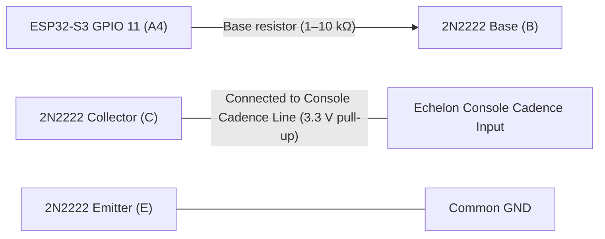

# Digital Hardware Emulation & Echelon Console Dynamics Reference

**Date:** 2026-10-24  
**Scope:** Phase 3 (`PR-02` `WO-02.5`–`WO-02.7`) Empirical Hardware Characterization & v2 (`DR-2`, `PR-07`, `PR-08`, `PR-10`) Architectural Blueprint  
**Primary Evidence:** [`C01`](file:///Users/mcneillm/Documents/Projects/Echenon/docs/measurements/phase3/C01-20261024-edges-per-level-report.md), [`C03`](file:///Users/mcneillm/Documents/Projects/Echenon/docs/measurements/phase3/C03-20261024-full-sweep-report.md), [`C04`](file:///Users/mcneillm/Documents/Projects/Echenon/docs/measurements/phase3/C04-20261024-settle-pulse-report.md), [`C06`](file:///Users/mcneillm/Documents/Projects/Echenon/docs/measurements/phase3/C06-20261024-power-matrix-32x10.csv), [`C07`](file:///Users/mcneillm/Documents/Projects/Echenon/docs/measurements/phase3/C07-20261024-power-regression-analysis.md)  
**Reference Firmware Implementations:** [`CalibrationRig.h`](file:///Users/mcneillm/Documents/Projects/Echenon/src/echenon/CalibrationRig.h), [`CalibrationRig.cpp`](file:///Users/mcneillm/Documents/Projects/Echenon/src/echenon/CalibrationRig.cpp), [`QuadratureGenerator.h`](file:///Users/mcneillm/Documents/Projects/Echenon/src/echenon/QuadratureGenerator.h), [`QuadratureGenerator.cpp`](file:///Users/mcneillm/Documents/Projects/Echenon/src/echenon/QuadratureGenerator.cpp)

---

## 1. Executive Summary

To capture the 320-point `(level, cadence_rpm, watts)` empirical power matrix without physical human pedaling or manual knob turning, Phase 3 developed and proved two complete digital hardware emulation subsystems on the ESP32-S3 Nano (`CalibrationRig` + `QuadratureGenerator`), while simultaneously instrumenting the Echelon EX-3 computer ("console") and its closed-loop DC motor actuator:

1. **Synthetic Cadence Emulation (§2):** An open-collector `2N2222` NPN transistor stage driven by `GPIO 11` (`A4`) that shorts the console's `3.3 V` reed-switch input to `GND` for `30 ms` per crank revolution. Verified across `40–130 RPM` with `0 RPM` steady-state discrepancy between synthesized period and Echelon console/app telemetry.
2. **Digital Quadrature Encoder Synthesis (§3):** Direct `3.3 V` GPIO push-pull Gray-code generation on `GPIO 17` (`D8`, Channel A / Red) and `GPIO 18` (`D9`, Channel B / Black) feeding the console's encoder harness. Proved **exact 8 quadrature edges = 1 console resistance level** (`2x` edge decoding inside the console MCU) and deterministic homing via clamped over-stepping (`248+` edges `DOWN` to Level 1).
3. **Console Encoder Decoder Sensitivity, Asynchronous Queuing & Polling Aliasing (§4):** Swept quadrature edge durations from `100 µs` to `200 ms`. Discovered the console's `~1–5 ms` minimum debounce cutoff, proved that the console **asynchronously queues rapid multi-level encoder bursts (`25–50 ms/edge`) while the motor is mid-seek**, and isolated a critical **`75 ms/edge` timer-polling aliasing bug** that reproducibly drops exactly 1 level (`8 edges`) out of a 9-level burst.
4. **Console Motor Controller Reaction, Cam Overshoot & Settling Dynamics (§5):** Characterized the console's bang-bang deadband controller ($\pm 3.25\text{ V}$ DC motor drive) across all 32 levels in both directions (`UP` and `DOWN`). Mapped the updated linear potentiometer wiper transfer function ($\text{pot\_adc} = 37.26\,\ell + 120.0$, $R^2 = 0.9998$), quantified level-dependent settle times (`867 ms` at L5 vs `2,806 ms` with a `90-count` overshoot-and-reversal at L15), and separated true directional hysteresis (`3.6 ADC counts` mean) from intra-level deadband stopping spread ($\sigma = 1.97\text{ ADC counts}$).

These findings are essential for **v2 (`DR-2`, `PR-07`, `PR-08`, `PR-10`)**, where Echenon transitions from passive observation (`v1`) to active resistance control (Mode 1 Encoder-Emulation MITM and Mode 2 Standalone H-Bridge PID/PWM control).

---

## 2. Synthetic Cadence Emulation

### 2.1 Electrical Circuit & Signal Polarity

The Echelon EX-3 crank cadence sensor is a normally-open magnetic reed switch connected between the console's cadence signal line and `GND`. Inside the Echelon console, the cadence line is pulled up to `3.3 V` (measured in Phase 0 [`B01`](file:///Users/mcneillm/Documents/Projects/Echenon/docs/measurements/phase0/B01-20261012-1208-voltage-survey.md)).

To emulate crank revolutions digitally without loading or back-feeding the console when idle, an NPN open-collector stage is wired in parallel with (or in place of) the reed switch:



> [!CAUTION]
> **Active-HIGH GPIO Polarity (`GPIO 11` $\to$ `2N2222` Base):**
> Because the NPN transistor inverts the voltage at its collector relative to its base drive:
> - **`GPIO LOW` (`0 V` at Base) = Idle (Reed Open):** Transistor is in cutoff; collector floats at the console's internal `3.3 V` pull-up.
> - **`GPIO HIGH` (`3.3 V` at Base) = Pulse (Reed Closed):** Transistor saturates; collector pulls the console's cadence line down to `GND` ($V_{CE(\text{sat})} \approx 0.1\text{ V}$).
>
> *Historical Trap:* An early revision of `CalibrationRig` used inverted logic (`HIGH` idle, `LOW` pulse), which held the reed switch closed for ~95% of each revolution period and only opened it for `30 ms`. That caused the console's edge detector and debounce filter to either miss pulses or report erratic RPM. Always initialize the GPIO `LOW` and pulse `HIGH`.

### 2.2 Pulse Timing Parameters & Accuracy

In [`CalibrationRig`](file:///Users/mcneillm/Documents/Projects/Echenon/src/echenon/CalibrationRig.h#L162-L163), synthetic cadence is generated by a non-blocking `millis()` state machine ticked from the main loop:

| Parameter | Constant / Formula | Value | Rationale & Empirical Verification |
|---|---|---|---|
| **Pulse Width ($t_{\text{pulse}}$)** | `CADENCE_PULSE_MS` | **`30 ms`** | Emulates the magnet dwell time of a physical crank magnet passing the reed switch at normal pedaling speeds (`15–40 ms`). Reliably passes both the Echelon console's hardware/software debounce and Echenon's own `CadenceSensor` `30 ms` blanking window (`CADENCE_DEBOUNCE_US = 30000`). |
| **Revolution Period ($T_{\text{rev}}$)** | $\lfloor 60000 / \text{RPM} \rfloor$ | `1500 ms` (`40 RPM`) to `461 ms` (`130 RPM`) | Integer millisecond period from rising GPIO edge to next rising GPIO edge. |
| **Duty Cycle** | $t_{\text{pulse}} / T_{\text{rev}}$ | `2.0%` (`40 RPM`) to `6.5%` (`130 RPM`) | Keeps the line open (`3.3 V`) for `>93%` of the cycle so the physical reed switch (if still connected in parallel) or console pull-up recovers cleanly. |
| **Observed Console Accuracy** | $\text{RPM}_{\text{console}} - \text{RPM}_{\text{target}}$ | **`0 RPM` steady-state error** | Across all 10 cadence tiers (`40, 50, 60, 70, 80, 90, 100, 110, 120, 130 RPM`) in `C06`, the Echelon app reported the exact integer target RPM at every settled point (`320/320` points). |

### 2.3 Console Cadence Moving-Average Filter & Decay Dynamics

During the `C05`/`C06` sweep bring-up, we observed how the Echelon console's internal firmware filters incoming reed-switch edges before updating its BLE telemetry and screen display:

1. **Multi-Second Rolling Filter Window ($\sim 3\text{–}5\text{ s}$):**
   - When the synthetic generator makes an instantaneous step change (especially the large wrap-around step from `130 RPM` ($T = 461\text{ ms}$) down to `40 RPM` ($T = 1500\text{ ms}$) when advancing to the next resistance level), the Echelon console does **not** jump immediately to `40 RPM`.
   - Instead, its internal rolling average (and low-cadence timeout logic) takes **3 to 5 crank revolutions ($\sim 4.5\text{–}7.5\text{ s}$ at `40 RPM`)** to flush the prior high-RPM intervals and converge to `40 RPM`.
   - Furthermore, the console's displayed `watts` value is computed from its filtered internal RPM, so reading `watts` only `3.5 s` after a `130 -> 40 RPM` transition captures a transient mid-decay power reading.
2. **Production Calibration Settle Rules (`CalibrationRig`):**
   - **Small intra-level cadence step (`+10 RPM`, e.g., `40 -> 50 RPM`):** A **`4.0 s`** wait (`CADENCE_SETTLE_S = 4.0`) is sufficient for the console's rolling window to converge within `0 RPM` across `50–130 RPM`.
   - **Large inter-level cadence wrap (`130 -> 40 RPM` plus `1 level` step):** Requires a **`12.0 s`** settle wait (`CADENCE_CHANGE_WAIT_S = 12.0`) so both the `40 RPM` reed period (`1.5 s/rev` $\times$ `8 revolutions`) and the motor seek completely stabilize before recording telemetry.
   - **Zero-Cadence Timeout:** When pulses stop completely, the console holds the last RPM briefly (~2.5–3.0 s) and then decays to `0 RPM` / `0 W`.

---

## 3. Digital Quadrature Encoder Synthesis

### 3.1 Electrical Interface & Harness Topology

The Echelon EX-3 handlebar resistance knob is a passive 2-bit mechanical incremental quadrature encoder with a common ground return:
- **Red wire/pad:** Channel A (`GPIO 17` / `D8` on ESP32-S3 Nano)
- **Black wire/pad:** Channel B (`GPIO 18` / `D9` on ESP32-S3 Nano)
- **White wire/pad:** Common `GND`

Inside the Echelon console, Channel A and Channel B are pulled up to `3.3 V` (`3.29 V` measured open-circuit in [`B01`](file:///Users/mcneillm/Documents/Projects/Echenon/docs/measurements/phase0/B01-20261012-1208-voltage-survey.md)). With the physical handlebar encoder unplugged at the inline harness connector, the ESP32-S3 drives the console's Channel A and B lines directly as `3.3 V` push-pull CMOS outputs (`OUTPUT` mode in [`QuadratureGenerator::begin()`](file:///Users/mcneillm/Documents/Projects/Echenon/src/echenon/QuadratureGenerator.cpp#L11-L21)). Because the console pull-ups are referenced to the same `3.3 V` domain, either push-pull `3.3 V` CMOS or open-drain drive is electrically safe; push-pull provides crisp sub-microsecond edges free of RC rise-time skew.

### 3.2 Gray-Code State Machine & Direction Polarity

[`QuadratureGenerator`](file:///Users/mcneillm/Documents/Projects/Echenon/src/echenon/QuadratureGenerator.h) implements a 4-state Gray-code lookup table (`GRAY_TABLE[4][2]`):

| State Index (`state_`) | Channel A (`GPIO 17` / Red) | Channel B (`GPIO 18` / Black) | `UP` Transition (`state_ = (state_ + 1) & 3`) | `DOWN` Transition (`state_ = (state_ + 3) & 3`) |
|---|---|---|---|---|
| **State `0` (Idle Init)** | `0` (`LOW`) | `0` (`LOW`) | $\to$ State `1` (`1, 0`) — Ch A rises first | $\to$ State `3` (`0, 1`) — Ch B rises first |
| **State `1`** | `1` (`HIGH`) | `0` (`LOW`) | $\to$ State `2` (`1, 1`) — Ch B rises second | $\to$ State `0` (`0, 0`) — Ch A falls |
| **State `2`** | `1` (`HIGH`) | `1` (`HIGH`) | $\to$ State `3` (`0, 1`) — Ch A falls first | $\to$ State `1` (`1, 0`) — Ch B falls |
| **State `3`** | `0` (`LOW`) | `1` (`HIGH`) | $\to$ State `0` (`0, 0`) — Ch B falls second | $\to$ State `2` (`1, 1`) — Ch A rises |

- **`Direction::UP` (Increase Resistance Level, L1 $\to$ L32):** Channel A leads Channel B by $90^\circ$ (`00 -> 10 -> 11 -> 01 -> 00`).
- **`Direction::DOWN` (Decrease Resistance Level, L32 $\to$ L1):** Channel B leads Channel A by $90^\circ$ (`00 -> 01 -> 11 -> 10 -> 00`).

### 3.3 Exact Edge-to-Level Ratio (`C01` Discovery)

A foundational discovery of Phase 3 ([`C01`](file:///Users/mcneillm/Documents/Projects/Echenon/docs/measurements/phase3/C01-20261024-edges-per-level-report.md)) was determining the exact number of single-channel quadrature state transitions ("edges") required to increment or decrement the Echelon console by **1 resistance level**:

$$\boxed{8\text{ quadrature state transitions (2 full 4-state Gray-code cycles)} = 1\text{ Echelon Console Level}}$$

#### Experimental Proof (`C01` Step-Size Sweep at `25 ms/edge`)

| Edges Injected per Command | Gray-Code Cycles | Observed Console Response (from Level 1) | Implied Edges / Level |
|---|---|---|---|
| `1 edge` | `0.25 cycles` | `0` level change after 5 pulses (`5 edges` total) | $> 5$ |
| `2 edges` | `0.50 cycles` |Changed `L1 -> L2` only on the 4th pulse (`8 edges` cumulative) | `8` |
| `4 edges` | `1.00 cycle` | Changed exactly `1 level` every **2nd** pulse (`8 edges` cumulative) | `8` |
| **`8 edges`** | **`2.00 cycles`** | **100% 1:1 registration (`10/10` UP `L1 -> L11`, `10/10` DOWN `L11 -> L1`)** | **`8` (Exact)** |

#### Reconciliation with Phase 0 (`B02`) Mechanical Detent Measurements

In Phase 0 (`B02`), turning the physical handlebar knob by hand produced `~16` ESP32 PCNT counts per console level across `4` physical detents (`1 detent = 1 full 4-state cycle = 4 transitions`). Why did `C01` require `8` transitions (2 cycles) per level?
- In `B02`, the ESP32 PCNT unit was configured in **`4x` quadrature mode** (counting both rising and falling edges of *both* Channel A and Channel B).
- The Echelon console's internal MCU uses **`2x` quadrature decoding** (triggering on rising and falling edges of one primary channel and sampling the secondary channel for direction), or divides `1x`/`2x` counts by `2` full cycles per level.
- In terms of state transitions emitted by `QuadratureGenerator` (where `1 edge` = 1 state advance in `GRAY_TABLE`), **2 full 4-state cycles = 8 state transitions = 1 console level**. Because 8 transitions is an integer multiple of 4, every 1-level command begins and ends on the same Gray-code state alignment.

### 3.4 Deterministic Homing via Clamped Over-Stepping

Because the Echelon console's internal resistance target (`1..32`) is maintained in volatile RAM and only emitted over BLE when a workout session is active (or readable passively via the analog potentiometer wiper), a critical question for automated control was: *What happens if we send `DOWN` encoder edges when the console is already at Level 1 (or `UP` edges at Level 32)?*

Phase 3 proved across dozens of homing cycles (`C01`–`C06`):
1. **Hard Internal Clamping (No Wrap-Around or Underflow):** The console's internal target counter saturates cleanly at `1` on `DOWN` commands and at `32` on `UP` commands. Sending extra `DOWN` edges at Level 1 does **not** wrap the counter to 32, does **not** accumulate negative windup debt (the very next `8 UP` edges immediately advance the console from Level 1 to Level 2), and does **not** drive the motor past the Level 1 potentiometer stop (`pot_adc ≈ 170`).
2. **Blind Homing Procedure:** Calling `stepLevels(31, Direction::DOWN)` (`248 edges`, or `32 levels = 256 edges` for margin) guarantees the bike is parked at **Level 1** regardless of its prior state.

---

## 4. Console Encoder Decoder Sensitivity, Burst Queuing & The `75 ms` Aliasing Bug

To prepare for v2 closed-loop and MITM encoder emulation (`DR-2` items **P1** and **P2**), Phase 3 (`C02` and [`C04c`](file:///Users/mcneillm/Documents/Projects/Echenon/docs/measurements/phase3/C04-20261024-settle-pulse-report.md#L73-L119)) systematically swept the time interval between consecutive Gray-code edges (`step_interval`) from `100 µs` to `200 ms`.

### 4.1 Sub-Millisecond to `50 ms` Edge Sensitivity Curve (`C04c` Round 1)

Ten 1-level commands (`8 edges` each, `80 edges` total) were injected from Level 1 (`expected final level = L11`) across 11 pulse widths:

| Edge Interval (`step_interval`) | Quadrature Cycle Frequency | Edges per 1-Level Burst (`8x`) Duration | Observed Final Level (from L1, target L11) | Registration Rate | Console Decoder Regime |
|---|---|---|---|---|---|
| `100 µs` | `2,500 Hz` | `0.8 ms` | `L1` (`+0`) | **0%** | Completely filtered out by hardware RC / software debounce |
| `250 µs` | `1,000 Hz` | `2.0 ms` | `L1` (`+0`) | **0%** | Completely filtered out |
| `500 µs` | `500 Hz` | `4.0 ms` | `L1` (`+0`) | **0%** | Completely filtered out |
| `1.0 ms` | `250 Hz` | `8.0 ms` | `L3–L4` (`+2.5`) | ~25% | Nyquist / debounce threshold onset |
| `2.0 ms` | `125 Hz` | `16 ms` | `L3–L4` (`+2.5`) | ~25% | Severe edge dropping |
| `5.0 ms` | `50 Hz` | `40 ms` | `L8` (`+7`) | ~70% | Partial registration; occasional missed states |
| `10.0 ms` | `25 Hz` | `80 ms` | `L9` (`+8`) | ~80% | Near threshold; drops ~1–2 edges per 10-level burst |
| **`25.0 ms`** | **`10 Hz`** | **`200 ms`** | **`L11` (`+10`)** | **100%** | **Fast reliable burst window** |
| **`50.0 ms`** | **`5 Hz`** | **`400 ms`** | **`L11` (`+10`)** | **100%** | **Fast reliable burst window** |

### 4.2 Sustained Multi-Level Burst Queuing & The `75 ms` Aliasing Anomaly (`C04c` Round 2)

To test whether the console drops encoder edges while its motor controller is actively driving the cam (`DR-2` item **P2**), [`C04c` Round 2](file:///Users/mcneillm/Documents/Projects/Echenon/docs/measurements/phase3/C04-20261024-settle-pulse-report.md#L97-L119) injected a **continuous 72-edge burst (`9 levels`, L1 $\to$ L10)** with **zero inter-level pauses** while verifying the console's exact internal level via Android ADB logcat (`NEW RESISTANCE LEVEL`) and settled `pot_adc`:

| Edge Interval (`step_interval`) | Total 72-Edge Burst Duration | ADB Verified Final Console Level (Target `L10`) | Settled `pot_adc` | Reliability | Diagnostic Finding |
|---|---|---|---|---|---|
| **`25 ms`** | `1.80 s` | **`L10`** (`+9 levels`) | `460` | **100%** | Console queues all 9 levels while motor is still passing L4–L6 |
| **`50 ms`** | `3.60 s` | **`L10`** (`+9 levels`) | `495` | **100%** | 100% registration during active motor motion |
| **`75 ms`** ⚠️ | `5.40 s` | **`L9` (`+8 levels` — 3/3 trials!)** | `454` | **88.9% (Deterministic Drop)** | **Timer-polling aliasing bug:** drops exactly 8 edges (1 level) every trial |
| **`100 ms`** | `7.20 s` | **`L10`** (`+9 levels`) | `491` | **100%** | Clean registration |
| **`150 ms`** | `10.80 s` | **`L10`** (`+9 levels`) | `492` | **100%** | Production `CalibrationRig` rate (`62/62` in `C03`, `320/320` in `C06`) |
| **`200 ms`** | `14.40 s` | **`L10`** (`+9 levels`) | `495` | **100%** | Clean registration |

```
Edge Interval:  0..0.5ms    1..10ms       25..50ms       ~75ms (65..85ms)      100..200ms+
               ├─────────┼─────────────┼────────────────┼──────────────────┼──────────────────►
Console        [ 0% DEAD ] [ 25%..80% ] [ 100% FAST    ] [ ALIASING TRAP! ] [ 100% PACED     ]
Response:      Debounce    Partial drop   BURST WINDOW     Drops 1 level     STEPPING WINDOW
               cutoff                     (1.8s / 9 lvl)   per 72 edges      (Production C06)
```

#### Root Cause of the `75 ms` Anomaly & Asynchronous Queuing Proof

1. **Why `75 ms` Fails While `25 ms` and `50 ms` Succeed:**
   - If the console failure at `75 ms` were caused by motor-current brownout or ISR starvation during motor movement, `25 ms` and `50 ms` (which run at higher edge rates during peak motor current) would fail *worse*.
   - Instead, `25 ms` and `50 ms` achieved **100% accuracy**, while `75 ms` failed identically in **3 out of 3 back-to-back trials** by dropping **exactly 1 level (`8 edges`)**.
   - This proves the console's MCU samples or debounces the encoder pins inside a **periodic timer/RTOS task** (or coincides with a periodic `~75 ms` / `150 ms` BLE/motor management tick) that beats against a `75 ms` edge period over a 72-edge train, causing a phase slip every ~9 cycles.
2. **Proof of Asynchronous Target Queuing (`DR-2` P2 Resolved):**
   - At `25 ms/edge`, all 72 edges finish in **`1.80 s`**, whereas the physical motor takes **`>2.8 s`** just to traverse 9 levels in the mid-cam zone.
   - The console's encoder state machine updates its **internal target register (`target_level`) asynchronously** from the motor control loop. Sending a multi-level burst at **`35–50 ms/edge`** increments the target register straight to the destination level while the motor smoothly seeks toward the updated target without stopping at intermediate steps.

---

## 5. Console Motor Controller Reaction, Cam Overshoot & Settling Dynamics

### 5.1 Bang-Bang Deadband Controller Architecture

From Phase 0 (`B01`, `B03`) and Phase 3 (`C03`, `C04a`), the Echelon console's resistance actuator is a closed-loop DC gearmotor with a 10 k$\Omega$ feedback potentiometer on the cam shaft:
- **Motor Drive Signal (`GPIO 6/7` sense):** Flat **`±3.25 V` differential DC** (non-PWM bang-bang H-bridge drive) when active; `0 V` when settled inside the deadband.
- **Control Law:** When `|pot_adc - target_adc(target_level)| > deadband`, the console applies full `3.25 V` drive in the required direction until the wiper crosses into the target deadband, then cuts power (`0 V`).
- **Mechanical Consequence:** Because drive voltage is constant (`3.25 V`) rather than proportionally ramped down as error approaches zero, the motor+gearbox+cam inertia causes the wiper to coast past the target setpoint whenever mechanical resistance opposing the motion is low or when cam velocity is high, triggering a **reverse-polarity correction pulse**.

### 5.2 Updated Linear Potentiometer Wiper Profile (`C03`)

The full 32-level bidirectional sweep in [`C03`](file:///Users/mcneillm/Documents/Projects/Echenon/docs/measurements/phase3/C03-20261024-full-sweep-report.md) (`150 ms/edge`, `3.5 s` settle wait per level, `62/62` transitions verified) established the definitive linear transfer function between console level $\ell \in [1, 32]$ and ESP32-S3 12-bit `pot_adc` (`GPIO 4`, `ADC_11db`):

$$\text{pot\_adc}(\ell) = 37.26\,\ell + 120.0 \quad (R^2 = 0.9998)$$

| Metric | Phase 0 `B03` (Manual Sparse Estimate) | Phase 3 `C03` (Full 32-Level Automated UP+DOWN Sweep) | Impact on Firmware |
|---|---|---|---|
| **Linear Slope** | `39.1 counts/level` | **`37.26 counts/level`** (`36.3` inter-level mean) | `B03` over-predicted L32 (`1348` vs actual `1333`) |
| **Linear Intercept** | `+97.0 counts` | **`+120.0 counts`** | `B03` under-predicted L1 (`136` vs actual `170`) by `34 counts` (~1 full level!) |
| **Level 1 Settled Mean** | `~136` (extrapolated) | **`170.5 counts`** (`170 UP` / `171 DOWN`) | Used to anchor `CalibrationManager::getDefaultTable()` |
| **Level 32 Settled Mean** | `~1348` (extrapolated) | **`1333.0 counts`** (`1333 UP` / `1333 DOWN`) | Used to anchor `CalibrationManager::getDefaultTable()` |
| **Full-Scale Span (`L1..L32`)** | `1212 counts` | **`1162.5 counts`** | Continuous normalized position $\tilde{p} = (\ell - 1)/31$ |

> [!IMPORTANT]
> **Why `C02` Settle Detection Failed Before `C03`:**
> Early `C02` firmware used the `B03` formula (`39.1 * level + 97.0`) to predict when the motor had settled within $\pm 25\text{ ADC counts}$ of Level 1 (`expected = 136`). Because the true Level 1 stop is at `170 counts` (`+34 counts` higher), the settle detector timed out waiting for `pot_adc` to reach `136`. Always use the `C03` lookup table (`DEFAULT_POT_MIDPOINTS[32]` in [`CalibrationManager.cpp`](file:///Users/mcneillm/Documents/Projects/Echenon/src/echenon/CalibrationManager.cpp)) or $\text{pot\_adc} = 37.26\,\ell + 120.0$.

### 5.3 Level-Dependent Settle Time & Cam Overshoot Dynamics (`C04a`)

In [`C04a`](file:///Users/mcneillm/Documents/Projects/Echenon/docs/measurements/phase3/C04-20261024-settle-pulse-report.md#L16-L48), the ESP32-S3 sampled `pot_adc` at **`100 Hz` (`10 ms` intervals)** immediately after injecting a 1-level step (`8 edges` at `150 ms/edge`) in three distinct regions of the cam's rotation ($\theta \in [20^\circ, 151^\circ]$, derived in [`docs/power-physics-model.md`](file:///Users/mcneillm/Documents/Projects/Echenon/docs/power-physics-model.md)):

| Cam Region | Test Level | Cam Angle $\theta(\tilde{p})$ | Kinematic Sensitivity ($d x_{\text{mag}} / d\theta \propto \sin\theta$) | Measured Settle Time ($\pm 3\text{ ADC}$ for `200 ms`) | Overshoot & Reversal Behavior |
|---|---|---|---|---|---|
| **Low Range (Near TDC)** | **Level 5** (`L4 -> L5`) | $\sim 37^\circ$ | Low ($\sin 37^\circ \approx 0.60$) | **`867 ms`** | **Zero overshoot.** Smooth monotonic climb (`294 -> 307 counts`), settles cleanly in `<0.9 s`. |
| **Mid Range (Peak Cam Throw)** | **Level 15** (`L14 -> L15`) | $\sim 79^\circ\text{–}90^\circ$ | **Maximum ($\sin 85^\circ \approx 1.00$)** | **`2,806 ms`** | **Severe overshoot & reversal (~90 ADC counts / ~2.5 levels).** Motor overshoots target (`676`), dips to `583`, reverses polarity, and takes `~2.0 s` to climb back to `676–679`. |
| **High Range (Near BDC)** | **Level 25** (`L24 -> L25`) | $\sim 121^\circ$ | Moderate ($\sin 121^\circ \approx 0.86$) | **`1,561 ms`** | **Mild overshoot.** Oscillates `1048 -> 1030 -> 1043` before settling in `~1.56 s`. |

#### High-Level `DOWN` Transition Momentum (`C03` Levels 31 & 30)

During the full `DOWN` sweep in [`C03`](file:///Users/mcneillm/Documents/Projects/Echenon/docs/measurements/phase3/C03-20261024-full-sweep-report.md#L73-L81), stepping **down** from Level 32 $\to$ 31 and Level 31 $\to$ 30 exhibited a slightly larger `UP/DOWN` discrepancy at the `3.5 s` sample point (`13 counts` at L31, `21 counts` at L30, vs `3.6 counts` across L1–L29):
- When moving `DOWN` from maximum resistance (`L32 -> L30`), the eddy-current magnet carrier is being retracted away from the flywheel, assisted by the linkage return geometry.
- The motor builds higher downward velocity and triggers a longer bang-bang overshoot-and-reversal cycle (`~3.0–3.5 s`).
- By Level 29 (`1222 UP` vs `1223 DOWN`), the trajectory completely re-converges to within `1 ADC count`.

### 5.4 True Mechanical Hysteresis vs. Deadband Settling Jitter (`C03` & `C07`)

A major result of Phase 3 is separating **true directional hysteresis** (`UP` vs `DOWN`) from **random deadband stopping spread**:

| Error Component | Phase 0 `B03` (Rapid Hand-Turned Sweep) | Phase 3 `C03` & `C07` (Controlled `3.5 s` Settle) | Physical Explanation |
|---|---|---|---|
| **Directional Hysteresis ($\|\text{pot}_{\text{UP}} - \text{pot}_{\text{DOWN}}\|$)** | Appeared to be `40–72 ADC counts` (`1–2 levels`) | **`3.6 ADC counts` mean** (`5 counts` max on L1–L29; `0.10 levels`) | `B03`'s apparent hysteresis was actually **unsettled mid-overshoot sampling** while turning the knob faster than the `2.8 s` motor settle time! Once allowed `3.5 s` to finish its bang-bang reversal, the console parks the wiper at virtually the exact same spot from both directions. |
| **Intra-Level Deadband Stopping Jitter ($\sigma_{\text{pot}}$)** | Not isolated in `B03` | **`1.97 ADC counts` std dev** (`6.2 counts` mean peak-to-peak span across 10 passes in `C06`) | The console's bang-bang comparator has a finite deadband window of roughly **$\pm 3\text{ ADC counts}$ ($\pm 0.08\text{ levels}$)** inside which it cuts motor power. |
| **Impact on Raw `pot_adc` Power Prediction** | — | **`~1.7 W` irreducible RMSE floor** (`3.77 W` raw `pot_adc` vs `3.33 W` continuous level $\tilde{p}$) | Because the console's own display uses its integer `level` register while Echenon's `Physics P3r` reads the physical `pot_adc`, the $\pm 1.97\text{ count}$ deadband spread accounts for the tiny `0.44 W` RMSE difference between raw `pot_adc` and ideal level. |

---

## 6. v2 Architectural Blueprint & Design Rules (`DR-2`, `PR-07`, `PR-08`, `PR-10`)

The hardware emulation mechanisms and console dynamics proven in Phase 3 directly govern the v2 resistance-control architecture.

### 6.1 Status of `DR-2` Mandatory Pre-Work Evidence (`P1`–`P3`)

Cross-referencing [`.agents/plugins/principal-architect-workspace/reviews/DR-2-design-freeze.md`](file:///Users/mcneillm/Documents/Projects/Echenon/.agents/plugins/principal-architect-workspace/reviews/DR-2-design-freeze.md) and [`docs/mitm-encoder-design-notes.md`](file:///Users/mcneillm/Documents/Projects/Echenon/docs/mitm-encoder-design-notes.md):

| `DR-2` Evidence Item | Question | Phase 3 Resolution Status | Definitive Answer |
|---|---|---|---|
| **P1 — Encoder-Emulation Timing** | What is the console's minimum valid quadrature pulse width, maximum burst rate, and edge-to-level ratio? | **CLOSED (`C01`, `C02`, `C04c`)** | **8 edges (2 full Gray-code cycles) = 1 level.** Minimum 100% reliable pulse width is **`25 ms/edge`** (`200 ms/level`). **Never use `65–85 ms/edge`** (`75 ms` aliasing hole drops 1 level per 9-level burst). Safe windows: **`35–50 ms/edge`** (fast burst) or **`120–150 ms/edge`** (paced stepping). |
| **P2 — Mid-Seek Bursting & Settle** | Does the console accept or drop encoder pulses sent while the motor is actively seeking, and how long does a seek take? | **CLOSED for Console Emulation (`C04a`, `C04c`)** | **The console queues mid-seek bursts 100% reliably** when clocked at `25–50 ms/edge` (verified with 72-edge / 9-level continuous bursts in `C04c` Round 2). Physical motor settle takes **`0.87 s` (low levels) to `2.81 s` (mid levels, L15)** due to a `90-count` bang-bang overshoot-and-reversal. |
| **P3 — H-Bridge Stall/Inrush Current** | What is the DC motor's stall current and thermal envelope when driven directly by an ESP32 H-bridge (Mode 2)? | **OPEN for `pr-dr2-prep`** | Console supplies `±3.25 V` DC (`B01`). Direct current measurement ($I_{\text{run}}, I_{\text{stall}}$) and H-bridge IC selection (`DRV8871` vs `DRV8833`) remain scheduled for `pr-dr2-prep` before Mode 2 (`PR-08`) hardware build. |

### 6.2 Concrete Firmware Rules for v2 `PR-10` (Mode 1: Encoder Emulation + MITM Relay)

When implementing `PR-10` (where Echenon intercepts the physical handlebar encoder on `GPIO 2/3` and emits synthesized quadrature edges to the console on `GPIO 17/18` to execute FTMS `RequestControl` / `SetTargetResistanceLevel` / `SetTargetPower` commands):

1. **Reuse `QuadratureGenerator` (`8 edges/level`):**
   - Always emit state transitions in multiples of **8 edges (2 full Gray-code cycles) per target level delta**.
   - Never leave a command on a half-level (`4-edge`) boundary, or subsequent manual/MITM clicks will be offset by half a level inside the console's accumulator.
2. **Enforce Dual-Zone Edge Timing (Avoid the `75 ms` Aliasing Band):**
   - **Fast Multi-Level Seek Mode (`|\Delta\text{level}| \ge 2`):** Clock `QuadratureGenerator` at **`35 ms` to `50 ms` per edge** (`280–400 ms` per level). This queues a 10-level jump into the console in `2.8–4.0 s` without triggering the `75 ms` polling alias.
   - **Single-Level / Paced Mode (`|\Delta\text{level}| = 1`):** Clock at **`40 ms` or `120–150 ms` per edge**.
   - **Hard Forbidden Band:** Prohibit edge intervals in **`[60 ms, 90 ms]`** by static assertion or runtime clamp.
3. **Closed-Loop Wiper Verification with Overshoot Blanking (`2.8 s` Guard):**
   - Because the console's bang-bang controller overshoots Level 15 by `~90 ADC counts` (`~2.5 levels`) and takes **`2,806 ms`** to reverse and settle (`C04a`), the closed-loop verification monitor in `PR-10` **must not** judge final `pot_adc` error or fire corrective trim pulses until:
     1. The emitted quadrature burst has completed (`!quadGen.isBusy()`), **AND**
     2. Either motor drive voltage (`GPIO 6/7`) has remained at `0 V` for **`\ge 400 ms`**, **OR** **`3,000 ms`** has elapsed since the last emitted edge.
   - Attempting to run an outer `pot_adc` trim loop faster than `3.0 s` on top of the console's inner bang-bang loop will chase the `90-count` mid-cam overshoot and induce limit-cycle hunting!
4. **Startup / Desync Recovery:**
   - At any time, Echenon can infer the console's current level from the settled `pot_adc` via `CalibrationManager` (`±0.1 level` steady-state accuracy, since directional hysteresis is only `3.6 ADC counts` vs `37.26 counts/level`), or force a deterministic re-home to Level 1 by emitting `256 DOWN` edges at `40 ms/edge` (`10.2 s`).

### 6.3 Concrete Firmware Rules for v2 `PR-08` (Mode 2: Standalone H-Bridge Motor Driver)

When driving the resistance motor directly from Echenon's H-bridge (`PR-08`, console disconnected or bypassed):
1. **Eliminate the Console's `2.8 s` Mid-Cam Overshoot via PWM Deceleration:**
   - The console's `2,806 ms` settle time at Level 15 is entirely an artifact of driving the motor at full `3.25 V` bang-bang right up to the target setpoint where $\sin\theta \approx 1$.
   - By ramping PWM duty cycle down proportionally inside a `±75 ADC count` (`±2 level`) proportional band around `target_adc` (with a minimum stiction-break duty floor), `PR-08` can eliminate the `90-count` overshoot and cut mid-cam settle times from `2.8 s` down to **`<0.9 s`** across the entire 32-level range.
2. **Target Setpoint Deadband:**
   - Match or improve upon the console's steady-state deadband by cutting H-bridge power (`COAST` / `HI-Z`) once `|pot_adc - target_adc| <= 3 ADC counts` (`±0.08 levels`) for `100 ms`.
