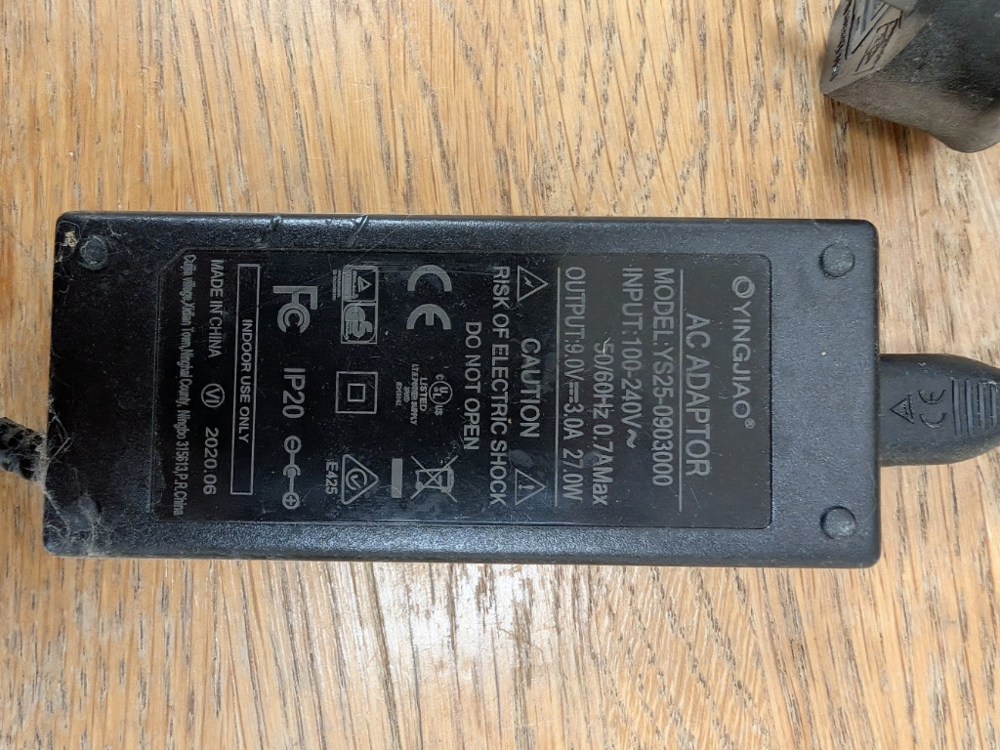
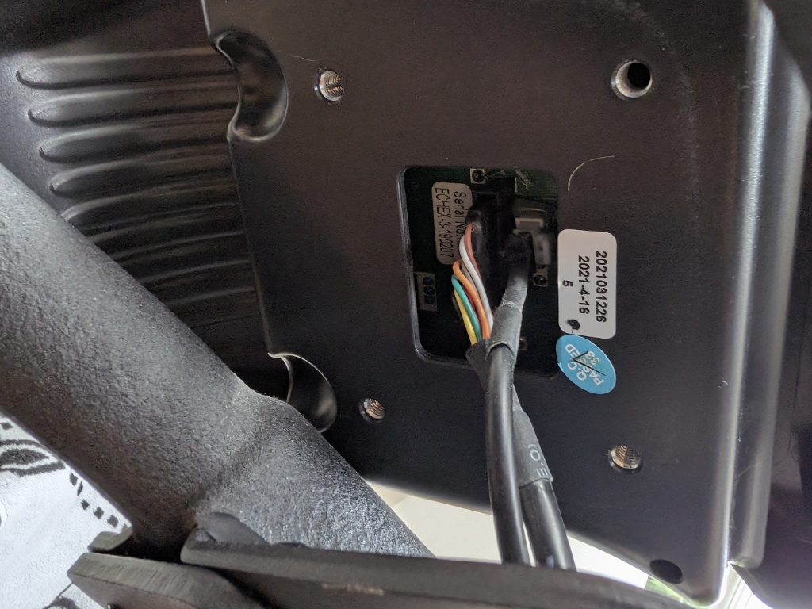
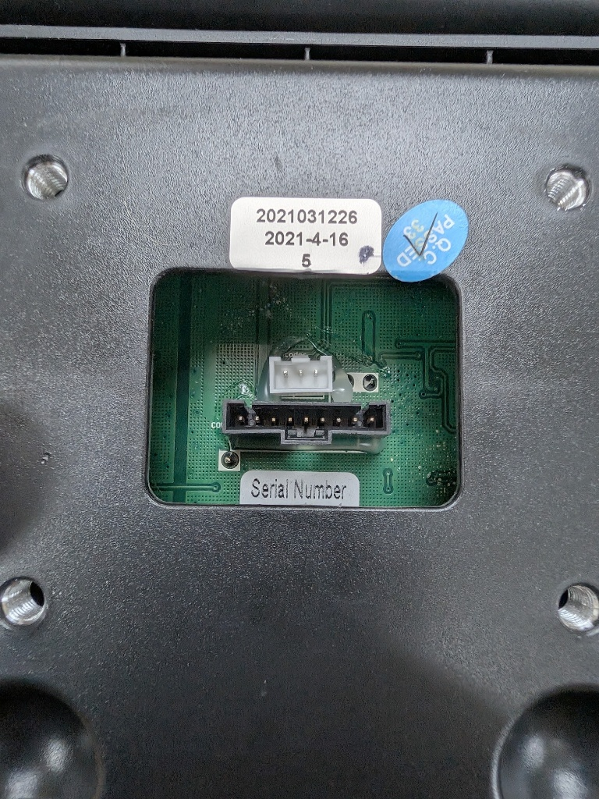
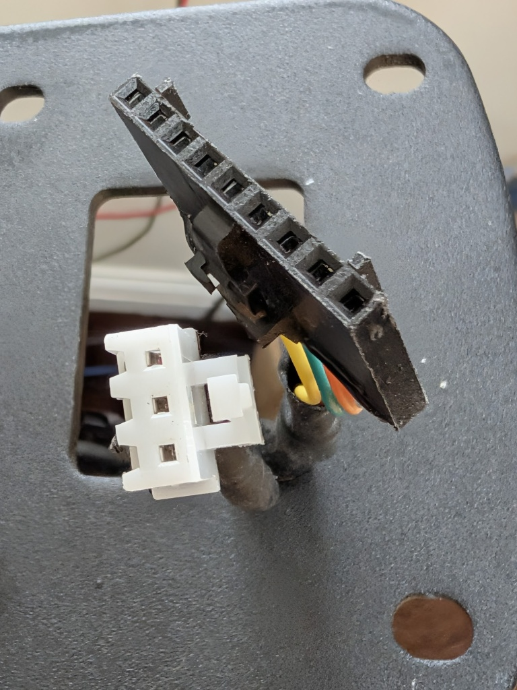
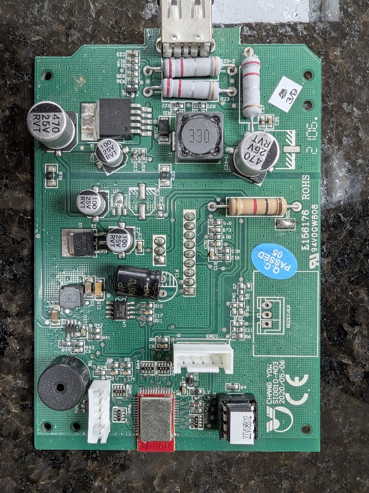
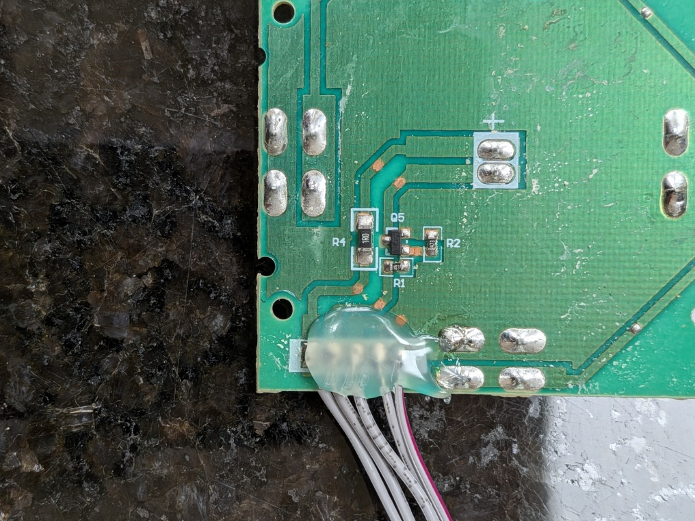
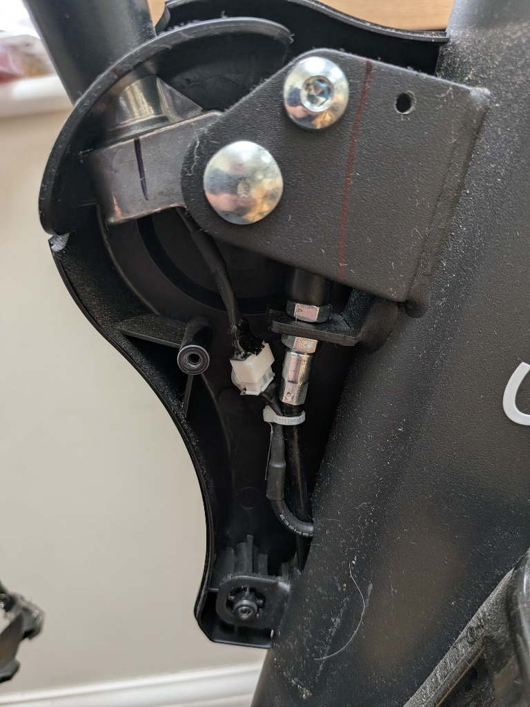
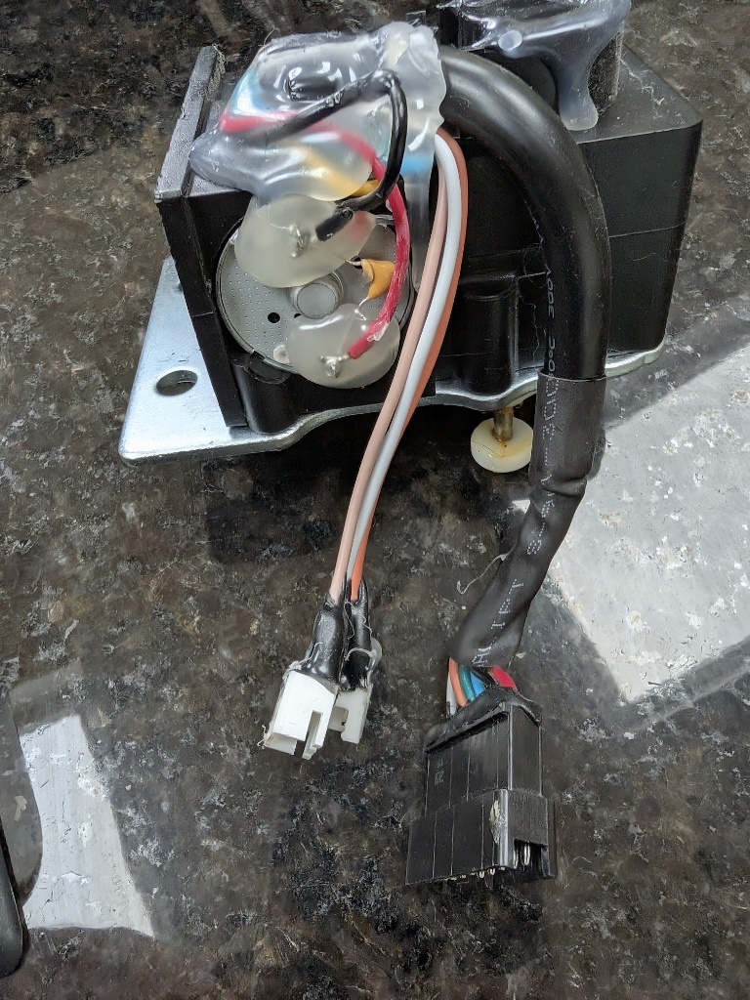
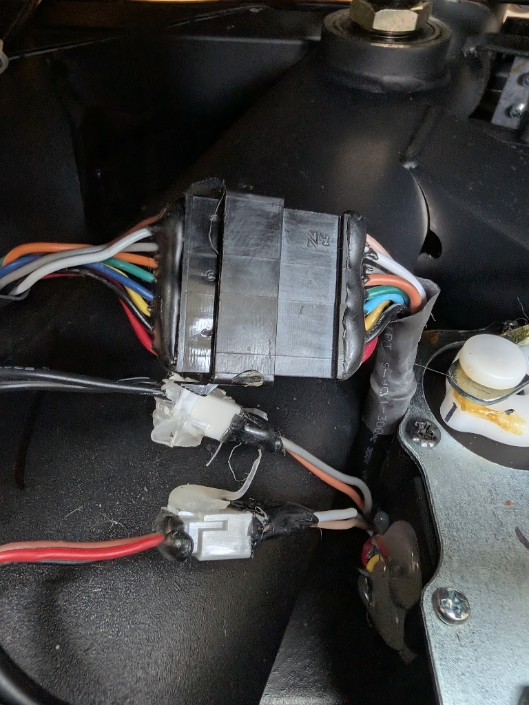

# Echelon EX-3 Hardware Specification

**A complete hardware reference for the Echelon EX-3 Smart Connect indoor bike internals.**

*Based on first-hand teardown, multimeter measurements, and physical inspection.
Source investigation: [echelon-teardown/conversation.md](echelon-teardown/conversation.md)*

---

## 1. Architecture Overview

The EX-3's electrical system is divided into three functional zones connected by
wiring looms:

```
┌──────────────────────────────────────────────────────────────────┐
│                    HANDLEBAR CONSOLE                             │
│                                                                  │
│  ┌────────────────┐     ┌──────────────────────────────────┐     │
│  │  Switch Board  │────▶│         Main Motherboard         │     │
│  │  (4 buttons    │ 5p  │  • Bluetooth SoC                 │     │
│  │   + 1 LED)     │ JST │  • Buck converter (9V→5V→3.3V)   │     │
│  └────────────────┘     │  • USB-A charging port           │     │
│                         │  • 6-pin JTAG header             │     │
│                         └──────┬──────────────┬────────────┘     │
│                                │ 9-pin        │ 3-pin            │
│                                │ JST-SM       │ JST              │
└────────────────────────────────┼──────────────┼──────────────────┘
                                 │              │
                    ─ ─ ─ ─ ─ ─ ─│─ ─ ─ ─ ─ ─ ─ │─ ─ ─ FRAME
                                 │              │
┌────────────────────────────────┼──────────────┼──────────────────┐
│                    LOWER BODY  │              │                  │
│                                ▼              ▼                  │
│                    ┌───────────────────────────────┐             │
│                    │    Central Wiring Hub         │             │
│  9V DC in ────────▶│  ┌────────────────────────-─┐ │             │
│  (power supply)    │  │ Resistance Potentiometer │ │             │
│                    │  │ (position feedback)      │ │             │
│                    │  ├────────────────────────-─┤ │             │
│                    │  │ Resistance DC Motor      │ │             │
│                    │  │ (actuator, 3.3V)         │ │             │
│                    │  └─────────────────────────-┘ │             │
│                    └──────────┬────────────────────┘             │
│                               │                                  │
│                    ┌──────────▼──────────┐                       │
│                    │   Cadence Sensor    │                       │
│                    │  (magnetic reed sw) │                       │
│                    └───────────────────-─┘                       │
│                                                                  │
│  ┌───────────────────────┐                                       │
│  │ Resistance Knob       │──── 3-pin JST ────▶ Console           │
│  │ (rotary encoder,3.3V) │                                       │
│  └───────────────────────┘                                       │
└──────────────────────────────────────────────────────────────────┘
```

---

## 2. Power Supply

| Parameter | Value |
|---|---|
| **Manufacturer** | YINGJIAO |
| **Model** | YS25-0903000 |
| **Input** | 100–240V AC, 50/60 Hz, 0.7A max |
| **Output** | 9.0V DC, 3.0A (27W) |
| **Polarity** | Centre positive |
| **Manufacture date** | 2020-06 |
| **Certifications** | FCC, CE, UL, RoHS, IP20 |

The 9V DC rail enters the bike frame and routes through the central wiring hub
up to the console motherboard via the 9-pin loom (white and brown wires).



---

## 3. Console Motherboard (Handlebar Unit)

### 3.1 Board Identification

| Field | Value |
|---|---|
| **Board designation** | ECHEX-3 |
| **Manufacturer** | CHANG YOU |
| **PCB revision** | S1001O-A03 |
| **PCB date code** | 2020/05/06 |
| **UL file** | E156176 |
| **Substrate** | 94V0GW808 (FR-4) |
| **Serial number (unit)** | 2021031226 (manufactured 2021-04-16) |

### 3.2 Key Components (Front)

| Component | Description |
|---|---|
| **Electrolytic capacitors** | 470µF 25V RVT (×1), 100µF 25V RVT (×3) — part of the buck converter |
| **Inductor** | Shielded 330µH power inductor — switching regulator energy storage |
| **Power resistors** | Multiple large through-hole resistors (current limiting / load balancing) |
| **Bluetooth SoC** | Red-capped RF module (bottom-left, shielded) — handles BLE protocol |
| **Microcontroller** | 8-pin DIP IC (marked "2210B02") — likely the main MCU or motor driver |
| **USB-A port** | Top of board — 5V charging output for tablet |
| **Buzzer** | Piezo buzzer (bottom-left) |
| **Voltage regulation** | Buck converter circuit steps 9V → 5V (USB) and → 3.3V (logic/BLE) |

### 3.3 Connectors (Rear)

| Connector | Type | Wires | Function |
|---|---|---|---|
| **9-pin black** | JST-SM (9-pin) | 9 wires (all slots populated) | Main loom — power, sensors, motor |
| **3-pin white** | JST 3-pin | Black, orange, red | Resistance control knob (rotary encoder) |
| **5-pin white** | JST 5-pin | Ribbon cable | Auxiliary switch board |
| **6-pin header** | Pin header (unpopulated) | — | JTAG / programming debug port |

### 3.4 Debug / Programming Interfaces

Two debug headers are visible on the PCB:

1. **6-pin header** — positioned away from the main power/sensor inputs. Likely
   the primary JTAG or UART programming header for the board's main MCU.
2. **Pads near the BLE module** — likely a dedicated SWD or UART port for
   flashing firmware onto the Bluetooth SoC.

### 3.5 Photos

| View | Image |
|---|---|
| Console rear — connectors entering casing |  |
| Console rear — close-up of PCB sockets |  |
| 9-pin and 3-pin connectors (wire side) |  |
| Connectors — alternate angle |  |
| PCB rear (solder side) — connectors and traces |  |
| PCB front (component side) — full board |  |
| PCB front — close-up of MCU, BLE module, and 5-pin header |  |

---

## 4. Auxiliary Switch Board

A small daughter board mounted behind the handlebar controls, connected to the
main motherboard via the 5-pin JST header.

| Field | Value |
|---|---|
| **PCB revision** | S1001O-B03 |
| **PCB date code** | 20180529 |
| **UL file** | E156176 (shared with main board) |
| **Substrate** | 94V0GW808 (FR-4) |

### 4.1 Components

| Component | Quantity | Description |
|---|---|---|
| **Tactile switches** | 4 (S1–S4) | Momentary pushbuttons — bike controls |
| **LED** | 1 | Status indicator |

The 4 switches and 1 LED share 5 wires. The switches likely share a common
ground (or VCC) and may use a resistor ladder network to send distinct voltage
values back to a single analog pin on the main board, minimising the wire count.

### 4.2 Photos

| View | Image |
|---|---|
| Switch board front — 4 tactile switches and LED |  |
| Switch board rear — traces and components |  |
| Switch board installed — ribbon cable to main PCB |  |

---

## 5. Resistance Control Knob (Rotary Encoder)

The red resistance knob on the handlebars is an **incremental quadrature rotary
encoder** operating on 3.3V logic. It connects to the console motherboard via
the 3-pin JST connector, and its signals are routed through the frame (not the
main 9-pin loom).

### 5.1 Connector

| Pin | Wire Colour | Function |
|---|---|---|
| 1 (left) | Black | Channel A — quadrature signal |
| 2 (middle) | Orange | Common (3.3V reference VCC) |
| 3 (right) | Red | Channel B — quadrature signal |

### 5.2 Measured Behaviour

| Measurement | Observation |
|---|---|
| **Black ↔ Orange** (Ch A to VCC) | 0V / 3.3V quadrature signal |
| **Red ↔ Orange** (Ch B to VCC) | 0V / 3.3V quadrature signal (90° phase shifted) |

The two channels pulse 90° out of phase (standard quadrature encoding). The
motherboard decodes both the **amount** and **direction** of rotation (CW =
increase resistance, CCW = decrease). The console translates this digital input
into motor drive commands sent down the 9-pin loom to the resistance actuator.

> [!NOTE]
> Wire colours corrected 2026-10-04 from bench measurements (B01). Earlier
> teardown visual inspection reported Red/Brown/Orange and hypothesized an analog
> pulse on Ch B. Bench verification (B01, B04) confirmed standard 3.3V quadrature on
> Black (Ch A) and Red (Ch B) with Orange as 3.3V VCC. PCNT decodes both channels
> cleanly with 0% bounce and 100% detection.

### 5.3 Photo

| View | Image |
|---|---|
| Resistance knob cavity — encoder and brake cable visible |  |

---

## 6. Central Wiring Hub (Lower Resistance Actuator Assembly)

The central wiring hub is a sealed unit located in the lower frame near the
flywheel. It is the junction point for all lower-body electrical components and
contains both the resistance actuator and position sensor.

### 6.1 Components Inside the Hub

#### Resistance Potentiometer (Position Feedback)

| Parameter | Value |
|---|---|
| **Type** | Rotary potentiometer (continuous rotation) |
| **Total resistance** | ~5.4 kΩ per 180° sweep |
| **Behaviour** | Two 180° sweeps per full rotation: 0→5.4kΩ, click-off, 0→5.4kΩ, click-off |
| **Measured voltage** | 1.16V – 1.7V across the two outer terminals (Yellow ↔ Green) |
| **Purpose** | Absolute position feedback — the console always knows the exact physical position of the magnetic brake carriage |

The dual 180° sweep pattern acts as a continuous-rotation absolute encoder,
allowing the motherboard to track the resistance arm position through its full
range of motion.

#### Resistance DC Motor (Actuator)

| Parameter | Value |
|---|---|
| **Type** | Small DC motor |
| **Operating voltage** | 3.3V |
| **Purpose** | Drives the resistance adjustment pin, physically moving the magnetic brake carriage |
| **Control** | Driven by the motherboard in response to rotary encoder input from the resistance knob |

The motor shaft is mechanically coupled to the same pin as the potentiometer,
so as the motor turns to adjust resistance, the potentiometer simultaneously
reports the new position back to the console — forming a closed feedback loop.

### 6.2 Connectors at the Hub

Three connectors exit the central hub:

| Connector | Wires | Destination |
|---|---|---|
| **9-pin JST-SM** (black) | All 9 wire colours | Up to console motherboard |
| **2-pin JST** (white, small) | Grey, Brown | Down to cadence reed switch at pedal crank |
| **2-pin** (power in) | Red→White, Black→Brown | 9V DC power supply input |

### 6.3 Photos

| View | Image |
|---|---|
| Actuator assembly — potentiometer and motor visible, heavily potted |  |
| Potentiometer close-up — wiper and terminals visible through potting |  |
| Potentiometer terminals — detail |  |
| Hub with all wiring — motor leads, pot wires, and loom exiting |  |
| Wiring junction — 9-pin loom, cadence, and power connections visible |  |

> [!NOTE]
> All solder joints inside the hub are heavily potted with silicone sealant to
> prevent fracturing under the heavy vibrations of indoor cycling sessions.

---

## 7. Cadence Sensor

| Parameter | Value |
|---|---|
| **Type** | Magnetic reed switch |
| **Location** | Pedal crank |
| **Signal** | 3.3V logic — digital pulse, one pulse per pedal revolution |
| **Wiring** | 2-wire (Grey + Brown from the 9-pin loom) |
| **Connection** | Via white JST connector on the central wiring hub |

---

## 8. Main Wiring Loom — Complete 9-Pin Pinout

The main wiring loom uses a **JST-SM 9-pin** connector carrying all sensor
data, actuator control, and power between the lower body and the console. All
nine slots are populated.

| Pin | Wire Colour | Component / Function | Electrical Notes |
|---|---|---|---|
| 1 | **Red** | Resistance motor (+) | Actuator control; 3.3V on a DMM (waveform unconfirmed, Phase 0 register row 1) |
| 2 | **Black** | Resistance motor (−) | Actuator control; 3.3V on a DMM (waveform unconfirmed, Phase 0 register row 1) |
| 3 | **Yellow** | Potentiometer (outer terminal) | Resistance measurement reference |
| 4 | **Blue** | Potentiometer (wiper) | Variable signal; sweeps 0–5.4 kΩ per 180° rotation |
| 5 | **Green** | Potentiometer (outer terminal) | Resistance measurement reference. 1.16–1.7V across Yellow↔Green |
| 6 | **Orange** | Cadence sensor | Reed switch circuit; 3.3V logic signal |
| 7 | **Grey** | Cadence sensor | Reed switch circuit; 3.3V logic signal |
| 8 | **White** | Main power (+) | +9V DC supply routed up to the console motherboard |
| 9 | **Brown** | Main power (GND) | System ground |

### 8.1 Signal Grouping

```
9-Pin JST-SM Loom
├── Power (2 wires)
│   ├── White ─── +9V DC
│   └── Brown ─── GND
├── Resistance Motor (2 wires)
│   ├── Red ───── Motor +  (3.3V)
│   └── Black ─── Motor −  (3.3V)
├── Resistance Potentiometer (3 wires)
│   ├── Yellow ── Outer terminal
│   ├── Blue ──── Wiper (variable)
│   └── Green ─── Outer terminal
└── Cadence Sensor (2 wires)
    ├── Orange ── Reed switch signal (3.3V)
    └── Grey ──── Reed switch signal (3.3V)
```

---

## 9. Resistance Knob Loom — 3-Pin Pinout

Separate from the main 9-pin loom. Connects the handlebar-mounted rotary
encoder directly to the console motherboard.

| Pin | Wire Colour | Function |
|---|---|---|
| 1 | **Black** | Channel A (quadrature signal) |
| 2 | **Orange** | Common (3.3V reference VCC) |
| 3 | **Red** | Channel B (quadrature signal) |

Connector type: JST 3-pin (white housing).

---

## 10. Voltage Summary

All data signals operate at **3.3V logic** levels. The only higher voltage in
the system is the 9V DC power rail from the external supply.

| Rail | Voltage | Source | Consumers |
|---|---|---|---|
| **Main power** | 9V DC | External YINGJIAO PSU | Console motherboard (input) |
| **USB charging** | 5V | Buck converter on motherboard | USB-A port → tablet |
| **Logic / BLE** | 3.3V | Second-stage regulator on motherboard | Bluetooth SoC, MCU, all sensor/actuator signals |

> [!IMPORTANT]
> **All sensor signals run at 3.3V, and the resistance motor measured 3.3V on
> a DMM.** A DMM reads the average, so the motor drive waveform (3.3V DC or
> higher-voltage PWM) is unconfirmed; it is characterised by oscilloscope in
> Phase 0 (register row 1, [`measurements/phase0/README.md`](measurements/phase0/README.md)).
> The only confirmed higher voltage is the 9V DC power rail from the external supply.

---

## 11. Reference Photos Index

All photos are stored in [`echelon-teardown/attachments/`](echelon-teardown/attachments/).

| Photo | Description | Section |
|---|---|---|
| `image_cabb80.jpg` | Power supply label (YINGJIAO YS25-0903000) | §2 |
| `image_cabecb.jpg` | Console rear — wiring loom entry point | §3 |
| `image_cabf0c.jpg` | Console rear — PCB connector sockets through casing | §3 |
| `image_cac24b.jpg` | 9-pin and 3-pin connectors (wire side, colours visible) | §3 |
| `image_cac26c.jpg` | Connectors alternate angle — both plugs | §3 |
| `image_cac669.jpg` | Resistance knob cavity — rotary encoder and brake cable | §5 |
| `image_cace65.jpg` | Main PCB rear (solder side) — traces and connectors | §3 |
| `image_cace8c.jpg` | Main PCB front (component side) — full board | §3 |
| `image_cb2022.jpg` | PCB close-up — MCU IC, BLE module, 5-pin header area | §3 |
| `image_cb27e1.jpg` | Switch board front — 4 tactile switches (S1–S4) + LED | §4 |
| `image_cb2806.jpg` | Switch board rear — PCB traces | §4 |
| `image_cb283e.jpg` | Switch board installed — ribbon cable to main PCB | §4 |
| `image_cb32e8.jpg` | Actuator assembly overview — potentiometer + motor | §6 |
| `image_cb3307.jpg` | Potentiometer close-up — wiper visible through potting | §6 |
| `image_cb3327.jpg` | Potentiometer terminals — detail shot | §6 |
| `image_cb3362.jpg` | Actuator hub — all wiring and motor leads visible | §6 |
| `image_cb3763.jpg` | Wiring junction — 9-pin loom, cadence, and power splits | §6 |

---

## 12. Instrumented Characterisation (Phase 0)

> All measurements in this section were taken with an ESP32-S3-Nano running the
> Echelon signal logger firmware (`v0.1.0-dev.6`), connected to the console
> harness via non-loading series-resistor taps. 8-channel ADC continuous mode at
> 83.3 kSa/s, decimated to 10 Hz ride log and raw burst capture.
> Oscilloscope: Rigol DHO804. DMM: standard bench multimeter.
>
> Evidence files: [`docs/measurements/phase0/`](measurements/phase0/)

### 12.1 ADC Pin Map (Confirmed)

GPIO 8 and 9 were initially logged via ADC channels 7 and 8 in early testing, but
were subsequently released from the continuous ADC scan to the ESP32 PCNT peripheral
(`EncoderModule`), leaving 8 ADC1 channels for continuous logging (CH0–CH6, CH9).

| ADC CH | GPIO | Wire | Signal | Tap Circuit | Idle ADC | Notes |
|---|---|---|---|---|---|---|
| 0 | 1 | Blue | Pot wiper | 22 kΩ series | 123–165 | Depends on level |
| 1 | 2 | Yellow | Pot outer ref | 22 kΩ series | 0 | Always 0V — see §12.4 |
| 2 | 3 | Green | Pot outer ref | 22 kΩ series | 2060 | ~1.66V active source — see §12.4 |
| 3 | 4 | Grey | Cadence return | 4.7 kΩ + 100 nF | 0 | |
| 4 | 5 | Orange | Cadence | 4.7 kΩ + 100 nF | 4095 | Pulls low on reed closure |
| 5 | D3 | Red | Motor sense + | 30 kΩ / 10 kΩ ÷4 | 0 | Forward drive |
| 6 | D4 | Black | Motor sense − | 30 kΩ / 10 kΩ ÷4 | 0 | Reverse drive |
| — | 8 | Black | Encoder Ch A | 4.7 kΩ series | 0/4095 | Released to PCNT (0% bounce) |
| — | 9 | Red | Encoder Ch B | 4.7 kΩ series | 0/4095 | Released to PCNT (0% bounce) |
| 9 | 10 | Orange | Encoder VCC | 4.7 kΩ + 100 nF | 4095 | 3.3V steady (ADC1 CH9) |

### 12.2 Resistance Motor Drive

The resistance motor is driven with **flat DC** (not PWM at any timescale from
100 µs to 10 s). Drive is bidirectional — the console reverses polarity to
change direction.

| Parameter | Measured Value | Method |
|---|---|---|
| Forward drive voltage | +3.25V (direct on motor) | Oscilloscope |
| Reverse drive voltage | −3.25V (direct on motor) | Oscilloscope |
| Forward through ÷4 divider | +0.81V → ADC ≈ 921–925 | ADC logger |
| Reverse through ÷4 divider | −0.81V (clamped to 0V) | ADC logger — see note |
| Peak reverse current | 175 mA | DMM (inline) |
| Steady reverse current | 150 mA | DMM (inline) |
| Peak forward current | 95 mA | DMM (inline) |
| Steady forward current | 50 mA | DMM (inline) |
| PWM detected? | **No** — flat DC at all timescales | Oscilloscope |
| Drive waveform | Square on/off, no ramp | Oscilloscope |

> [!NOTE]
> The ÷4 divider only detects forward drive polarity. Reverse drive produces a
> negative voltage that is clamped to 0V by the ADC input protection. To detect
> both directions, the motor sense is split across two ADC channels (ch5 for +,
> ch6 for −), each with its own divider. In practice, motor+ reads ~921 during
> forward and motor− reads ~922 during reverse.

Evidence: [A01-motor-characterisation.md](measurements/phase0/A01-20261011-motor-characterisation.md),
[A02-motor-current.md](measurements/phase0/A02-20261011-motor-current.md)

### 12.3 Resistance Potentiometer — Full Profile

The pot is cam-driven and makes a **continuous rotation** (no hard stop). The
cam profile is not a simple linear sweep — it has two distinct non-working arcs,
two dead zones, and a working range that occupies roughly half the rotation.

#### 360° Cam Profile

Measured by applying direct DC to the motor (bypassing the console) and
recording the pot wiper ADC value during continuous rotation:

```
   ADC
  4095 ┊
       ┊
  2850 ┊            ╱╲               ╱╲               ╱╲
       ┊           ╱  ╲             ╱  ╲             ╱  ╲
  2100 ┊ ·········╱····╲···········╱····╲···········╱····╲····  Saturation
       ┊         ╱      ┊         ╱      ┊         ╱
       ┊        ╱       ┊        ╱       ┊        ╱
       ┊       ╱     Dead zone  ╱     Dead zone  ╱
       ┊      ╱      ┊ ┊      ╱      ┊ ┊      ╱
   698 ┊ ─────       ┊ ┊─────       ┊ ┊─────     Plateau 2
   366 ┊──           ┊ ┊──          ┊ ┊──         Plateau 1
   125 ┊─            ┊ ┊            ┊ ┊           Parked idle
     0 ┊·············╳···············╳·················────────
       └──────────────────────────────────────────────────── angle
                   0°  gap        180°  gap       360°
```

| Feature | ADC Range | Voltage | Angular Extent |
|---|---|---|---|
| Plateau 1 (non-working) | 362–367 | 295 mV | ~45° |
| Plateau 2 (non-working) | 697–703 | 566 mV | ~80° |
| Working ramp | 0–2120 | 0–1.71V | ~80° per half |
| Saturation plateau | 2100–2120 | 1.70V | Brief |
| Dead zone 1 | 2850 → 0 | gap crossing | ~5° |
| Dead zone 2 | 2870 → 0 | gap crossing | ~5° |
| Working range total | 0–2120 | 0–1.71V | ~160° (two halves) |

#### Key Properties

| Property | Value |
|---|---|
| Rotation type | Continuous (no hard stop) |
| Dead zones | 2, at approximately 0° and 180° |
| Working ramp linearity | Highly linear (0→2120 over ~16s at test speed) |
| Ramp symmetry | Mirror halves produce identical profiles |
| ADC range utilised by console | 165–1327 (28% of 12-bit range) |
| Pot voltage utilised by console | 133–1069 mV (936 mV of 3.3V range) |

Evidence: [A03-pot-revolution.csv](measurements/phase0/A03-20261011-pot-revolution.csv),
[A03-pot-revolution-run2.csv](measurements/phase0/A03-20261011-pot-revolution-run2.csv)

### 12.4 Reference Voltages (Yellow and Green)

The pot reference lines do **not** behave as expected for a simple 3-terminal
pot. They appear to be part of a more complex sensing circuit inside the console.

| Wire | Expected | Measured | Source Impedance |
|---|---|---|---|
| Yellow (ch1, "hi ref") | 3.3V | **0V** (always) | — |
| Green (ch2, "lo ref") | 0V | **1.66V** (steady) | **2.4 kΩ** |

Green is an **active voltage source** at 1.66V with low output impedance
(2.4 kΩ), measured by loading with 10 kΩ to GND through the 22 kΩ series tap.
It rises slightly with resistance level (2059 at level 1 → 2079 at level 32,
a 20 ADC / 16 mV shift across the full range).

Evidence: Load test performed 2026-10-11, see bench report.

### 12.5 Resistance Levels

The console provides **32 discrete resistance levels**, each corresponding to a
specific pot wiper position. The mapping is highly linear with no hysteresis.

| Level | ADC | mV | Level | ADC | mV | Level | ADC | mV | Level | ADC | mV |
|---|---|---|---|---|---|---|---|---|---|---|---|
| 1 | 165 | 133 | 9 | 444 | 358 | 17 | 744 | 600 | 25 | 1044 | 841 |
| 2 | 186 | 150 | 10 | 483 | 389 | 18 | 785 | 633 | 26 | 1085 | 874 |
| 3 | 223 | 180 | 11 | 525 | 423 | 19 | 819 | 660 | 27 | 1126 | 907 |
| 4 | 261 | 210 | 12 | 559 | 450 | 20 | 857 | 691 | 28 | 1162 | 936 |
| 5 | 299 | 241 | 13 | 598 | 482 | 21 | 900 | 725 | 29 | 1198 | 965 |
| 6 | 340 | 274 | 14 | 634 | 511 | 22 | 933 | 752 | 30 | 1237 | 997 |
| 7 | 372 | 300 | 15 | 669 | 539 | 23 | 969 | 781 | 31 | 1274 | 1027 |
| 8 | 408 | 329 | 16 | 713 | 575 | 24 | 1004 | 809 | 32 | 1327 | 1069 |

| Parameter | Value |
|---|---|
| Number of levels | 32 |
| ADC range | 165–1327 |
| Voltage range | 133–1069 mV (936 mV span) |
| Mean step size | 37.5 ADC / 30.2 mV per level |
| Single reference formula | `wiper_adc = 39.1 × level + 97.0` (B03 linear fit, R² = 0.9989) |
| Hysteresis | None (up/down match within ±1 ADC) |
| "Flat road" default | Level 19 (ADC 819, 660 mV) |

Evidence: [A04-levels-1-32.csv](measurements/phase0/A04-20261011-levels-1-32.csv)

### 12.6 Encoder-to-Level Mapping

| Parameter | Value |
|---|---|
| Encoder type | Incremental quadrature, 3.3V |
| Steps per detent | 4 (confirmed by PCNT hardware counter) |
| **Detents per level** | **4** (confirmed by operator at bench) |
| **Steps per level** | **16** (4 detents × 4 steps) |
| **Full range (32 levels)** | **512 encoder steps** (128 detents) |
| Direction | CW = increase, CCW = decrease |

Evidence: [B04-pcnt-encoder-comparison.md](measurements/phase0/B04-20261004-pcnt-encoder-comparison.md),
[A04-levels-1-32-events.csv](measurements/phase0/A04-20261011-levels-1-32-events.csv),
operator confirmation at bench 2026-10-11.

### 12.7 Closed-Loop Control Behaviour

The console implements a simple **bang-bang positional servo**. It compares the
pot wiper voltage (actual position) to an internal target derived from the
encoder count, and drives the motor at full voltage until they match.

| Behaviour | Detail |
|---|---|
| Control type | Bang-bang (full drive or off, no proportional) |
| Seek speed | ~8s from level 1 to level 19 |
| Overshoot | None observed |
| Direction reversal | Yes — hunts FWD/REV if target not reached |
| Motor timeout | **None** — drives indefinitely |
| Fault on stall | **None** — no fault state, no error indication |
| Recovery from stall | **Immediate** — resumes seeking when motor reconnected |
| Display during stall | Continues working — shows target level, responds to knob |

Evidence: [A09-motor-disconnect.csv](measurements/phase0/A09-20261011-motor-disconnect.csv)

### 12.8 Cadence Sensor

| Parameter | Value |
|---|---|
| Type | Magnetic reed switch |
| Circuit | 4.7 kΩ series + 100 nF filter cap |
| Idle state | ADC 4095 (pulled high) |
| Active state | ADC ~217 (reed closed) |
| Closure duration | 20–50 ms at 50–120 RPM |
| Confirmed RPM range | 45–50 RPM (displayed on console) |

> [!NOTE]
> The original 22 kΩ series resistors were too high for the ESP32-S3 ADC
> continuous-mode source impedance requirement. Brief reed closures were missed
> because the S/H capacitor could not charge in time. Replaced with 4.7 kΩ +
> 100 nF, which passes the transient and provides ESD filtering.

Evidence: [B01-sensor-bringup-report.md](measurements/phase0/B01-20261003-sensor-bringup-report.md)

### 12.9 Power-On Sequence

| Event | Time from Power-On | Detail |
|---|---|---|
| Rail ramp (0→full) | < 100 ms | All signals reach steady state |
| Console idle | 0–∞ | Level 1, pot=165, motor off, awaiting class |
| Class start | On app connect | Stays at level 1; no automatic seek |
| User selects level | Manual | Motor drives to selected target (e.g., level 19 "flat road") |
| Seek duration (1→19) | ~8 s | Full motor drive until pot matches target |

**Power-off:** All signals drop to zero within one ADC sample (~12 µs). Residual
leakage: pot=0, green=2, vcc=25–27 (sub-threshold ADC noise).

**Power-on default:** The console always powers on to **level 1** (pot ≈ 165).
It does not remember the previous level. Motor seek only begins when a class is
started from the companion app.

Evidence: [A13-power-on-capture.csv](measurements/phase0/A13-20261011-power-on-capture.csv)
