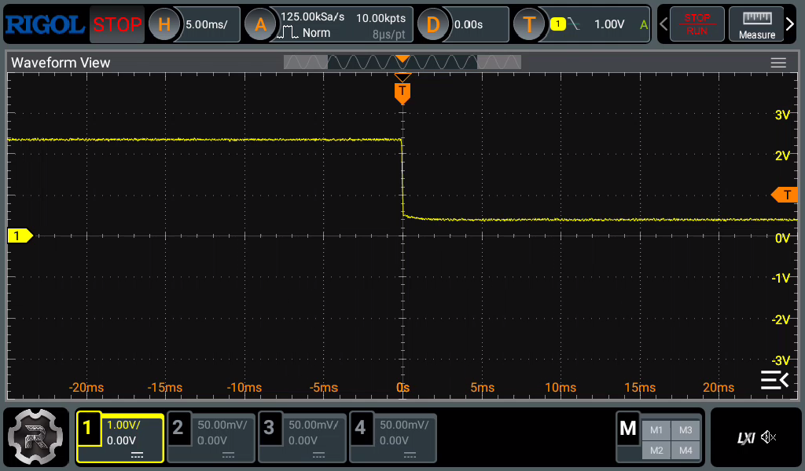
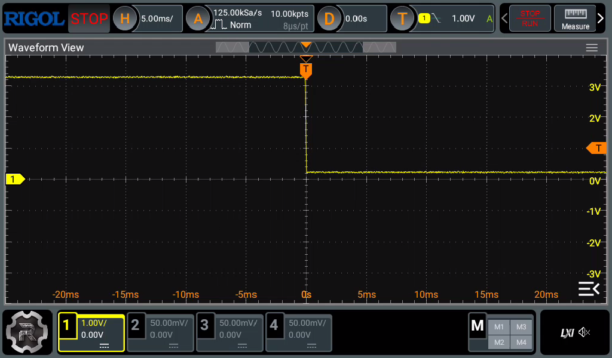

# A07 — Cadence Edge Distortion (Row #7)

**Date:** 2026-10-12
**Bench session:** DR-1 prep WO1
**Instrument:** Rigol DHO804 oscilloscope, 10:1 probe
**Probe:** CH1 on Orange (cadence, GPIO 5) at console side; ground on
Brown (GND)
**Settings:** 1 V/div, 5 ms/div, 125 kSa/s, single-trigger falling edge
at 1.0 V
**Firmware:** `v0.1.0-dev.7` (env `ex3-waveshare-nano`)

## Purpose

Confirm that the passive 4.7 kΩ + 100 nF tap on the Orange (cadence) line
does not distort the reed-switch signal seen by the console. This validates
the passive interception premise (row #7).

## Method

1. Scope probed Orange at the console side while pedalling slowly (~1 rev
   per 2–3 seconds).
2. Captured the falling edge (reed closure) with the tap connected (normal
   wiring).
3. Disconnected the 4.7 kΩ + 100 nF tap from Orange at the Y-harness.
4. Recaptured the falling edge at the same pedal speed and scope settings.

## Captures

### With tap (4.7 kΩ + 100 nF connected)

### Without tap (direct console connection)

## Results

| Parameter | With tap | Without tap | Delta |
|---|---|---|---|
| High level (idle) | ~2.8 V | ~3.1 V | −0.3 V |
| Low level (reed closed) | ~0 V | ~0 V | 0 |
| Fall time (3.3 V → 0 V) | < 1 ms | < 1 ms | Negligible |
| Edge rounding | Minimal | None | Imperceptible |
| Contact bounce | Filtered | Slightly visible | Tap is beneficial |

### Observations

1. **Edge quality is essentially identical.** The 4.7 kΩ + 100 nF RC time
   constant (τ = 0.47 ms) adds imperceptible rounding at the 5 ms/div
   timebase. Both edges are clean and fast (< 1 ms fall time).

2. **High level drops ~0.3 V with the tap.** The 4.7 kΩ series resistance
   forms a voltage divider with the console's internal pull-up. The idle
   level drops from ~3.1 V to ~2.8 V — still well above any logic
   threshold and well within the ESP32's GPIO high input level.

3. **The 100 nF capacitor filters reed-switch contact bounce.** The
   without-tap capture shows slightly more noise at the transition. The
   tap acts as a low-pass filter that improves signal quality for the
   ESP32's edge-counting interrupt.

4. **Low level is 0 V in both cases.** The reed switch pulls the line to
   GND with negligible on-resistance relative to the pull-up.

## Conclusion

**The passive tap premise is confirmed.** The 4.7 kΩ + 100 nF network does
not distort the cadence signal in any way that would affect the console's
reed-switch detection. The slight high-level drop (0.3 V) is irrelevant to
the console's digital threshold. The RC filter is actually beneficial,
suppressing contact bounce.

## Proposal for DR-1

- **The cadence tap can be retained as-is.** No design change needed for
  row #7. The passive network is transparent to the console and provides
  a cleaner signal to the ESP32 than a direct connection would.
