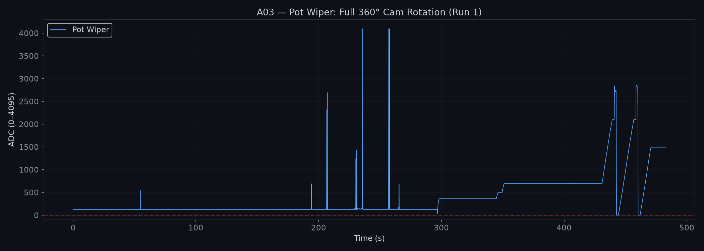
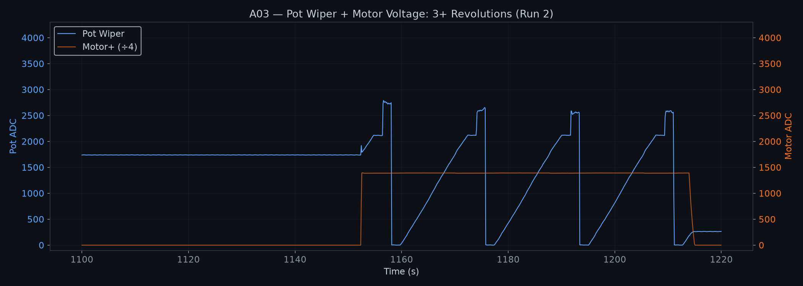
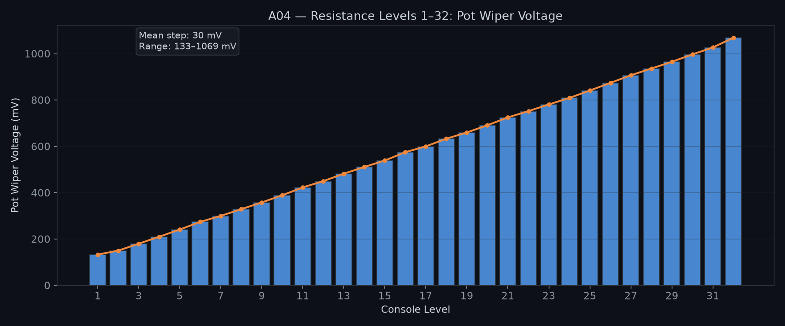
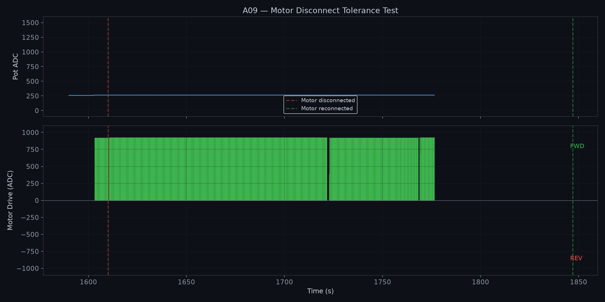
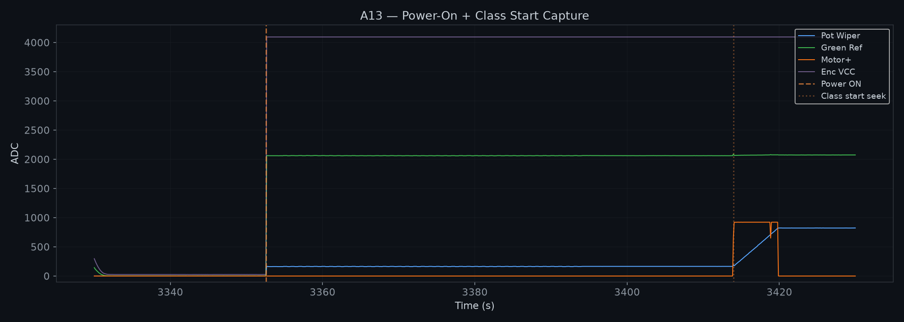

# WO5 Bench Evidence Report — Session 2026-10-11

**Date:** 2026-10-11  
**Board:** EX-3 on Waveshare ESP32-S3-Nano  
**Firmware:** `v0.1.0-dev.6` on branch `signal-logger/wo4d-logger-fixes`  
**Operator:** mcneillm  
**IP:** 192.168.1.100 / echenon.local  

---

## Executive Summary

Evening bench session completing 5 register rows from the Phase 0 observation campaign. All tests passed. Key discoveries:

- The pot has **two dead zones** at 0° and 180° with a linear working ramp between them
- The console has **32 resistance levels** spanning 133–1069 mV (28% of ADC range)
- Each level change requires **4 encoder detents** (16 quadrature steps)
- The console **never faults** on motor disconnect — it hunts indefinitely and recovers instantly on reconnect
- The Green reference line is an **active 1.66V source with 2.4kΩ impedance**
- Power-on rail ramp completes in **100ms**; class start auto-seeks to flat road (level 19)

---

## Test A03 — Pot Revolution Profile (Register #3, #5)

### Method

Applied direct voltage to the motor (bypassing console controller) to drive continuous 360° cam rotation while the signal logger captured the pot wiper ADC value. Two runs performed:

- **Run 1:** 3.3V supply, ~2.5 revolutions, pot wiper only (motor sense not connected)
- **Run 2:** ~4.5V from VIN (USB 5V - Schottky drop), 3+ revolutions, motor sense ÷4 divider connected

### Run 1 — Full Profile

| Feature | Time | ADC | Voltage |
|---|---|---|---|
| Idle (parked) | 0–297s | 123–125 | 99 mV |
| Plateau 1 (non-working arc) | 298–344s | 362–367 | 295 mV |
| Transition 1→2 | 344–351s | 367→698 | — |
| Plateau 2 (non-working arc) | 351–430s | 697–703 | 566 mV |
| Working ramp | 430–442s | 703→2110 | 566→1701 mV |
| Saturation plateau | ~442s | 2100–2110 | 1700 mV |
| **Dead zone 1** | 442–443s | 2850→0 | Wiper crosses gap |
| Working ramp (mirror) | 443–460s | 0→2117 | 0→1706 mV |
| **Dead zone 2** | 460–461s | 2870→0 | Second gap |
| Ramp + park | 461–471s | 0→1494 | Motor stopped |

### Run 2 — With Motor Voltage

| Measurement | Value |
|---|---|
| Motor+ ADC during drive | 1388–1393 (steady) |
| Applied voltage (÷4 back-calculated) | 4.48V (VIN = USB 5V − diode) |
| Ramp linearity | Highly linear, 0→2120 over ~16s/half-rev |
| Dead zone width | ~1s at this motor speed |
| Dead zone crossings captured | 4 (at t≈1158, 1176, 1194, 1212s) |
| Motor voltage sag at dead zone | None — stable throughout |

### Findings

1. The pot is **not a simple linear pot**. It has two non-working arcs (plateaus at ADC 366 and 698) and two dead zone gaps where the wiper crosses an open section.
2. The working range is ADC 0–2120 (0–1.7V), which is only **52% of the full ADC range**.
3. The console only uses levels 1–32 within ADC 165–1327, which is **28% of the working range** — the pot has significant headroom.
4. The two dead zones are ~symmetric at 0° and 180° of cam rotation.

### Data Files

| File | Rows | Description |
|---|---|---|
| [A03-pot-revolution.csv](./A03-20261011-pot-revolution.csv) | 9,460 | Run 1 ride log |
| [A03-pot-revolution-run2.csv](./A03-20261011-pot-revolution-run2.csv) | 24,222 | Run 2 ride log (with motor voltage) |
| [A03-pot-revolution-burst.csv](./A03-20261011-pot-revolution-burst.csv) | — | Run 1 burst capture |
| [A03-pot-revolution-run2-burst.csv](./A03-20261011-pot-revolution-run2-burst.csv) | — | Run 2 burst capture |

---

## Test A04 — 32 Resistance Levels (Register #4)

### Method

Clicked encoder knob from level 1 to level 32, pausing ~2s at each level for the ride log to capture the stable pot wiper value. Then clicked back down to level 28.

### Results

| Level | ADC | mV | | Level | ADC | mV | | Level | ADC | mV |
|---|---|---|---|---|---|---|---|---|---|---|
| 1 | 165 | 133 | | 12 | 559 | 450 | | 23 | 969 | 781 |
| 2 | 186 | 150 | | 13 | 598 | 482 | | 24 | 1004 | 809 |
| 3 | 223 | 180 | | 14 | 634 | 511 | | 25 | 1044 | 841 |
| 4 | 261 | 210 | | 15 | 669 | 539 | | 26 | 1085 | 874 |
| 5 | 299 | 241 | | 16 | 713 | 575 | | 27 | 1126 | 907 |
| 6 | 340 | 274 | | 17 | 744 | 600 | | 28 | 1162 | 936 |
| 7 | 372 | 300 | | 18 | 785 | 633 | | 29 | 1198 | 965 |
| 8 | 408 | 329 | | 19 | 819 | 660 | | 30 | 1237 | 997 |
| 9 | 444 | 358 | | 20 | 857 | 691 | | 31 | 1274 | 1027 |
| 10 | 483 | 389 | | 21 | 900 | 725 | | 32 | 1327 | 1069 |
| 11 | 525 | 423 | | 22 | 933 | 752 | | | | |

### Key Parameters

| Parameter | Value |
|---|---|
| Total levels | 32 |
| ADC range | 165–1327 (28% of 12-bit range) |
| Voltage range | 133–1069 mV (936 mV span) |
| Mean step size | 37.5 ADC / 30.2 mV per level |
| Linearity | Highly linear (R² > 0.99) |
| Yellow (ch1) reference | 0 at all levels |
| Green (ch2) reference | 2059–2079 (rises ~20 ADC over 32 levels) |
| Encoder detents per level | **4** (confirmed by operator) |
| Encoder steps per level | **16** (4 detents × 4 steps/detent) |
| Full range in encoder steps | **512** (32 levels × 16 steps) |
| Hysteresis | None observed (up/down match within ±1 ADC) |

> [!IMPORTANT]
> **DR-1 parameter:** To change one resistance level via MITM, inject exactly **16 quadrature encoder steps**. Full range = 512 steps.

### Data Files

| File | Rows | Description |
|---|---|---|
| [A04-levels-1-32.csv](./A04-20261011-levels-1-32.csv) | 36,000 | Ride log (wrapped buffer) |
| [A04-levels-1-32-events.csv](./A04-20261011-levels-1-32-events.csv) | 167 | Encoder + motor events |

---

## Test A06 — Green Reference Source Impedance (Register #6)

### Method

Measured Green reference (ch2, GPIO 3) voltage with and without a 10kΩ load resistor to GND. Load applied at the ADC pin (after the 22kΩ series resistor in the tap circuit).

### Results

| Condition | ADC | Voltage |
|---|---|---|
| No load | 2063 | 1.663V |
| 10kΩ to GND | 599 | 0.483V |

### Source Impedance Calculation

Circuit: Console Green → Z_src → 22kΩ → ADC pin → 10kΩ → GND

$$Z_{src} = \frac{V_{noload}}{V_{loaded}} \times R_{load} - R_{load} - R_{series} = \frac{1.663}{0.483} \times 10k - 10k - 22k = 2.4\,k\Omega$$

### Findings

| Parameter | Value |
|---|---|
| Green reference voltage | **1.663V** (stable, not 0V as expected for "lo ref") |
| Yellow reference voltage | **0V** (not 3.3V as expected for "hi ref") |
| Green source impedance | **≈2.4 kΩ** |
| Green is active source? | **Yes** — low impedance, can supply current |

> [!NOTE]
> The pot reference lines are swapped from what a simple 3-terminal pot would suggest. Green (labelled "lo ref") outputs 1.66V. Yellow (labelled "hi ref") outputs 0V. The console's pot circuit is more complex than a simple potentiometer.

---

## Test A09 — Motor Disconnect Tolerance (Register #9)

### Method

With the console powered and at level 1 (ADC 264):
1. Disconnected motor wires
2. Monitored motor drive channels and pot position for 3+ minutes
3. Turned knob from level 16 to level 1 while motor disconnected
4. Reconnected motor and observed recovery

### Results

| Phase | Time | Duration | Observation |
|---|---|---|---|
| Motor disconnected | t=1610s | — | Motor drive voltage appears on ch5/ch6 |
| Forward drive attempt | 1610–1721s | 111s | Motor+ held at ADC 925 (~3.0V) |
| Direction reversal | 1721–1724s | 3s | Console switches to reverse |
| Reverse drive attempt | 1724–1758s | 34s | Motor- held at ADC 922 |
| Forward again | 1777–1804s | 27s | Hunting oscillation continues |
| Motor reconnected | t=1847s | — | Immediate recovery |
| Seeking to target | 1847–1855s | 8s | Motor REV, pot 806→297 |
| Settled at level 1 | t=1858s | — | Pot=165, motor OFF |

### Findings

| Question | Answer |
|---|---|
| Console faults on disconnect? | **No** |
| Motor drive timeout? | **None** — drives indefinitely |
| Console display works? | **Yes** — shows levels, responds to knob |
| Drive behaviour | **Hunts** — oscillates FWD/REV trying to seek |
| Recovery on reconnect? | **Immediate** — seeks to target, no power cycle needed |
| Encoder still works? | **Yes** — knob turns registered throughout |

> [!IMPORTANT]
> **DR-1 implication:** The console's motor controller is purely reactive — it compares pot position to target and drives until they match. No watchdog, no timeout, no fault state. The motor can be disconnected and reconnected at any time without consequence.

### Data Files

| File | Rows | Description |
|---|---|---|
| [A09-motor-disconnect.csv](./A09-20261011-motor-disconnect.csv) | 36,000 | Full ride log including disconnect period |
| [A09-motor-disconnect-events.csv](./A09-20261011-motor-disconnect-events.csv) | 167 | Encoder events during knob turns |

---

## Test A13 — Power-On + Class Start Capture (Register #13)

### Method

Full power cycle of the console with the signal logger capturing:
1. Stopped active class
2. Powered off console (3s)
3. Powered on console (10s settle)
4. Started new class (resistance set to flat road = level 19)

### Results

| Event | Time | Detail |
|---|---|---|
| **Power OFF** | t≈3340s | All signals drop to 0 within one sample |
| Console dead | 3340–3352s | pot=0, green=2, vcc=25 (leakage only) |
| **Power ON** | t=3352.6s | Rail ramp: 0→full in **100ms** |
| Signals stable | t=3352.7s | pot=162, green=2061, vcc=4095 |
| Idle at level 1 | 3352.7–3413.9s | 61s — console up, no class active |
| **Class start** | t=3414.0s | Motor kicks in: motor+=661→921 |
| Seeking level 19 | 3414.0–3422s | ~8s — pot ramps 165→822 (flat road) |
| Settled | t≈3422s | pot=822, motor=OFF |

### Findings

| Parameter | Value |
|---|---|
| Power-on rail ramp | **<100ms** (one decimation window) |
| Time to stable signals | **100ms** |
| Power-on default level | **Level 1** (pot=162) |
| Class start auto-seek target | **Level 19** (pot=822, "flat road") |
| Seek time (1→19) | **~8 seconds** |
| Motor drive during seek | ADC 921 (≈3.0V via ÷4 divider) |

> [!NOTE]
> The console powers on to level 1 and waits. Motor seek only begins when a class is started from the app. The rail ramp is fast enough that the logger captures at most one transitional sample.

### Data Files

| File | Rows | Description |
|---|---|---|
| [A13-power-on-capture.csv](./A13-power-on-capture.csv) | 36,000 | Full ride log across power cycle |

---

## Register Status After This Session

| Row | Item | Status | Evidence |
|---|---|---|---|
| #1 | Motor drive voltage | ✅ | A01 (WO4b) |
| #2 | Motor current | ✅ | A02 (WO4b) |
| #3 | Pot over revolution | ✅ | **A03** — 2 runs, full profile |
| #4 | Levels 1–32 | ✅ | **A04** — complete table |
| #5 | Pot shape / dead zones | ✅ | **A03** — dead zones, plateaus, working half |
| #6 | Reference impedance | ✅ | **A06** — Green 1.66V, 2.4kΩ |
| #7 | Cadence | ✅ | B01 |
| #8 | Encoder | ✅ | B01+B02+B04 |
| #9 | Motor disconnect | ✅ | **A09** — no fault, hunts, recovers |
| #10 | Console 3.3V rail | ⏭️ | Skipped — ch9=4095 steady (passive evidence) |
| #11 | VIN tolerance | ✅ | WO4b |
| #12 | BLE app spike | ⬜ | Deferred — needs BLE app |
| #13 | Power-on capture | ✅ | **A13** — full sequence |

**11 of 13 rows complete. 1 skipped (passive evidence), 1 deferred.**

---

## Complete Data File Inventory

All files stored in `docs/measurements/phase0/`:

| File | Size | Test |
|---|---|---|
| `A03-20261011-pot-revolution.csv` | 9,460 rows | Pot run 1 |
| `A03-20261011-pot-revolution-burst.csv` | — | Pot run 1 burst |
| `A03-20261011-pot-revolution-run2.csv` | 24,222 rows | Pot run 2 + motor |
| `A03-20261011-pot-revolution-run2-burst.csv` | — | Pot run 2 burst |
| `A03-chart-pot-revolution-run1.png` | — | Chart |
| `A03-chart-pot-revolution-run2.png` | — | Chart |
| `A04-20261011-levels-1-32.csv` | 36,000 rows | Level sweep |
| `A04-20261011-levels-1-32-events.csv` | 167 rows | Encoder events |
| `A04-chart-levels-1-32.png` | — | Chart |
| `A09-20261011-motor-disconnect.csv` | 36,000 rows | Motor disconnect |
| `A09-20261011-motor-disconnect-events.csv` | 167 rows | Events |
| `A09-chart-motor-disconnect.png` | — | Chart |
| `A13-20261011-power-on-capture.csv` | 36,000 rows | Power cycle |
| `A13-chart-power-on-capture.png` | — | Chart |
